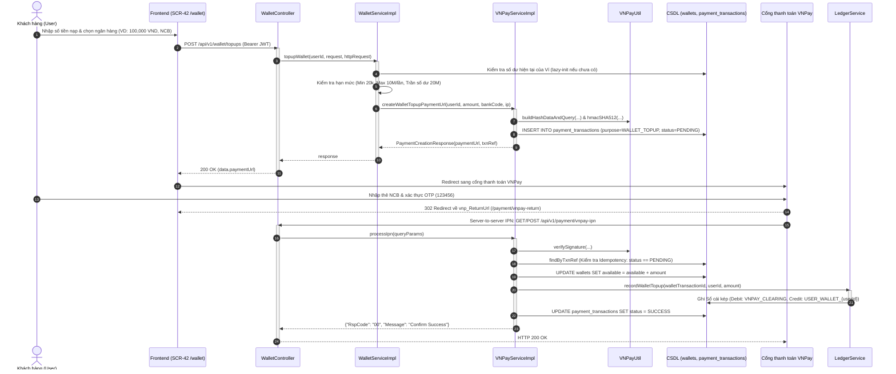

# HƯỚNG DẪN TÍCH HỢP CỔNG THANH TOÁN VNPAY & HỆ THỐNG VÍ - KÝ QUỸ (FPTPOST)
# VNPAY INTEGRATION, WALLET & ESCROW EXECUTION GUIDE (UC-34 & UC-35)

Tài liệu này cung cấp hướng dẫn toàn diện về kiến trúc hệ thống, chu kỳ xử lý request, chuẩn mã hóa HMAC-SHA512, cơ sở dữ liệu sổ cái kép (double-entry ledger), và **truy vết chi tiết từng dòng code thực thi (Code-Level Execution Trace)** cho:
- **UC-34 (Nạp tiền vào ví qua VNPay - SCR-42, API-084, API-085, API-086)**
- **UC-35 (Thanh toán đơn hàng và Ký quỹ Escrow - SCR-22, API-087)**

---

## 1. TỔNG QUAN KIẾN TRÚC & LUỒNG NGHIỆP VỤ (SYSTEM ARCHITECTURE)

Hệ thống thanh toán của FPTPost kết nối giữa **Cổng thanh toán VNPay**, **Ví điện tử nội bộ (Wallet)**, **Tài khoản ký quỹ trung gian (Escrow)** và **Hệ thống Sổ cái kép (Double-Entry Ledger)** nhằm đảm bảo an toàn tuyệt đối cho người gửi (Sender) và tài xế (Courier).

```
┌────────────────────────────────────────────────────────────────────────────────────────────────────────┐
│                                   SƠ ĐỒ TỔNG THỂ KIẾN TRÚC THANH TOÁN                                  │
└────────────────────────────────────────────────────────────────────────────────────────────────────────┘

                           ┌────────────────────────────┐
                           │      Người dùng / App      │
                           │   (Frontend React / Vite)  │
                           └──────────────┬─────────────┘
                                          │
            ┌─────────────────────────────┴────────────────────────────┐
            │ [UC-34] Nạp tiền vào Ví                 [UC-35] Thanh toán & Ký quỹ Đơn
            ▼                                                          ▼
  POST /api/v1/wallet/topups                               POST /api/v1/orders/{id}/payment
            │                                                          │
            ▼                                        ┌─────────────────┴─────────────────┐
  ┌───────────────────┐                              ▼                                   ▼
  │  Kiểm tra hạn mức │                     [Nhánh A: WALLET]                   [Nhánh B: VNPAY]
  │  ví (BR-R-050)    │                              │                                   │
  └─────────┬─────────┘                     Kiểm tra số dư Ví                   Sinh URL thanh toán
            │                                        │                          qua cổng VNPay
            ▼                                        ▼                                   │
    Sinh URL VNPay                                Trừ Ví &                               │
 (WALLET_TOPUP)                           Tạo Escrow (HELD)                              │
            │                                        │                                   │
            ▼                                        ▼                                   ▼
┌───────────────────────┐                 ┌───────────────────────┐            ┌───────────────────────┐
│     Cổng thanh toán   │                 │     Sổ cái kép        │            │     Cổng thanh toán   │
│     VNPAY Sandbox     │                 │   (Ledger Service)    │            │     VNPAY Sandbox     │
└───────────┬───────────┘                 └───────────────────────┘            └───────────┬───────────┘
            │                                                                              │
            ├───────────────────────────────── IPN Callback ───────────────────────────────┤
            ▼                                                                              ▼
┌──────────────────────────────────────────────────────────────────────────────────────────────────────┐
│  POST/GET /api/v1/payment/vnpay-ipn (Idempotent Webhook)                                             │
│  - Kiểm tra chữ ký bảo mật SHA-512                                                                  │
│  - Phân loại mục đích:                                                                               │
│      + WALLET_TOPUP: Cộng available Ví -> Ghi bút toán (Debit: VNPAY, Credit: WALLET)                │
│      + ORDER_ESCROW: Tạo Escrow (HELD) -> Đơn sang ESCROWED -> Ghi bút toán (Debit: VNPAY, Escrow)  │
└──────────────────────────────────────────────────────────────────────────────────────────────────────┘
```

---

### 1.1 Luồng 1 — UC-34: Nạp tiền vào ví qua VNPay (`WALLET_TOPUP`)

#### Sơ đồ trình tự (Sequence Diagram)



---

### 1.2 Luồng 2 — UC-35: Thanh toán đơn hàng và Ký quỹ (`ORDER_ESCROW`)

Sender có 2 lựa chọn thanh toán ký quỹ:

#### Nhánh A: Thanh toán bằng số dư Ví nội bộ (`WALLET`)
1. Sender mở màn hình **SCR-22** (`/orders/:id/payment`).
2. Gửi request `POST /api/v1/orders/{id}/payment` với `{"paymentMethod": "WALLET"}` kèm Bearer JWT.
3. Backend kiểm tra:
   - Người gọi có role `SENDER` hoặc `ADMIN`.
   - Quyền sở hữu: `order.senderId == currentUser.id`.
   - Trạng thái đơn hàng: Đang ở `PENDING_ESCROW` (hoặc `CONFIRMED`/`DRAFT`).
   - Khóa bi quan (`PESSIMISTIC_WRITE`) trên bản ghi `Wallet`.
   - Kiểm tra `wallet.available >= order.declaredValue`.
4. Trừ `wallet.available`, tăng `wallet.escrowHeld` tương ứng với số tiền ký quỹ.
5. Tạo bản ghi bảng `escrows` (`status = HELD`, `paymentMethod = WALLET`).
6. Ghi bút toán kép vào `ledger_transactions` và `ledger_entries`:
   - **Ghi Nợ (DEBIT)**: `USER_WALLET_{userId}`
   - **Ghi Có (CREDIT)**: `ESCROW_ORDER_{orderId}`
7. Cập nhật trạng thái đơn hàng sang `ESCROWED`.
8. Trả về kết quả thành công ngay lập tức (`status: "SUCCESS"`).

#### Nhánh B: Thanh toán trực tiếp qua Cổng VNPay (`VNPAY`)
1. Sender gửi `POST /api/v1/orders/{id}/payment` với `{"paymentMethod": "VNPAY", "bankCode": "NCB"}`.
2. Backend kiểm tra quyền sở hữu đơn hàng, sau đó gọi `VNPayService.createOrderEscrowPaymentUrl(...)`:
   - Sinh `txnRef` dạng `ORD-{orderId}-{timestamp}-{random}`.
   - Lưu `PaymentTransaction` với `purpose = PaymentPurpose.ORDER_ESCROW`, `orderId = order.id`, `orderCode = order.orderCode`, `status = PENDING`.
   - Trả về `paymentUrl`.
3. Client chuyển hướng sang VNPay Sandbox để thanh toán.
4. Khi nhận IPN (mã `00`):
   - Kiểm tra idempotency.
   - Tạo bản ghi trong `escrows` (`status = HELD`, `paymentMethod = VNPAY`).
   - Ghi bút toán kép vào Sổ cái:
     - **Ghi Nợ (DEBIT)**: `VNPAY_CLEARING`
     - **Ghi Có (CREDIT)**: `ESCROW_ORDER_{orderId}`
   - Cập nhật trạng thái đơn hàng sang `ESCROWED`.
   - Cập nhật `PaymentTransaction` sang `SUCCESS`.

---

## 2. CẤU TRÚC DATABASE & ENTITIES LIÊN QUAN

Toàn bộ cấu trúc bảng tuân thủ chính xác tài liệu `docs/DATABASE.md`:

```
┌─────────────────────────┐          ┌─────────────────────────┐
│         wallets         │          │         escrows         │
│        (DB-024)         │          │        (DB-028)         │
├─────────────────────────┤          ├─────────────────────────┤
│ id (PK)                 │          │ id (PK)                 │
│ user_id (FK, Unique)    │          │ order_id (FK, Unique)   │
│ available               │          │ sender_id (FK)          │
│ escrow_held             │          │ amount                  │
│ pending_withdraw        │          │ status (HELD/RELEASED)  │
│ total_balance           │          │ payment_method (WALLET) │
│ version (OptimisticLock)│          │ created_at / updated_at │
└─────────────────────────┘          └─────────────────────────┘
             ▲                                    ▲
             │                                    │
             │           ┌────────────────────────┴────────┐
             │           │       shipping_orders           │
             │           │           (DB-011)              │
             │           ├─────────────────────────────────┤
             │           │ id (PK)                         │
             │           │ order_code (Unique)             │
             │           │ sender_id (FK)                  │
             │           │ declared_value                  │
             │           │ status: PENDING_ESCROW/ESCROWED │
             │           └─────────────────────────────────┘
             │                                    │
┌────────────┴────────────┐          ┌────────────┴────────────┐
│   ledger_transactions   │          │   payment_transactions  │
│        (DB-026)         │          │         (DB-029)        │
├─────────────────────────┤          ├─────────────────────────┤
│ id (PK)                 │          │ id (PK)                 │
│ type (TOPUP/ESCROW_HOLD)│          │ txn_ref (Unique)        │
│ reference_type          │          │ order_id (Nullable)     │
│ reference_id            │          │ order_code (Nullable)   │
│ amount                  │          │ user_id (FK)            │
│ status (POSTED)         │          │ purpose (TOPUP/ESCROW)  │
└────────────┬────────────┘          │ amount                  │
             │ 1:N                   │ status (PENDING/SUCCESS)│
             ▼                       │ bank_code, response_code│
┌─────────────────────────┐          │ ip_address, expires_at  │
│      ledger_entries     │          └─────────────────────────┘
│        (DB-027)         │
├─────────────────────────┤
│ id (PK)                 │
│ transaction_id (FK)     │
│ account (VNPAY/WALLET/..)
│ direction (DEBIT/CREDIT)│
│ amount                  │
└─────────────────────────┘
```

### 2.1 Bảng `wallets` (DB-024)
- Đại diện cho số dư ví của từng người dùng (`user_id`).
- `available`: Số dư khả dụng có thể dùng để nạp thêm, thanh toán hoặc rút tiền.
- `escrow_held`: Tiền đang bị giam giữ bảo đảm cho các đơn hàng đang vận chuyển.
- `total_balance` = `available` + `escrow_held` + `pending_withdraw`.
- Áp dụng cơ chế **Optimistic Locking (`@Version`)** và **Pessimistic Locking (`findByUserIdForUpdate`)** khi thao tác trừ/cộng tiền để chống Race Condition.

### 2.2 Bảng `escrows` (DB-028)
- Lưu trữ khoản tiền bị giữ cho mỗi đơn hàng (`order_id`).
- Trạng thái `status`:
  - `HELD`: Tiền đang được giam giữ an toàn sau khi thanh toán.
  - `RELEASED`: Đã giải ngân cho tài xế sau khi giao hàng thành công.
  - `REFUNDED`: Đã hoàn lại cho Sender nếu hủy đơn/khiếu nại thành công.

### 2.3 Bảng `payment_transactions` (DB-029)
- Phân biệt mục đích qua trường `purpose`:
  - `WALLET_TOPUP`: Giao dịch nạp tiền vào ví cá nhân (`orderCode` và `orderId` là `null`, `userId` bắt buộc). Mã `txnRef` bắt đầu bằng `TOPUP-`.
  - `ORDER_ESCROW`: Giao dịch ký quỹ thanh toán trực tiếp cho đơn hàng (`orderId` và `orderCode` có giá trị). Mã `txnRef` bắt đầu bằng `ORD-`.

### 2.4 Bảng `shipping_orders` (DB-011) - Vòng đời trạng thái thanh toán
- `DRAFT` / `PENDING_CONFIRMATION` -> `CONFIRMED`
- `PENDING_ESCROW`: Chờ Sender thanh toán ký quỹ (tiền hàng bảo đảm).
- `ESCROWED`: Đã ký quỹ thành công -> Hệ thống điều phối chuyển sang tìm tài xế (`FINDING_SHIPPER`).

---

## 3. QUY CHUẨN MẬT MÃ VÀ TẠO CHỮ KÝ SỐ (HMAC-SHA512)

VNPay phiên bản `2.1.0` yêu cầu tuân thủ nghiêm ngặt 5 bước mật mã (triển khai trong [`VNPayUtil.java`](file:///c:/Users/Le%20Nhut%20Huy/Desktop/Projects/SE1910/SBA301/project/SBA391_Group6_Project/server/src/main/java/com/fptpost/modules/payment/util/VNPayUtil.java)):

1. **Lọc tham số**: Loại bỏ hoàn toàn `vnp_SecureHash` và `vnp_SecureHashType`, cùng các giá trị rỗng/null.
2. **Sắp xếp thứ tự chữ cái (Alphabetical Sort)**: Danh sách khóa tham số sắp xếp theo mã ASCII tăng dần (`A-Z`, `a-z`).
3. **Mã hóa URL (URL Encoding)**: Tất cả tên trường và giá trị được encode chuẩn `US-ASCII` / `UTF-8`.
4. **Băm HMAC-SHA512**: Băm toàn bộ chuỗi nối `key1=val1&key2=val2...` với `vnp_HashSecret`, trả về chuỗi 128 ký tự hexa chữ thường.
5. **So khớp chữ ký an toàn**: Dùng `MessageDigest.isEqual(...)` để chống tấn công phân tích thời gian thực thi (Timing Attack).

---

## 4. ĐẶC TẢ CHI TIẾT API ENDPOINTS (KÈM PAYLOAD MẪU & cURL)

Tất cả các API nghiệp vụ đều trả về định dạng bọc chuẩn `ApiResponse<T>`:
```json
{
  "success": true,
  "status": 200,
  "code": 1000,
  "message": "...",
  "data": { ... },
  "timestamp": "2026-10-14T02:00:00Z"
}
```

---

### 4.1 API UC-34: Nạp tiền vào ví qua VNPay (API-084)
- **Đường dẫn**: `POST /api/v1/wallet/topups` (hoặc `/api/wallet/topups`)
- **Yêu cầu xác thực**: Bắt buộc có Header `Authorization: Bearer <JWT_TOKEN>`.
- **Quy tắc nghiệp vụ**:
  - `amount >= 20000` (PRM-056: Tối thiểu 20.000 VNĐ)
  - `amount <= 10000000` (PRM-057: Tối đa 10.000.000 VNĐ/giao dịch)
  - `currentBalance + amount <= 20000000` (BR-R-050 / PRM-058: Hạn mức số dư tối đa 20.000.000 VNĐ).

#### Request Body mẫu:
```json
{
  "amount": 200000,
  "bankCode": "NCB",
  "language": "vn"
}
```

#### Response mẫu (200 OK):
```json
{
  "success": true,
  "status": 200,
  "code": 1000,
  "message": "Khởi tạo yêu cầu nạp tiền vào ví thành công",
  "data": {
    "code": "00",
    "message": "success",
    "paymentUrl": "https://sandbox.vnpayment.vn/paymentv2/vpcpay.html?vnp_Amount=20000000&vnp_Command=pay&vnp_CreateDate=20261014090000&vnp_CurrCode=VND&vnp_ExpireDate=20261014091500&vnp_IpAddr=127.0.0.1&vnp_Locale=vn&vnp_OrderInfo=Nap+tien+vao+vi+FPTPost+User+1&vnp_OrderType=other&vnp_ReturnUrl=http%3A%2F%2Flocalhost%3A8080%2Fapi%2Fv1%2Fpayment%2Fvnpay-return&vnp_TmnCode=B91MXQ5Y&vnp_TxnRef=TOPUP-1718000000-A1B2C3&vnp_Version=2.1.0&vnp_SecureHash=7d383b169527f4e9...",
    "txnRef": "TOPUP-1718000000-A1B2C3"
  },
  "timestamp": "2026-10-14T02:00:00Z"
}
```

#### Lệnh cURL mẫu:
```bash
curl -X POST "http://localhost:8080/api/v1/wallet/topups" \
  -H "Authorization: Bearer <YOUR_ACCESS_TOKEN>" \
  -H "Content-Type: application/json" \
  -d '{
    "amount": 200000,
    "bankCode": "NCB",
    "language": "vn"
  }'
```

---

### 4.2 API Truy vấn thông tin số dư Ví (API-088, UC-38)
- **Đường dẫn**: `GET /api/v1/wallet` (hoặc `/api/wallet`)
- **Yêu cầu xác thực**: Bắt buộc có Header `Authorization: Bearer <JWT_TOKEN>`.

#### Response mẫu (200 OK):
```json
{
  "success": true,
  "status": 200,
  "code": 1000,
  "message": "Thông tin ví",
  "data": {
    "id": 1,
    "userId": 1,
    "available": 2500000,
    "escrowHeld": 150000,
    "pendingWithdraw": 0,
    "totalBalance": 2650000,
    "updatedAt": "2026-10-14T02:15:00Z"
  },
  "timestamp": "2026-10-14T02:15:00Z"
}
```

#### Lệnh cURL mẫu:
```bash
curl -X GET "http://localhost:8080/api/v1/wallet" \
  -H "Authorization: Bearer <YOUR_ACCESS_TOKEN>"
```

---

### 4.3 API UC-35: Thanh toán & Ký quỹ Đơn hàng (API-087)
- **Đường dẫn**: `POST /api/v1/orders/{id}/payment`
- **Yêu cầu xác thực**: Bắt buộc có Header `Authorization: Bearer <JWT_TOKEN>` và tài khoản phải có role `SENDER` hoặc `ADMIN`. Bắt buộc `order.senderId == currentUser.id`.

#### Trường hợp 1: Thanh toán bằng số dư Ví (`paymentMethod: "WALLET"`)
##### Request Body:
```json
{
  "paymentMethod": "WALLET"
}
```

##### Response thành công (200 OK):
```json
{
  "success": true,
  "status": 200,
  "code": 1000,
  "message": "Xử lý thanh toán đơn hàng thành công",
  "data": {
    "orderId": 1,
    "orderCode": "ORD-TEST-001",
    "paymentMethod": "WALLET",
    "amount": 150000,
    "status": "SUCCESS",
    "message": "Thanh toán và ký quỹ đơn hàng thành công qua ví FPTPost"
  },
  "timestamp": "2026-10-14T02:20:00Z"
}
```

##### Lệnh cURL mẫu:
```bash
curl -X POST "http://localhost:8080/api/v1/orders/1/payment" \
  -H "Authorization: Bearer <YOUR_ACCESS_TOKEN>" \
  -H "Content-Type: application/json" \
  -d '{
    "paymentMethod": "WALLET"
  }'
```

#### Trường hợp 2: Thanh toán trực tiếp qua Cổng VNPay (`paymentMethod: "VNPAY"`)
##### Request Body:
```json
{
  "paymentMethod": "VNPAY",
  "bankCode": "NCB",
  "language": "vn"
}
```

##### Response chuyển hướng VNPay (200 OK):
```json
{
  "success": true,
  "status": 200,
  "code": 1000,
  "message": "Xử lý thanh toán đơn hàng thành công",
  "data": {
    "orderId": 2,
    "orderCode": "ORD-TEST-002",
    "paymentMethod": "VNPAY",
    "amount": 250000,
    "status": "PENDING_PAYMENT",
    "paymentUrl": "https://sandbox.vnpayment.vn/paymentv2/vpcpay.html?vnp_Amount=25000000&vnp_Command=pay&...&vnp_TxnRef=ORD-2-1718000000-ABC",
    "txnRef": "ORD-2-1718000000-ABC",
    "message": "Khởi tạo thanh toán VNPay thành công. Vui lòng chuyển hướng người dùng đến paymentUrl."
  },
  "timestamp": "2026-10-14T02:22:00Z"
}
```

##### Lệnh cURL mẫu:
```bash
curl -X POST "http://localhost:8080/api/v1/orders/2/payment" \
  -H "Authorization: Bearer <YOUR_ACCESS_TOKEN>" \
  -H "Content-Type: application/json" \
  -d '{
    "paymentMethod": "VNPAY",
    "bankCode": "NCB",
    "language": "vn"
  }'
```

---

### 4.4 API Callback từ VNPay (Return URL & Webhook IPN)

#### 1. Return URL (Đồng bộ qua Browser - API-085)
- **Đường dẫn**: `GET /api/v1/payment/vnpay-return` (hỗ trợ alias `/api/payment/vnpay-return`, `/api/v1/payment/vnpay/return`)
- **Quyền**: Công khai (`permitAll()`).
- **Nhiệm vụ**: Xác thực chữ ký số, đọc mã phản hồi, trả dữ liệu biên lai giao dịch cho Frontend render.

#### 2. Server IPN Webhook (Bất đồng bộ Server-to-Server - API-086)
- **Đường dẫn**: `GET /api/v1/payment/vnpay-ipn` hoặc `POST /api/v1/payment/vnpay-ipn` (hỗ trợ alias `/api/payment/vnpay-ipn`, `/api/v1/payment/vnpay/ipn`)
- **Quyền**: Công khai (`permitAll()`).
- **Định dạng trả về**: Luôn là `200 OK` với body JSON PascalCase:
  ```json
  {
    "RspCode": "00",
    "Message": "Confirm Success"
  }
  ```
- **Cơ chế Idempotency**: Nếu giao dịch đã ở trạng thái `SUCCESS` hoặc `FAILED`, lập tức trả về `{"RspCode": "02", "Message": "Order already confirmed"}`, tuyệt đối không xử lý cộng tiền hay chuyển trạng thái đơn hàng lần thứ hai.

---

## 5. BẢO MẬT & PHÂN QUYỀN (`SecurityConfig.java`)

Trong [`SecurityConfig.java`](file:///c:/Users/Le%20Nhut%20Huy/Desktop/Projects/SE1910/SBA301/project/SBA391_Group6_Project/server/src/main/java/com/fptpost/config/SecurityConfig.java), hệ thống áp dụng phân quyền chi tiết như sau:

| Endpoint Pattern | Method | Quyền truy cập | Mục đích nghiệp vụ |
|---|---|---|---|
| `/api/v1/wallet/**` | Mọi method | `authenticated()` | Quản lý ví, xem số dư, nạp tiền (UC-34, UC-38) |
| `/api/wallet/**` | Mọi method | `authenticated()` | Alias tương thích ngược cho endpoint ví |
| `/api/v1/orders/*/payment` | POST | `hasAnyRole("SENDER", "ADMIN")` | Thanh toán & ký quỹ đơn hàng (UC-35, API-087) |
| `/api/v1/payment/vnpay-return*` | GET | `permitAll()` | VNPay redirect trình duyệt người dùng về |
| `/api/payment/vnpay-return*` | GET | `permitAll()` | Alias công khai |
| `/api/v1/payment/vnpay-ipn*` | GET, POST | `permitAll()` | VNPay Server bắn thông báo ngầm (Webhook) |
| `/api/payment/vnpay-ipn*` | GET, POST | `permitAll()` | Alias công khai |
| `/api/payment/test-data/seed` | POST | `permitAll()` | Seed dữ liệu mẫu cho môi trường DEV/DEMO |

> [!WARNING]
> Không bao giờ để mở `permitAll()` toàn bộ cho `/api/payment/**` hoặc `/api/v1/payment/**`. Chỉ mở `permitAll()` cho các endpoint nhận callback từ VNPay đã có thuật toán đối soát chữ ký SHA-512.

---

## 6. GIAO DIỆN FRONTEND (SCR-42 & SCR-22)

### 6.1 Màn hình SCR-42: Quản lý Ví & Nạp tiền (`/wallet`)
- **File**: [`client/src/pages/WalletPage.tsx`](file:///c:/Users/Le%20Nhut%20Huy/Desktop/Projects/SE1910/SBA301/project/SBA391_Group6_Project/client/src/pages/WalletPage.tsx)
- **Tính năng nổi bật**:
  - 3 thẻ hiển thị số dư: **Số dư khả dụng**, **Đang ký quỹ (Escrow)**, **Tổng tài sản ví**.
  - Các chip chọn nhanh số tiền: 50.000đ, 100.000đ, 200.000đ, 500.000đ, 1.000.000đ, 2.000.000đ, 5.000.000đ.
  - Ô nhập tùy chọn với cơ chế kiểm tra hạn mức trực tiếp theo thời gian thực (PRM-056: tối thiểu 20.000đ, PRM-057: tối đa 10.000.000đ/lần, BR-R-050: trần số dư 20.000.000đ).
  - Tự động bắt query params từ VNPay (`vnp_ResponseCode`, `vnp_TxnRef`) khi người dùng được chuyển hướng về, gọi API xác thực và cập nhật số dư tức thì.

### 6.2 Màn hình SCR-22: Thanh toán Đơn hàng & Ký quỹ (`/orders/:id/payment`)
- **File**: [`client/src/pages/OrderPaymentPage.tsx`](file:///c:/Users/Le%20Nhut%20Huy/Desktop/Projects/SE1910/SBA301/project/SBA391_Group6_Project/client/src/pages/OrderPaymentPage.tsx)
- **Tính năng nổi bật**:
  - Hiển thị đầy đủ thông tin đơn hàng: Mã đơn, sản phẩm, người nhận, địa chỉ giao hàng và **Số tiền ký quỹ (Escrow) bắt buộc**.
  - Tích hợp 2 thẻ phương thức thanh toán:
    - **Ví FPTPost**: Hiển thị số dư khả dụng thực tế. Nếu không đủ tiền, tự động hiển thị cảnh báo thiếu hụt và nút chuyển nhanh đến trang `/wallet` để nạp thêm.
    - **Cổng VNPay**: Cho phép chọn ngân hàng (NCB, QR, VNBANK, Thẻ quốc tế) và sinh URL chuyển hướng.
  - Hiển thị huy hiệu trạng thái đơn hàng (`PENDING_ESCROW` -> `ESCROWED`).

### 6.3 Màn hình Biên lai giao dịch VNPay (`/payment/vnpay-return`)
- **File**: [`client/src/pages/VNPayReturnPage.tsx`](file:///c:/Users/Le%20Nhut%20Huy/Desktop/Projects/SE1910/SBA301/project/SBA391_Group6_Project/client/src/pages/VNPayReturnPage.tsx)
- Nhận diện trạng thái giao dịch từ VNPay, hiển thị bảng biên lai thanh toán chi tiết (mã tham chiếu, mã VNPay, số tiền, ngân hàng, loại thẻ) và điều hướng quay lại Ví hoặc Đơn hàng.

---

## 7. BẢNG MÃ LỖI VÀ MÃ TRẠNG THÁI VNPAY

### 7.1 Mã phản hồi cổng thanh toán (`vnp_ResponseCode`)

| Mã lỗi | Ý nghĩa thực tế | Diễn giải chi tiết | Hành động gợi ý cho khách / merchant |
|---|---|---|---|
| `00` | Giao dịch thành công | Khách đã thanh toán hoàn tất tiền | Duyệt nạp ví hoặc chuyển đơn sang `ESCROWED` |
| `07` | Giao dịch bị nghi ngờ | Trừ tiền thành công nhưng nghi ngờ gian lận | Tạm giữ đơn hàng để CSKH xác minh danh tính |
| `09` | Chưa đăng ký Internet Banking | Thẻ ATM chưa kích hoạt tính năng thanh toán online | Nhắc khách liên hệ ngân hàng mở Internet Banking |
| `10` | Nhập sai thông tin quá 3 lần | Nhập sai số thẻ, tên hoặc ngày hiệu lực > 3 lần | Yêu cầu khách kiểm tra lại thẻ vật lý |
| `11` | Hết hạn chờ thanh toán | Phiên giao dịch quá thời hạn 15 phút | Nhắc khách tạo lại phiên thanh toán mới |
| `12` | Thẻ/Tài khoản bị khóa | Thẻ hoặc tài khoản ngân hàng của khách đang bị phong tỏa | Khách cần liên hệ trực tiếp ngân hàng phát hành |
| `13` | Nhập sai OTP | Khách nhập sai mã OTP gửi về điện thoại | Hướng dẫn khách yêu cầu gửi lại OTP và nhập cẩn thận |
| `24` | Khách hàng hủy giao dịch | Khách chủ động bấm "Hủy giao dịch" trên cổng VNPay | Cập nhật transaction thành `CANCELLED` |
| `51` | Tài khoản không đủ số dư | Số dư tài khoản ngân hàng nhỏ hơn số tiền nạp/trả | Nhắc khách nạp thêm tiền hoặc chọn thẻ khác |
| `65` | Vượt hạn mức thanh toán | Số tiền vượt quá hạn mức thanh toán trong ngày | Khách cần nâng hạn mức chi tiêu thẻ |
| `75` | Ngân hàng bảo trì | Hệ thống core banking của ngân hàng đang nâng cấp | Khách vui lòng chọn ngân hàng khác để thanh toán |
| `99` | Lỗi không xác định | Lỗi kết nối giữa cổng VNPay và switch ngân hàng | Yêu cầu khách thử lại sau ít phút |

### 7.2 Mã phản hồi IPN (`RspCode` - Trả về cho máy chủ VNPay)

| RspCode | Message | Trường hợp kích hoạt |
|---|---|---|
| `00` | `Confirm Success` | Chữ ký hợp lệ, giao dịch tồn tại, khớp số tiền, cộng ví/ký quỹ thành công |
| `01` | `Order not Found` | Không tìm thấy mã `vnp_TxnRef` trong bảng `payment_transactions` |
| `02` | `Order already confirmed` | Giao dịch đã xử lý trước đó (Idempotency check thành công) |
| `04` | `Invalid Amount` | Số tiền `vnp_Amount` không khớp với giá trị ghi nhận ban đầu |
| `97` | `Invalid Checksum` | Sai chữ ký bảo mật HMAC-SHA512 |
| `99` | `Unknown Error` | Gặp sự cố không mong muốn trong quá trình ghi dữ liệu |

---

## 8. HƯỚNG DẪN TEST THỰC TẾ TRỌN VẸN (END-TO-END TESTING GUIDE)

### 8.1 Thông tin cấu hình Merchant Sandbox & Thẻ Test NCB

| Tên cấu hình | Giá trị cấu hình Sandbox |
|---|---|
| **Terminal ID (`vnp_TmnCode`)** | `B91MXQ5Y` |
| **Secret Hash Key (`vnp_HashSecret`)** | `HDMKJXGPKGDZUQJDDBEFKXEIXZYWSNCM` |
| **URL cổng thanh toán (`vnp_PayUrl`)** | `https://sandbox.vnpayment.vn/paymentv2/vpcpay.html` |
| **Return Callback URL (`vnp_ReturnUrl`)** | `http://localhost:8080/api/v1/payment/vnpay-return` |
| **Ngân hàng test Sandbox** | **NCB** (Ngân hàng Quốc Dân) |
| **Số thẻ test** | `9704198526191432198` |
| **Tên chủ thẻ** | `NGUYEN VAN A` |
| **Ngày phát hành** | `07/15` |
| **Mã OTP xác thực** | `123456` |

### 8.2 Tài khoản người dùng mẫu (Pre-seeded Demo Accounts)
Lớp [`UserDemoSeeder.java`](file:///c:/Users/Le%20Nhut%20Huy/Desktop/Projects/SE1910/SBA301/project/SBA391_Group6_Project/server/src/main/java/com/fptpost/modules/identity/config/UserDemoSeeder.java) và [`PaymentDemoSeeder.java`](file:///c:/Users/Le%20Nhut%20Huy/Desktop/Projects/SE1910/SBA301/project/SBA391_Group6_Project/server/src/main/java/com/fptpost/modules/payment/config/PaymentDemoSeeder.java) đã khởi tạo sẵn:
- **Tài khoản Sender mẫu**: `sender@fptpost.vn` (Mật khẩu: `12345678`, Role: `SENDER`, `userId = 1`).
- **Ví mẫu của Sender**: Đã có sẵn **2.500.000 VNĐ** khả dụng.
- **Đơn hàng mẫu chờ ký quỹ**: `ORD-TEST-001` (150.000 VNĐ), `ORD-TEST-002` (250.000 VNĐ).

---

### 8.3 Kịch bản kiểm thử từng bước (Step-by-Step)

#### Bước 1: Đăng nhập lấy JWT Access Token
Chạy lệnh cURL sau để đăng nhập bằng tài khoản `sender@fptpost.vn`:

```bash
curl -X POST "http://localhost:8080/api/v1/auth/login" \
  -H "Content-Type: application/json" \
  -d '{
    "identifier": "sender@fptpost.vn",
    "password": "12345678"
  }'
```
Lấy chuỗi `data.accessToken` từ phản hồi trả về để gắn vào Header: `Authorization: Bearer <TOKEN>`.

---

#### Bước 2: Kiểm thử UC-34 — Nạp tiền vào ví qua VNPay Sandbox
1. **Gọi API nạp tiền vào ví**:
   ```bash
   curl -X POST "http://localhost:8080/api/v1/wallet/topups" \
     -H "Authorization: Bearer <TOKEN>" \
     -H "Content-Type: application/json" \
     -d '{
       "amount": 500000,
       "bankCode": "NCB",
       "language": "vn"
     }'
   ```
2. **Mở `paymentUrl`** trên trình duyệt:
   - Nhập số thẻ: `9704198526191432198`
   - Tên chủ thẻ: `NGUYEN VAN A`
   - Ngày phát hành: `07/15`
   - Bấm tiếp tục, nhập mã OTP: `123456`.
3. **Kiểm tra số dư sau nạp**:
   ```bash
   curl -X GET "http://localhost:8080/api/v1/wallet" \
     -H "Authorization: Bearer <TOKEN>"
   ```
   **Kết quả kỳ vọng**: Số dư `available` tăng từ 2.500.000 VNĐ lên 3.000.000 VNĐ. Bảng `ledger_entries` xuất hiện 2 dòng ghi Nợ `VNPAY_CLEARING` và ghi Có `USER_WALLET_1`.

---

#### Bước 3: Kiểm thử UC-35 (Nhánh 1) — Ký quỹ đơn hàng bằng Ví FPTPost
Thực hiện ký quỹ cho đơn hàng mẫu `ORD-TEST-001` (ID = 1, giá trị ký quỹ: 150.000 VNĐ):

```bash
curl -X POST "http://localhost:8080/api/v1/orders/1/payment" \
  -H "Authorization: Bearer <TOKEN>" \
  -H "Content-Type: application/json" \
  -d '{
    "paymentMethod": "WALLET"
  }'
```

**Kết quả kỳ vọng**:
- Response trả về: `status: "SUCCESS"`.
- Bảng `wallets`: `available` giảm 150.000 VNĐ, `escrow_held` tăng 150.000 VNĐ.
- Bảng `escrows`: Tạo bản ghi mới `order_id = 1`, `status = "HELD"`, `payment_method = "WALLET"`.
- Bảng `shipping_orders`: Trạng thái đơn `ORD-TEST-001` chuyển từ `PENDING` sang `ESCROWED`.
- Bảng `ledger_entries`: Xuất hiện bút toán DEBIT `USER_WALLET_1` và CREDIT `ESCROW_ORDER_1`.

---

#### Bước 4: Kiểm thử UC-35 (Nhánh 2) — Ký quỹ đơn hàng trực tiếp qua VNPay
Thực hiện ký quỹ cho đơn hàng mẫu `ORD-TEST-002` (ID = 2, giá trị ký quỹ: 250.000 VNĐ) qua cổng VNPay:

```bash
curl -X POST "http://localhost:8080/api/v1/orders/2/payment" \
  -H "Authorization: Bearer <TOKEN>" \
  -H "Content-Type: application/json" \
  -d '{
    "paymentMethod": "VNPAY",
    "bankCode": "NCB",
    "language": "vn"
  }'
```

1. Mở `data.paymentUrl` nhận được trên trình duyệt và hoàn tất thanh toán bằng thẻ NCB (OTP `123456`).
2. **Kết quả kỳ vọng**:
   - Trình duyệt chuyển về `/payment/vnpay-return` hiển thị biên lai thành công.
   - Bảng `escrows`: Xuất hiện bản ghi cho `order_id = 2` với `status = "HELD"`, `payment_method = "VNPAY"`.
   - Bảng `shipping_orders`: Trạng thái đơn `ORD-TEST-002` cập nhật sang `ESCROWED`.
   - Bảng `ledger_entries`: Xuất hiện bút toán DEBIT `VNPAY_CLEARING` và CREDIT `ESCROW_ORDER_2`.

---

#### Bước 5: Kiểm thử tính chống trùng lặp (Idempotency) của Webhook IPN
Giả lập VNPay gửi lại IPN lần thứ 2 cho giao dịch đã hoàn tất:
```bash
curl -X GET "http://localhost:8080/api/v1/payment/vnpay-ipn?vnp_Amount=50000000&vnp_BankCode=NCB&vnp_BankTranNo=VNP14567890&vnp_CardType=ATM&vnp_OrderInfo=Thanh+toan&vnp_PayDate=20261014090000&vnp_ResponseCode=00&vnp_TmnCode=B91MXQ5Y&vnp_TransactionNo=14567890&vnp_TransactionStatus=00&vnp_TxnRef=ORD-TEST-003&vnp_SecureHash=7db6c547ce11e3bce7449265f247cae44fbff23959bc2cb092a7f5d0233eafe918231bb14f8fa176a928baeb1fa7e1d5306ba03c374668ba509e5163fc6e8ba4"
```
**Kết quả kỳ vọng**: Server trả về ngay lập tức:
```json
{
  "RspCode": "02",
  "Message": "Order already confirmed"
}
```
Tuyệt đối không cộng thêm tiền vào ví hay trừ tiền đơn hàng lần thứ 2.
