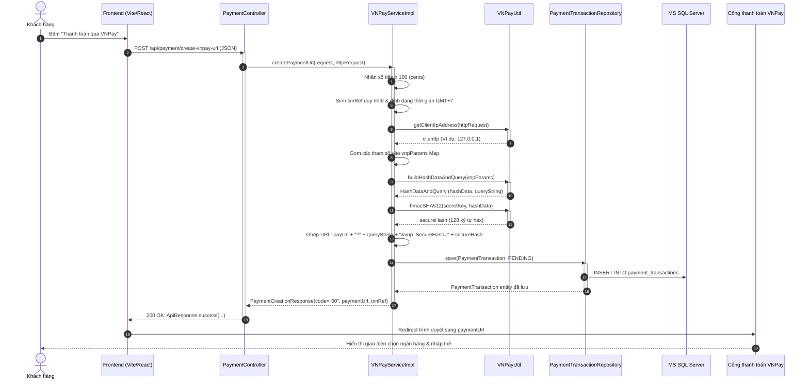
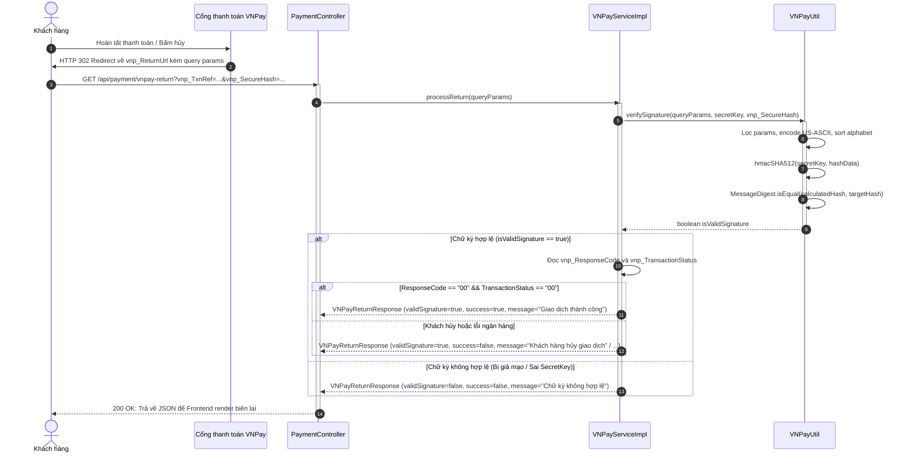
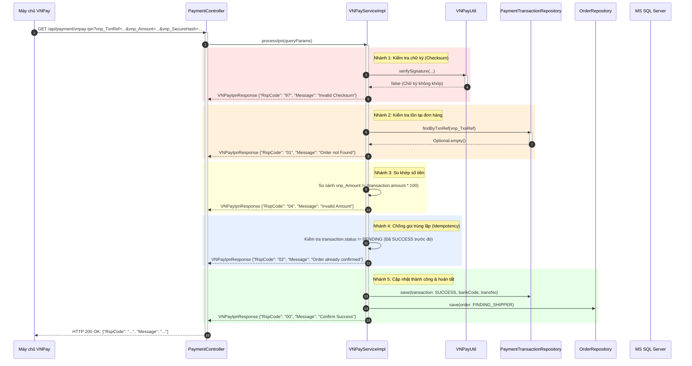

# HƯỚNG DẪN TÍCH HỢP CỔNG THANH TOÁN VNPAY (SPRING BOOT)
# VNPAY INTEGRATION & CODE-LEVEL EXECUTION GUIDE

Tài liệu này cung cấp hướng dẫn toàn diện về kiến trúc nội bộ, chu kỳ xử lý request, chuẩn mật mã băm bảo mật, và **truy vết chi tiết từng dòng code thực thi (Code-Level Execution Trace)** cho cổng thanh toán VNPay trên backend Spring Boot.

---

## 1. TỔNG QUAN KIẾN TRÚC HỆ THỐNG (SYSTEM ARCHITECTURE)

### 1.1 Sơ đồ phân tầng và ranh giới trách nhiệm

Hệ thống tích hợp cổng thanh toán VNPay bao gồm 4 thành phần chính hoạt động theo mô hình phi trạng thái (stateless), đảm bảo tính toàn vẹn và bất biến của dữ liệu giao dịch:

```
┌─────────────────────────────────────────────────────────────────────────────────┐
│                           SƠ ĐỒ KIẾN TRÚC TOÀN HỆ THỐNG                         │
└─────────────────────────────────────────────────────────────────────────────────┘

 ┌──────────────┐                 ┌───────────────────────┐
 │              │ 1. Tạo GD       │   Spring Boot Backend │
 │  Frontend /  ├────────────────►│   (Controller/Service)│
 │  Client App  │◄────────────────┤                       │
 │ (React/Vite) │ 2. URL thanh toán│                       │
 └──────┬───────┘                 └───┬───────────────▲───┘
        │                             │               │
        │ 3. Redirect trình duyệt     │ 4. Lưu GD     │ 7. Server IPN
        │    sang cổng VNPay          │    (PENDING)  │    (Webhook ngầm)
        ▼                             ▼               │
 ┌──────────────┐                 ┌───────────┐       │
 │ Cổng thanh   │                 │ Cơ sở     │       │
 │ toán VNPAY   │                 │ dữ liệu   │       │
 └──────┬───────┘                 │ (MS SQL)  │       │
        │                         └───────────┘       │
        │ 5. Khách trả tiền xong & Redirect           │
        ├─────────────────────────────────────────────┘
        │    (Return URL - Đồng bộ qua trình duyệt)
        │
        └─────────────────────────────────────────────►
             6. Asynchronous Server IPN Webhook
```

1. **Client / Frontend Application (Giao diện người dùng)**:
   - Gửi yêu cầu khởi tạo thanh toán tới backend: `POST /api/payment/create-vnpay-url`.
   - Nhận URL thanh toán đã ký số bảo mật từ backend và chuyển hướng (redirect) trình duyệt người dùng sang cổng thanh toán VNPay.
   - Nhận kết quả điều hướng về qua `vnp_ReturnUrl` (`GET /api/payment/vnpay-return`) để hiển thị thông báo kết quả cho người dùng.

2. **Spring Boot Backend (Hệ thống xử lý nghiệp vụ)**:
   - **Bảo mật tuyệt đối**: Quản lý bí mật `vnp_HashSecret` và `vnp_TmnCode` trong file cấu hình máy chủ, không bao giờ để lộ xuống client.
   - **Xử lý số tiền**: Quy đổi đơn vị tiền tệ sang xu VNPay (nhân 100 lần, ví dụ: 250,000 VND thành `25000000`).
   - **Ký số & xác thực mã băm**: Triển khai thuật toán HMAC-SHA512 tuân thủ nghiêm ngặt quy tắc sắp xếp alphabet và chuẩn hóa URL encoding.
   - **Ghi nhận giao dịch**: Quản lý vòng đời `PaymentTransaction` từ trạng thái `PENDING` sang `SUCCESS`, `FAILED` hoặc `CANCELLED`.
   - **Lắng nghe Webhook IPN**: Xử lý server-to-server webhook từ máy chủ VNPay đảm bảo tính **Idempotent (chống trùng lặp giao dịch)** và cập nhật đơn hàng an toàn.

3. **Cổng thanh toán VNPay (VNPay Payment Gateway)**:
   - Cung cấp giao diện thanh toán qua ATM nội địa, Internet Banking, VNPAY-QR, Thẻ quốc tế Visa/Mastercard.
   - Điều hướng người dùng trở lại hệ thống của merchant sau khi kết thúc phiên giao dịch.
   - Bắn thông báo kết quả ngầm (IPN) đa luồng kèm cơ chế gọi lại (retry mechanism).

4. **Cơ sở dữ liệu (Database / MS SQL Server)**:
   - Bảng `payment_transactions`: Lưu trữ lịch sử giao dịch thanh toán, mã tham chiếu ngân hàng, mã lỗi, trace audit log.
   - Bảng `shipping_orders`: Cập nhật trạng thái đơn hàng khi nhận được IPN hợp lệ (ví dụ chuyển từ `PENDING` sang `FINDING_SHIPPER`).

---

## 2. QUY CHUẨN MẬT MÃ VÀ TẠO CHỮ KÝ SỐ (HMAC-SHA512)

Để đảm bảo dữ liệu không bị kẻ xấu can thiệp (chống tấn công Man-in-the-Middle) và thay đổi giá trị đơn hàng, VNPay chuẩn `2.1.0` bắt buộc áp dụng chuẩn mã hóa sau:

1. **Lọc dữ liệu (Parameter Filtering)**:
   - Loại bỏ hoàn toàn `vnp_SecureHash` và `vnp_SecureHashType` trước khi tính toán.
   - Bỏ qua tất cả các tham số có giá trị `null` hoặc chuỗi rỗng `""`.
2. **Sắp xếp bảng chữ cái (Alphabetical Sorting)**:
   - Danh sách key tham số bắt buộc phải được sắp xếp theo thứ tự mã ASCII tăng dần (`A-Z`, `a-z`).
3. **Mã hóa URL (URL Encoding)**:
   - Tất cả tên trường (`fieldName`) và giá trị (`fieldValue`) phải được mã hóa URL chuẩn `US-ASCII` hoặc `UTF-8` thông qua `URLEncoder.encode(val, StandardCharsets.US_ASCII.toString())`.
   - Nối các trường lại thành chuỗi `key1=value1&key2=value2&...`.
4. **Băm HMAC-SHA512**:
   - Sử dụng khóa bí mật `vnp_HashSecret` làm secret key.
   - Kết quả băm được format về định dạng chuỗi thập lục phân chữ thường (lowercase hex) gồm đúng **128 ký tự**.
5. **So khớp chữ ký an toàn (Timing Attack Resistance)**:
   - Khi kiểm tra chữ ký ở phía server, sử dụng `MessageDigest.isEqual(...)` để chống tấn công phân tích thời gian thực thi (constant-time comparison).

---

## 3. CHI TIẾT CÁC LUỒNG REQUEST VÀ TRUY VẾT DÒNG CODE THỰC THI (CODE TRACE)

---

### LUỒNG 1: TẠO URL THANH TOÁN (PAYMENT CREATION FLOW)

#### Sơ đồ trình tự (Sequence Diagram)



#### Truy vết từng dòng code thực thi (Step-by-Step Code Trace)

##### **Bước 1: Controller tiếp nhận request**
- **Lớp**: [`PaymentController`](file:///c:/Users/Le%20Nhut%20Huy/Desktop/Projects/SE1910/SBA301/project/SBA391_Group6_Project/server/src/main/java/com/fptpost/modules/payment/controller/PaymentController.java)
- **Hàm**: `createPaymentUrl(PaymentCreationRequest request, HttpServletRequest httpRequest)`
- **Đoạn code thực thi**:
  ```java
  @PostMapping("/create-vnpay-url")
  public ResponseEntity<ApiResponse<PaymentCreationResponse>> createPaymentUrl(
          @Valid @RequestBody PaymentCreationRequest request,
          HttpServletRequest httpRequest) {
      log.info("Received request to create VNPay payment URL for orderCode: {}", request.getOrderCode());
      PaymentCreationResponse response = vnPayService.createPaymentUrl(request, httpRequest);
      return ResponseEntity.ok(ApiResponse.success("VNPay redirect URL created successfully", response));
  }
  ```
- **Diễn giải**: Spring MVC kiểm tra `@Valid` đảm bảo `orderCode` không rỗng và `amount` $\ge 1,000$ VND. Sau đó truyền request và đối tượng `HttpServletRequest` sang Service.

##### **Bước 2: Xử lý tiền tệ, thời gian và sinh mã giao dịch**
- **Lớp**: [`VNPayServiceImpl`](file:///c:/Users/Le%20Nhut%20Huy/Desktop/Projects/SE1910/SBA301/project/SBA391_Group6_Project/server/src/main/java/com/fptpost/modules/payment/service/impl/VNPayServiceImpl.java)
- **Hàm**: `createPaymentUrl(...)`
- **Đoạn code thực thi**:
  ```java
  // 1. Nhân 100 lần số tiền theo quy định của VNPay
  long vnpAmount = request.getAmount().multiply(BigDecimal.valueOf(100)).longValue();

  // 2. Sinh mã tham chiếu giao dịch txnRef (duy nhất)
  String txnRef = generateTxnRef(request.getOrderCode());

  // 3. Trích xuất địa chỉ IP người dùng
  String clientIp = VNPayUtil.getClientIpAddress(httpRequest);

  // 4. Định dạng thời gian GMT+7 (yyyyMMddHHmmss)
  ZonedDateTime now = ZonedDateTime.now(VIETNAM_ZONE);
  String createDate = now.format(DATE_FORMATTER);
  String expireDate = now.plusMinutes(vnPayConfig.getTimeoutMinutes()).format(DATE_FORMATTER);
  ```
- **Diễn giải**:
  - VNPay không dùng số thập phân nên số tiền 250,000 VND sẽ thành chuỗi `25000000`.
  - Hàm `generateTxnRef` kiểm tra trong database: nếu mã `orderCode` chưa có trong bảng `payment_transactions`, dùng luôn `orderCode`; nếu đã tồn tại (khách bấm thanh toán lại), nối thêm timestamp `_System.currentTimeMillis()` để không bao giờ bị lỗi trùng mã trên cổng VNPay.
  - Hàm `VNPayUtil.getClientIpAddress` duyệt qua các header proxy như `X-Forwarded-For`, `Proxy-Client-IP` để lấy đúng IP thật của client, tự động chuẩn hóa IPv6 loopback `0:0:0:0:0:0:0:1` thành `127.0.0.1`.

##### **Bước 3: Tập hợp tham số chuẩn VNPay và ký số HMAC-SHA512**
- **Lớp**: [`VNPayServiceImpl`](file:///c:/Users/Le%20Nhut%20Huy/Desktop/Projects/SE1910/SBA301/project/SBA391_Group6_Project/server/src/main/java/com/fptpost/modules/payment/service/impl/VNPayServiceImpl.java) phối hợp cùng [`VNPayUtil`](file:///c:/Users/Le%20Nhut%20Huy/Desktop/Projects/SE1910/SBA301/project/SBA391_Group6_Project/server/src/main/java/com/fptpost/modules/payment/util/VNPayUtil.java)
- **Đoạn code thực thi**:
  ```java
  Map<String, String> vnpParams = new HashMap<>();
  vnpParams.put("vnp_Version", vnPayConfig.getVersion());        // "2.1.0"
  vnpParams.put("vnp_Command", vnPayConfig.getCommand());        // "pay"
  vnpParams.put("vnp_TmnCode", vnPayConfig.getVnp_TmnCode());    // Tải từ application.yml
  vnpParams.put("vnp_Amount", String.valueOf(vnpAmount));
  vnpParams.put("vnp_CurrCode", vnPayConfig.getCurrCode());      // "VND"
  vnpParams.put("vnp_TxnRef", txnRef);
  vnpParams.put("vnp_OrderInfo", orderInfo);
  vnpParams.put("vnp_OrderType", vnPayConfig.getOrderType());    // "other"
  vnpParams.put("vnp_Locale", locale);                          // "vn"
  vnpParams.put("vnp_ReturnUrl", vnPayConfig.getVnp_ReturnUrl());
  vnpParams.put("vnp_IpAddr", clientIp);
  vnpParams.put("vnp_CreateDate", createDate);
  vnpParams.put("vnp_ExpireDate", expireDate);
  if (request.getBankCode() != null && !request.getBankCode().trim().isEmpty()) {
      vnpParams.put("vnp_BankCode", request.getBankCode().trim());
  }

  // Gọi hàm utils để sắp xếp và mã hóa URL
  VNPayUtil.HashDataAndQuery hashDataAndQuery = VNPayUtil.buildHashDataAndQuery(vnpParams);

  // Tính chữ ký số HMAC-SHA512
  String secureHash = VNPayUtil.hmacSHA512(vnPayConfig.getVnp_HashSecret(), hashDataAndQuery.hashData());

  // Ráp URL thanh toán hoàn chỉnh
  String paymentUrl = vnPayConfig.getVnp_PayUrl() + "?" + hashDataAndQuery.queryString() + "&vnp_SecureHash=" + secureHash;
  ```
- **Chi tiết bên trong hàm `VNPayUtil.buildHashDataAndQuery`**:
  ```java
  // Lọc tham số không rỗng và không phải vnp_SecureHash
  List<String> fieldNames = new ArrayList<>();
  // ...
  Collections.sort(fieldNames); // Sắp xếp Alphabetical
  for (int i = 0; i < fieldNames.size(); i++) {
      String fieldName = fieldNames.get(i);
      String fieldValue = params.get(fieldName);
      String encodedFieldName = URLEncoder.encode(fieldName, StandardCharsets.US_ASCII.name());
      String encodedFieldValue = URLEncoder.encode(fieldValue, StandardCharsets.US_ASCII.name());
      hashData.append(fieldName).append('=').append(encodedFieldValue);
      query.append(encodedFieldName).append('=').append(encodedFieldValue);
      if (i < fieldNames.size() - 1) {
          hashData.append('&');
          query.append('&');
      }
  }
  ```

##### **Bước 4: Lưu vết giao dịch xuống cơ sở dữ liệu**
- **Lớp**: [`PaymentTransactionRepository`](file:///c:/Users/Le%20Nhut%20Huy/Desktop/Projects/SE1910/SBA301/project/SBA391_Group6_Project/server/src/main/java/com/fptpost/modules/payment/repository/PaymentTransactionRepository.java)
- **Đoạn code thực thi**:
  ```java
  PaymentTransaction transaction = PaymentTransaction.builder()
          .txnRef(txnRef)
          .orderCode(request.getOrderCode())
          .amount(request.getAmount())
          .orderInfo(orderInfo)
          .bankCode(request.getBankCode())
          .status(PaymentStatus.PENDING)
          .ipAddress(clientIp)
          .build();
  paymentTransactionRepository.save(transaction);
  ```
- **Diễn giải**: Lưu 1 bản ghi vào bảng `payment_transactions` với trạng thái `PENDING`. Sau đó trả URL về cho Client chuyển hướng trình duyệt.

---

### LUỒNG 2: XỬ LÝ RETURN URL (BROWSER REDIRECT CALLBACK)

#### Sơ đồ trình tự (Sequence Diagram)



#### Truy vết từng dòng code thực thi (Step-by-Step Code Trace)

##### **Bước 1: Tiếp nhận các query params từ trình duyệt người dùng**
- **Lớp**: [`PaymentController`](file:///c:/Users/Le%20Nhut%20Huy/Desktop/Projects/SE1910/SBA301/project/SBA391_Group6_Project/server/src/main/java/com/fptpost/modules/payment/controller/PaymentController.java)
- **Hàm**: `handleVNPayReturn(@RequestParam Map<String, String> queryParams)`
- **Đoạn code thực thi**:
  ```java
  @GetMapping("/vnpay-return")
  public ResponseEntity<ApiResponse<VNPayReturnResponse>> handleVNPayReturn(
          @RequestParam Map<String, String> queryParams) {
      log.info("Received VNPay return callback with {} parameters", queryParams.size());
      VNPayReturnResponse response = vnPayService.processReturn(queryParams);
      return ResponseEntity.ok(ApiResponse.success("VNPay transaction return processed", response));
  }
  ```

##### **Bước 2: Tái tính toán mã băm và kiểm tra chữ ký**
- **Lớp**: [`VNPayServiceImpl`](file:///c:/Users/Le%20Nhut%20Huy/Desktop/Projects/SE1910/SBA301/project/SBA391_Group6_Project/server/src/main/java/com/fptpost/modules/payment/service/impl/VNPayServiceImpl.java)
- **Hàm**: `processReturn(Map<String, String> queryParams)`
- **Đoạn code thực thi**:
  ```java
  String secureHash = queryParams.get("vnp_SecureHash");
  boolean isValidSignature = VNPayUtil.verifySignature(queryParams, vnPayConfig.getVnp_HashSecret(), secureHash);
  ```
- **Khối logic kiểm tra chữ ký bên trong `VNPayUtil.verifySignature`**:
  ```java
  // Loại bỏ vnp_SecureHash và vnp_SecureHashType khỏi danh sách
  List<String> fieldNames = new ArrayList<>();
  for (Map.Entry<String, String> entry : params.entrySet()) {
      String key = entry.getKey();
      String value = entry.getValue();
      if (key != null && !"vnp_SecureHash".equals(key) && !"vnp_SecureHashType".equals(key)
              && value != null && !value.trim().isEmpty()) {
          fieldNames.add(key);
      }
  }
  Collections.sort(fieldNames);

  // Re-encode giá trị vì Servlet Container đã tự decode URL khi map vào RequestParam
  StringBuilder hashData = new StringBuilder();
  for (int i = 0; i < fieldNames.size(); i++) {
      String fieldName = fieldNames.get(i);
      String fieldValue = params.get(fieldName);
      String encodedFieldValue = URLEncoder.encode(fieldValue, StandardCharsets.US_ASCII.name());
      hashData.append(fieldName).append('=').append(encodedFieldValue);
      if (i < fieldNames.size() - 1) hashData.append('&');
  }

  // So sánh kết quả băm với mã vnp_SecureHash nhận được
  String calculatedHash = hmacSHA512(secretKey, hashData.toString());
  return MessageDigest.isEqual(
          calculatedHash.toLowerCase().getBytes(StandardCharsets.UTF_8),
          targetSecureHash.trim().toLowerCase().getBytes(StandardCharsets.UTF_8)
  );
  ```

##### **Bước 3: Phân tích mã kết quả và ánh xạ thông báo**
- **Lớp**: [`VNPayServiceImpl`](file:///c:/Users/Le%20Nhut%20Huy/Desktop/Projects/SE1910/SBA301/project/SBA391_Group6_Project/server/src/main/java/com/fptpost/modules/payment/service/impl/VNPayServiceImpl.java)
- **Đoạn code thực thi**:
  ```java
  // Chia 100 để đưa số tiền từ cents về lại giá trị VND thực tế
  Long amount = null;
  if (queryParams.get("vnp_Amount") != null) {
      amount = Long.parseLong(queryParams.get("vnp_Amount")) / 100;
  }

  boolean isSuccess = isValidSignature && "00".equals(responseCode) && "00".equals(transactionStatus);
  String message = resolveResponseMessage(isValidSignature, responseCode);
  ```
- **Khối `switch-case` ánh xạ thông báo (`resolveResponseMessage`)**:
  ```java
  if (!isValidSignature) return "Chữ ký không hợp lệ (Invalid Checksum)";
  return switch (responseCode) {
      case "00" -> "Giao dịch thành công";
      case "24" -> "Khách hàng hủy giao dịch.";
      case "51" -> "Tài khoản của quý khách không đủ số dư để thực hiện giao dịch.";
      case "11" -> "Đã hết hạn chờ thanh toán. Xin quý khách vui lòng thực hiện lại giao dịch.";
      case "13" -> "Quý khách nhập sai mật khẩu xác thực giao dịch (OTP).";
      default   -> "Giao dịch không thành công (Mã lỗi: " + responseCode + ")";
  };
  ```

---

### LUỒNG 3: ASYNCHRONOUS IPN WEBHOOK (XỬ LÝ CHÍNH XÁC TỪNG NHÁNH RẼ)

Đây là **luồng quan trọng nhất** của hệ thống thanh toán: VNPay tự động gọi API ngầm từ server sang server để xác nhận giao dịch. Luồng này đòi hỏi kiểm tra toàn diện và bảo vệ chống trùng lặp dữ liệu (Idempotency).

#### Sơ đồ trình tự (Sequence Diagram)



#### Truy vết từng dòng code thực thi và các nhánh rẽ lỗi (Branching & Errors Trace)

Toàn bộ logic IPN được triển khai gói gọn trong hàm `processIpn` của [`VNPayServiceImpl`](file:///c:/Users/Le%20Nhut%20Huy/Desktop/Projects/SE1910/SBA301/project/SBA391_Group6_Project/server/src/main/java/com/fptpost/modules/payment/service/impl/VNPayServiceImpl.java).

##### **Nhánh 1: Sai chữ ký số (Invalid Checksum - Mã `97`)**
- **Điều kiện kích hoạt**: Khi dữ liệu bị thay đổi trên đường truyền, hoặc Secret Key giữa hệ thống và VNPay bị lệch.
- **Dòng code thực thi**:
  ```java
  // Bước 1: Kiểm tra chữ ký số
  String secureHash = queryParams.get("vnp_SecureHash");
  boolean isValidSignature = VNPayUtil.verifySignature(queryParams, vnPayConfig.getVnp_HashSecret(), secureHash);
  if (!isValidSignature) {
      log.warn("VNPay IPN Error [97]: Invalid Checksum for txnRef={}", txnRef);
      return VNPayIpnResponse.invalidChecksum(); // {"RspCode": "97", "Message": "Invalid Checksum"}
  }
  ```
- **Hành động của hệ thống**: Lập tức dừng xử lý, không truy vấn hay chỉnh sửa bất kỳ bảng nào trong cơ sở dữ liệu.

##### **Nhánh 2: Không tìm thấy giao dịch / đơn hàng (Order Not Found - Mã `01`)**
- **Điều kiện kích hoạt**: `vnp_TxnRef` không tương ứng với bất kỳ bản ghi nào trong bảng `payment_transactions`.
- **Dòng code thực thi**:
  ```java
  // Bước 2: Kiểm tra giao dịch trong DB
  Optional<PaymentTransaction> optionalTransaction = paymentTransactionRepository.findByTxnRef(txnRef);
  if (optionalTransaction.isEmpty()) {
      // Tìm thử theo orderCode nếu txnRef có gắn hậu tố timestamp
      optionalTransaction = paymentTransactionRepository.findFirstByOrderCodeOrderByCreatedAtDesc(txnRef);
  }

  if (optionalTransaction.isEmpty()) {
      log.warn("VNPay IPN Error [01]: Order not found for txnRef={}", txnRef);
      return VNPayIpnResponse.orderNotFound(); // {"RspCode": "01", "Message": "Order not Found"}
  }

  PaymentTransaction transaction = optionalTransaction.get();
  ```
- **Hành động của hệ thống**: Báo về cho VNPay rằng mã đơn không tồn tại, tránh xử lý nhầm giao dịch ảo.

##### **Nhánh 3: Sai lệch số tiền thanh toán (Invalid Amount - Mã `04`)**
- **Điều kiện kích hoạt**: Khách hàng cố tình sửa đổi số tiền thanh toán hoặc có sự không thống nhất giữa 2 bên.
- **Dòng code thực thi**:
  ```java
  // Bước 3: Kiểm tra số tiền
  long expectedAmountInCents = transaction.getAmount().multiply(BigDecimal.valueOf(100)).longValue();
  long receivedAmountInCents;
  try {
      receivedAmountInCents = Long.parseLong(queryParams.get("vnp_Amount"));
  } catch (NumberFormatException e) {
      return VNPayIpnResponse.invalidAmount();
  }

  if (expectedAmountInCents != receivedAmountInCents) {
      log.warn("VNPay IPN Error [04]: Amount mismatch for txnRef={}. Expected: {}, Received: {}",
              txnRef, expectedAmountInCents, receivedAmountInCents);
      return VNPayIpnResponse.invalidAmount(); // {"RspCode": "04", "Message": "Invalid Amount"}
  }
  ```
- **Hành động của hệ thống**: Từ chối giao dịch, giữ nguyên trạng thái đơn hàng để kế toán hoặc admin kiểm tra thủ công.

##### **Nhánh 4: Đơn hàng đã được xác nhận trước đó (Order Already Confirmed - Mã `02` - Idempotency)**
- **Điều kiện kích hoạt**: VNPay retry gửi IPN lần thứ 2, thứ 3 do mạng lag, trong khi lần gọi đầu tiên backend đã xử lý thành công (`status != PENDING`).
- **Dòng code thực thi**:
  ```java
  // Bước 4: Kiểm tra trạng thái hiện tại của giao dịch
  if (transaction.getStatus() != PaymentStatus.PENDING) {
      log.info("VNPay IPN Notice [02]: Order already confirmed for txnRef={}, currentStatus={}",
              txnRef, transaction.getStatus());
      return VNPayIpnResponse.orderAlreadyConfirmed(); // {"RspCode": "02", "Message": "Order already confirmed"}
  }
  ```
- **Hành động của hệ thống**: Trả về `02` ngay lập tức mà **không cộng tiền hay cập nhật đơn hàng lần thứ hai**. Đây là kỹ thuật cốt lõi để loại bỏ lỗi cộng tiền trùng lặp (double spending).

##### **Nhánh 5: Xác nhận thanh toán thành công hoặc thất bại (Success / Failed Update - Mã `00`)**
- **Điều kiện kích hoạt**: Cả 4 bước kiểm tra đều đạt yêu cầu.
- **Dòng code thực thi**:
  ```java
  // Bước 5: Cập nhật thông tin chi tiết của giao dịch từ VNPay
  String responseCode = queryParams.get("vnp_ResponseCode");
  String transactionStatus = queryParams.get("vnp_TransactionStatus");
  String transactionNo = queryParams.get("vnp_TransactionNo");
  String bankCode = queryParams.get("vnp_BankCode");
  String bankTranNo = queryParams.get("vnp_BankTranNo");
  String cardType = queryParams.get("vnp_CardType");
  String payDate = queryParams.get("vnp_PayDate");

  transaction.setResponseCode(responseCode);
  transaction.setTransactionStatus(transactionStatus);
  transaction.setTransactionNo(transactionNo);
  transaction.setBankCode(bankCode);
  transaction.setBankTranNo(bankTranNo);
  transaction.setCardType(cardType);
  transaction.setPayDate(payDate);

  // Kiểm tra thành công: ResponseCode và TransactionStatus đều phải là "00"
  boolean isSuccess = "00".equals(responseCode) && "00".equals(transactionStatus);
  if (isSuccess) {
      transaction.setStatus(PaymentStatus.SUCCESS);
      log.info("VNPay Payment SUCCESS for txnRef={}, orderCode={}", txnRef, transaction.getOrderCode());

      // Cập nhật trạng thái đơn hàng shipping_orders sang FINDING_SHIPPER (Sẵn sàng tìm shipper)
      updateShippingOrderIfPresent(transaction.getOrderCode(), OrderStatus.FINDING_SHIPPER);
  } else {
      // Nếu khách bấm hủy (mã 24) hoặc lỗi khác
      transaction.setStatus("24".equals(responseCode) ? PaymentStatus.CANCELLED : PaymentStatus.FAILED);
      log.warn("VNPay Payment FAILED/CANCELLED for txnRef={}, responseCode={}, transactionStatus={}",
              txnRef, responseCode, transactionStatus);
  }

  // Lưu entity PaymentTransaction cập nhật vào database
  paymentTransactionRepository.save(transaction);

  // Bước 6: Trả về mã phản hồi chuẩn hóa cho VNPay
  return VNPayIpnResponse.success(); // {"RspCode": "00", "Message": "Confirm Success"}
  ```
- **Chi tiết hàm `updateShippingOrderIfPresent`**:
  ```java
  private void updateShippingOrderIfPresent(String orderCode, OrderStatus targetStatus) {
      if (orderRepository.isPresent()) {
          orderRepository.get().findByOrderCode(orderCode).ifPresent(order -> {
              order.setStatus(targetStatus);
              orderRepository.get().save(order); // UPDATE shipping_orders SET status = 'FINDING_SHIPPER'
              log.info("Updated shipping order {} to status {}", orderCode, targetStatus);
          });
      }
  }
  ```

---

## 4. QUY CÁCH API ENDPOINTS (API SPECIFICATIONS)

### 4.1 Khởi tạo URL thanh toán
- **Đường dẫn**: `POST /api/payment/create-vnpay-url` (hoặc `/api/v1/payment/create-vnpay-url`)
- **Headers**: `Content-Type: application/json`

#### Dữ liệu gửi lên (Request Body):
```json
{
  "orderCode": "ORD-20261013-001",
  "amount": 250000,
  "orderInfo": "Thanh toan don hang ORD-20261013-001",
  "bankCode": "NCB",
  "language": "vn"
}
```

#### Dữ liệu trả về (Response 200 OK):
```json
{
  "success": true,
  "status": 200,
  "code": 1000,
  "message": "VNPay redirect URL created successfully",
  "data": {
    "code": "00",
    "message": "success",
    "paymentUrl": "https://sandbox.vnpayment.vn/paymentv2/vpcpay.html?vnp_Amount=25000000&vnp_Command=pay&vnp_CreateDate=20261013180000&vnp_CurrCode=VND&vnp_ExpireDate=20261013181500&vnp_IpAddr=127.0.0.1&vnp_Locale=vn&vnp_OrderInfo=Thanh+toan+don+hang+ORD-20261013-001&vnp_OrderType=other&vnp_ReturnUrl=http%3A%2F%2Flocalhost%3A8080%2Fapi%2Fpayment%2Fvnpay-return&vnp_TmnCode=B91MXQ5Y&vnp_TxnRef=ORD-20261013-001&vnp_Version=2.1.0&vnp_SecureHash=7d383b169527f4e9...",
    "txnRef": "ORD-20261013-001"
  },
  "timestamp": "2026-10-13T11:00:00Z"
}
```

---

### 4.2 Return URL (Đồng bộ qua Browser)
- **Đường dẫn**: `GET /api/payment/vnpay-return`
- **Mục đích**: Hiển thị kết quả thanh toán trên giao diện người dùng.

#### Dữ liệu trả về (Response 200 OK):
```json
{
  "success": true,
  "status": 200,
  "code": 1000,
  "message": "VNPay transaction return processed",
  "data": {
    "orderCode": "ORD-20261013-001",
    "amount": 250000,
    "bankCode": "NCB",
    "bankTranNo": "VNP14123456",
    "cardType": "ATM",
    "orderInfo": "Thanh toan don hang ORD-20261013-001",
    "payDate": "20261013180500",
    "responseCode": "00",
    "transactionNo": "14567890",
    "transactionStatus": "00",
    "secureHash": "7d383b169527f4e9...",
    "validSignature": true,
    "success": true,
    "message": "Giao dịch thành công"
  },
  "timestamp": "2026-10-13T11:05:00Z"
}
```

---

### 4.3 IPN Webhook (Server-to-Server Asynchronous)
- **Đường dẫn**: `GET /api/payment/vnpay-ipn`
- **Giao thức**: HTTP GET từ máy chủ VNPay.
- **Yêu cầu HTTP Status**: Luôn trả về `200 OK` với định dạng JSON PascalCase chuẩn xác:

```json
{
  "RspCode": "00",
  "Message": "Confirm Success"
}
```

---

## 5. BẢNG MÃ LỖI VÀ MÃ TRẠNG THÁI VNPAY (RESPONSE CODE MATRIX)

### 5.1 Mã phản hồi cổng thanh toán (`vnp_ResponseCode`)

| Mã lỗi | Ý nghĩa thực tế | Diễn giải chi tiết | Hành động gợi ý cho khách / merchant |
|---|---|---|---|
| `00` | Giao dịch thành công | Khách đã thanh toán hoàn tất tiền | Duyệt đơn, bắt đầu quy trình giao hàng |
| `07` | Giao dịch bị nghi ngờ | Trừ tiền thành công nhưng nghi ngờ gian lận | Tạm giữ đơn hàng để CSKH xác minh danh tính |
| `09` | Chưa đăng ký Internet Banking | Thẻ ATM chưa kích hoạt tính năng thanh toán online | Nhắc khách liên hệ ngân hàng mở Internet Banking |
| `10` | Nhập sai thông tin quá 3 lần | Nhập sai số thẻ, tên hoặc ngày hiệu lực > 3 lần | Yêu cầu khách kiểm tra lại thẻ vật lý |
| `11` | Hết hạn chờ thanh toán | Phiên giao dịch quá thời hạn 15 phút | Nhắc khách tạo lại phiên thanh toán mới |
| `12` | Thẻ/Tài khoản bị khóa | Thẻ hoặc tài khoản ngân hàng của khách đang bị phong tỏa | Khách cần liên hệ trực tiếp ngân hàng phát hành |
| `13` | Nhập sai OTP | Khách nhập sai mã OTP gửi về điện thoại | Hướng dẫn khách yêu cầu gửi lại OTP và nhập cẩn thận |
| `24` | Khách hàng hủy giao dịch | Khách chủ động bấm "Hủy giao dịch" trên cổng VNPay | Đưa đơn về trạng thái Đã hủy (CANCELLED) |
| `51` | Tài khoản không đủ số dư | Số dư tài khoản nhỏ hơn số tiền thanh toán | Nhắc khách nạp thêm tiền hoặc chọn thẻ khác |
| `65` | Vượt hạn mức thanh toán | Số tiền vượt quá hạn mức thanh toán trong ngày | Khách cần nâng hạn mức chi tiêu thẻ |
| `75` | Ngân hàng bảo trì | Hệ thống core banking của ngân hàng đang nâng cấp | Khách vui lòng chọn ngân hàng khác để thanh toán |
| `79` | Nhập sai mật khẩu quá số lần | Nhập sai mã PIN/mật khẩu thanh toán quá mức cho phép | Khách cần mở khóa tài khoản tại ngân hàng |
| `99` | Lỗi không xác định | Lỗi kết nối giữa cổng VNPay và switch ngân hàng | Yêu cầu khách thử lại sau ít phút |

---

### 5.2 Mã trạng thái giao dịch (`vnp_TransactionStatus`)

| Mã trạng thái | Diễn giải |
|---|---|
| `00` | Giao dịch thanh toán thành công |
| `01` | Giao dịch chưa hoàn tất (đang chờ xử lý) |
| `02` | Giao dịch bị lỗi / thanh toán thất bại |
| `04` | Giao dịch đảo / đã bị hoàn tiền qua tra soát |
| `05` | Cổng VNPay đang xử lý hoàn tiền (Refund processing) |
| `06` | Đã gửi yêu cầu hoàn tiền sang ngân hàng |
| `07` | Giao dịch đang bị nghi ngờ gian lận |
| `09` | Giao dịch hoàn tiền bị từ chối |

---

### 5.3 Mã phản hồi IPN (`RspCode` - Merchant trả về cho VNPay)

| RspCode | Message | Trường hợp kích hoạt |
|---|---|---|
| `00` | `Confirm Success` | Chữ ký hợp lệ, đơn hàng tồn tại, khớp số tiền, cập nhật DB thành công |
| `01` | `Order not Found` | Không tìm thấy mã `vnp_TxnRef` trong cơ sở dữ liệu |
| `02` | `Order already confirmed` | Đơn hàng đã được xác nhận trước đó (Idempotency check) |
| `04` | `Invalid Amount` | Số tiền `vnp_Amount` không khớp với giá trị đơn hàng trong DB |
| `97` | `Invalid Checksum` | Sai chữ ký bảo mật HMAC-SHA512 |
| `99` | `Unknown Error` | Gặp lỗi không xác định (lỗi kết nối DB, timeout) |

---

## 6. HƯỚNG DẪN TEST TRÊN MÔI TRƯỜNG SANDBOX (TESTING GUIDE)

### 6.1 Thông tin cấu hình Merchant Sandbox

| Tên cấu hình | Giá trị cấu hình Sandbox |
|---|---|
| **Terminal ID (`vnp_TmnCode`)** | `B91MXQ5Y` |
| **Secret Hash Key (`vnp_HashSecret`)** | `HDMKJXGPKGDZUQJDDBEFKXEIXZYWSNCM` |
| **URL cổng thanh toán (`vnp_PayUrl`)** | `https://sandbox.vnpayment.vn/paymentv2/vpcpay.html` |
| **Return Callback URL (`vnp_ReturnUrl`)** | `http://localhost:8080/api/payment/vnpay-return` |
| **Merchant WebAPI URL (`vnp_ApiUrl`)** | `https://sandbox.vnpayment.vn/merchant_webapi/api/transaction` |

### 6.2 Thẻ test ngân hàng NCB Sandbox

Dùng thông tin thẻ sau để thanh toán thử nghiệm trên cổng VNPay:

- **Ngân hàng**: `NCB` (Ngân hàng Quốc Dân)
- **Số thẻ**: `9704198526191432198`
- **Tên chủ thẻ**: `NGUYEN VAN A`
- **Ngày phát hành**: `07/15`
- **Mã OTP**: `123456`

### 6.3 Các kịch bản kiểm thử thực tế

1. **Kịch bản 1: Thanh toán thành công trọn vẹn**:
   - Gửi request `POST /api/payment/create-vnpay-url` với số tiền `250000`.
   - Mở URL nhận được, chọn ngân hàng NCB.
   - Nhập đúng số thẻ, ngày phát hành `07/15`, tên `NGUYEN VAN A`.
   - Nhập OTP `123456`.
   - **Kết quả kỳ vọng**: Trình duyệt chuyển về `vnpay-return` với mã `00`. IPN cập nhật bản ghi trong bảng `payment_transactions` thành `SUCCESS` và đơn hàng trong bảng `shipping_orders` thành `FINDING_SHIPPER`.

2. **Kịch bản 2: Khách hàng bấm hủy giao dịch**:
   - Mở URL thanh toán, bấm nút **"Hủy giao dịch"**.
   - **Kết quả kỳ vọng**: Trình duyệt nhận mã lỗi `24`, transaction trong DB chuyển thành `CANCELLED`.

3. **Kịch bản 3: Thử nghiệm giả mạo số tiền (Tampering Test)**:
   - Thay đổi số tiền `vnp_Amount` trên URL callback hoặc giả lập gọi IPN.
   - **Kết quả kỳ vọng**: Hệ thống phát hiện sai chữ ký số (Checksum Mismatch) và trả về ngay mã `97` (`Invalid Checksum`), ngăn chặn hoàn toàn việc cộng tiền trái phép.

4. **Kịch bản 4: Kiểm thử Webhook ngầm từ xa với Ngrok**:
   - Do VNPay Sandbox không thể gửi trực tiếp IPN vào IP `localhost:8080`, sử dụng Ngrok để mở cổng:
     ```bash
     ngrok http 8080
     ```
   - Lấy URL HTTPS do Ngrok cấp (ví dụ: `https://abc-123.ngrok-free.app`) để cấu hình vào portal VNPay Merchant:
     `https://abc-123.ngrok-free.app/api/payment/vnpay-ipn`

---

### 6.4 Dữ liệu mẫu khởi tạo sẵn để kiểm thử (Pre-seeded Demo Test Data)

Hệ thống đã tích hợp sẵn lớp [`PaymentDemoSeeder`](file:///c:/Users/Le%20Nhut%20Huy/Desktop/Projects/SE1910/SBA301/project/SBA391_Group6_Project/server/src/main/java/com/fptpost/modules/payment/config/PaymentDemoSeeder.java). Lớp này tự động chạy khi khởi động server ở profile `dev`, `demo`, `test`, hoặc `local`, sinh sẵn 4 bộ dữ liệu đơn hàng và giao dịch mẫu tương ứng với từng tình huống kiểm thử:

| Mã đơn (`orderCode`) | Số tiền | Trạng thái đơn | Trạng thái thanh toán | Mục đích kiểm thử (Testing Purpose) |
|---|---|---|---|---|
| **`ORD-TEST-001`** | `150,000 VND` | `PENDING` | `PENDING` | Test trực tiếp việc nhận IPN hoặc Return URL để duyệt giao dịch từ `PENDING` sang `SUCCESS`. |
| **`ORD-TEST-002`** | `250,000 VND` | `PENDING` | *(Chưa có giao dịch)* | Test trọn vẹn luồng từ đầu: gọi API tạo URL thanh toán mới, mở cổng VNPay trả bằng thẻ NCB. |
| **`ORD-TEST-003`** | `500,000 VND` | `FINDING_SHIPPER` | `SUCCESS` | Test khả năng **chống trùng lặp (Idempotency)** của IPN: gọi webhook lặp lại và kiểm tra mã trả về `02` (`Order already confirmed`). |
| **`ORD-TEST-004`** | `1,000,000 VND` | `PENDING` | `CANCELLED` | Kiểm tra giao dịch đã bị khách hàng hủy (`responseCode: "24"`). |

#### Endpoint làm mới / kích hoạt dữ liệu mẫu tức thì:
Bạn có thể gọi trực tiếp API sau (qua Postman, curl hoặc Swagger UI) mà không cần restart server:
```http
POST /api/payment/test-data/seed
```

#### Các lệnh cURL mẫu để test nhanh:

##### 1. Kích hoạt nạp dữ liệu mẫu:
```bash
curl -X POST "http://localhost:8080/api/payment/test-data/seed"
```

##### 2. Tạo URL thanh toán cho đơn mẫu `ORD-TEST-002`:
```bash
curl -X POST "http://localhost:8080/api/payment/create-vnpay-url" \
  -H "Content-Type: application/json" \
  -d '{
    "orderCode": "ORD-TEST-002",
    "amount": 250000,
    "orderInfo": "Thanh toan don hang test ORD-TEST-002",
    "bankCode": "NCB",
    "language": "vn"
  }'
```

##### 3. Giả lập gọi IPN xác nhận thành công cho đơn `ORD-TEST-001`:
*(Sau khi gọi lệnh dưới, kiểm tra database bảng `shipping_orders` sẽ thấy đơn `ORD-TEST-001` tự động đổi sang `FINDING_SHIPPER`)*
```bash
# Giả lập IPN thành công
curl -X GET "http://localhost:8080/api/payment/vnpay-ipn?vnp_Amount=15000000&vnp_BankCode=NCB&vnp_BankTranNo=VNP14567890&vnp_CardType=ATM&vnp_OrderInfo=Thanh+toan+don+hang+test+ORD-TEST-001&vnp_PayDate=20261013180000&vnp_ResponseCode=00&vnp_TmnCode=B91MXQ5Y&vnp_TransactionNo=14567890&vnp_TransactionStatus=00&vnp_TxnRef=ORD-TEST-001&vnp_SecureHash=7db6c547ce11e3bce7449265f247cae44fbff23959bc2cb092a7f5d0233eafe918231bb14f8fa176a928baeb1fa7e1d5306ba03c374668ba509e5163fc6e8ba4"
```

---

### 6.5 Danh sách tài khoản người dùng mẫu (Pre-seeded Demo Test Accounts)

Lớp [`UserDemoSeeder`](file:///c:/Users/Le%20Nhut%20Huy/Desktop/Projects/SE1910/SBA301/project/SBA391_Group6_Project/server/src/main/java/com/fptpost/modules/identity/config/UserDemoSeeder.java) tự động kích hoạt tạo 4 tài khoản kiểm thử đại diện cho các vai trò trong hệ thống. Tất cả tài khoản đều dùng chung **mật khẩu siêu dễ nhớ: `12345678`**:

| Vai trò (Role) | Email đăng nhập | Số điện thoại | Họ và tên | Mật khẩu (Dễ nhớ) | Mô tả sử dụng |
|---|---|---|---|---|---|
| **SENDER** *(Người gửi hàng)* | `sender@fptpost.vn` | `+84901234567` | Nguyễn Văn Sender | **`12345678`** | Dùng tạo đơn, thanh toán VNPay (liên kết với 4 đơn hàng mẫu trên) |
| **COURIER** *(Tài xế/Shipper)* | `courier@fptpost.vn` | `+84902345678` | Trần Văn Shipper | **`12345678`** | Dùng test app giao hàng, nhận đơn `FINDING_SHIPPER` sau khi khách trả tiền |
| **ADMIN** *(Quản trị viên)* | `admin@fptpost.vn` | `+84903456789` | Lê Quản Trị Admin | **`12345678`** | Dùng quản lý toàn bộ hệ thống, cấu hình và tra soát giao dịch |
| **MODERATOR** *(Kiểm duyệt)* | `moderator@fptpost.vn` | `+84904567890` | Hoàng Kiểm Duyệt | **`12345678`** | Dùng duyệt tài xế, bưu cục, hỗ trợ khiếu nại |

#### Lệnh cURL đăng nhập lấy JWT Token:
```bash
curl -X POST "http://localhost:8080/api/v1/auth/login" \
  -H "Content-Type: application/json" \
  -d '{
    "identifier": "sender@fptpost.vn",
    "password": "12345678"
  }'
```
*(Hoặc dùng số điện thoại: `"identifier": "+84901234567"`)*

