# FPTPOST - TÀI LIỆU THIẾT KẾ CƠ SỞ DỮ LIỆU TOÀN DIỆN (DATABASE DESIGN SPECIFICATION)

> **Dự án**: FPTPost - Nền tảng Giao nhận vận chuyển bưu gửi & Ký quỹ an toàn  
> **Phiên bản**: v2.0 (Toàn diện & Sẵn sàng chịu tải Production)  
> **Kiến trúc**: Modular Monolith (Thiết kế hướng Domain-Driven Design, sẵn sàng tách Microservices)  
> **Hệ quản trị CSDL chính (RDBMS)**: **Microsoft SQL Server (Transact-SQL / T-SQL)**  
> **Cơ sở dữ liệu hỗ trợ (Document/NoSQL)**: **MongoDB** (Lưu vết GPS thời gian thực, Chat, Thông báo, Audit logs)  

---

## 1. TỔNG QUAN KIẾN TRÚC DỮ LIỆU (DATA ARCHITECTURE OVERVIEW)

### 1.1 Nguyên tắc thiết kế cốt lõi
1. **Bảo toàn 100% khả năng tương thích ngược (Backward Compatibility)**:
   - Toàn bộ 16 Entity/Bảng đã triển khai trong mã nguồn (`users`, `roles`, `user_roles`, `user_profiles`, `consents`, `otp_codes`, `blacklist`, `sessions`, `orders`, `order_images`, `wallets`, `escrows`, `payment_transactions`, `ledger_transactions`, `ledger_entries`, `products`) được giữ nguyên tên bảng, tên cột, kiểu dữ liệu và mối quan hệ JPA.
2. **Tính dễ vận hành (Operability)**:
   - Mọi bảng giao dịch và thực thể nghiệp vụ đều có trường kiểm toán (Audit Trails): `created_at`, `updated_at`, `created_by`, `updated_by`.
   - Bảng lưu vết lịch sử biến động trạng thái (`order_status_histories`, `escrow_logs`) phục vụ truy vết tranh chấp và kiểm toán độc lập.
   - Áp dụng Soft Delete (`is_deleted`, `deleted_at`) cho tài khoản, danh mục và cấu hình nhằm bảo toàn lịch sử dữ liệu quan hệ.
   - Lưu trữ dữ liệu cấu hình động, metadata hoặc raw response từ đối tác thanh toán dưới dạng chuỗi `NVARCHAR(MAX)` chuẩn JSON (kết hợp hàm `ISJSON()` của SQL Server).
3. **Tính chịu tải cao & Toàn vẹn đồng thời (Scalability & High Concurrency)**:
   - **Optimistic Locking**: Bổ sung cột `@Version` (`version BIGINT`) cho các bảng dễ xảy ra Race Condition (`wallets`, `escrows`, `orders`).
   - **Khóa chống trùng lặp (Idempotency Key)**: Đặt Unique Index trên `idempotency_key` và `reference_code` cho tất cả các bảng dòng tiền, thanh toán và sổ cái kế toán.
   - **Composite Indexes**: Đánh chỉ mục hỗn hợp được đo đạc theo các mẫu truy vấn phổ biến nhất (tìm đơn theo khu vực + trạng thái; xem lịch sử giao dịch theo `user_id` + `created_at DESC`).
4. **Phân chia lưu trữ RDBMS vs NoSQL (Polyglot Persistence)**:
   - **Microsoft SQL Server**: Nguồn chân lý duy nhất (Single Source of Truth) cho trạng thái đơn hàng, dữ liệu tài khoản, phân quyền, số dư ví, ký quỹ, giao dịch thanh toán và sổ cái bút toán kép (ACID Transactional).
   - **MongoDB**: Dữ liệu có tần suất ghi cao (high-throughput append-only) hoặc bán cấu trúc: Điểm vị trí GPS shipper (`location_pings`), sự kiện hành trình chi tiết (`tracking_events`), tin nhắn phòng chat (`chat_messages`), thông báo người dùng (`notifications`), và nhật ký thao tác mở rộng (`audit_logs`).

### 1.2 Phân nhóm Bounded Contexts (Modular Monolith)

Hệ thống cơ sở dữ liệu được phân chia thành 5 Domain chính:
- **Module 1: Core User, Identity & KYC**: Quản lý tài khoản, phân quyền RBAC, hồ sơ cá nhân, phiên đăng nhập JWT/Refresh Token, mã xác thực OTP, danh sách đen, và hồ sơ bưu tá/địa chỉ giao dịch.
- **Module 2: Order, Logistics & Journey Tracking**: Quản lý vòng đời bưu phẩm từ khi tạo đơn, đăng tải ảnh, khớp lệnh tài xế/chuyến đi, báo giá cước phí, hành trình chuyển phát và mã bàn giao bảo mật (Handover Tokens).
- **Module 3: Wallet, Escrow & Double-Entry Ledger**: Trung tâm kiểm soát tài chính: Ví điện tử cá nhân, Ký quỹ giam giữ an toàn (Escrow), và Sổ cái kế toán bút toán kép (Double-Entry Ledger) bảo đảm nguyên tắc $\sum \text{Debit} = \sum \text{Credit}$.
- **Module 4: Payment Gateway & Banking Reconciliation**: Kết nối cổng thanh toán VNPay, liên kết tài khoản ngân hàng thụ hưởng, yêu cầu rút tiền/hoàn tiền và báo cáo đối soát ngân quỹ định kỳ.
- **Module 5: Pricing, Dispute, Rating, Safety & Infrastructure**: Bảng cước phí linh hoạt theo khoảng cách/khối lượng, xử lý khiếu nại tranh chấp, đền bù, đánh giá uy tín tài xế, bộ lọc từ khóa cấm, Transactional Outbox Pattern và khóa phân tán.

---

## 2. SƠ ĐỒ ERD TOÀN HỆ THỐNG (MERMAID ER DIAGRAM)

```mermaid
erDiagram
    %% ==========================================
    %% 1. CORE USER & IDENTITY CONTEXT
    %% ==========================================
    users ||--o{ user_roles : "assigned"
    roles ||--o{ user_roles : "granted_to"
    users ||--|| user_profiles : "has"
    users ||--o{ consents : "signs"
    users ||--o{ otp_codes : "requests"
    users ||--o{ sessions : "maintains"
    users ||--o{ addresses : "saves"
    users ||--o| courier_profiles : "registers"
    users ||--o{ blacklist : "added_by"

    %% ==========================================
    %% 2. ORDER & LOGISTICS CONTEXT
    %% ==========================================
    users ||--o{ orders : "places (sender)"
    users ||--o{ orders : "delivers (courier)"
    orders ||--o{ order_images : "contains"
    orders ||--o{ order_status_histories : "tracks"
    orders ||--o{ offers : "receives"
    users ||--o{ offers : "bids (courier)"
    users ||--o{ trips : "creates (courier)"
    trips ||--o{ trip_order_matches : "matches"
    orders ||--o{ trip_order_matches : "matched_with"
    orders ||--o{ handover_tokens : "secured_by"

    %% ==========================================
    %% 3. WALLET, ESCROW & DOUBLE-ENTRY LEDGER
    %% ==========================================
    users ||--|| wallets : "owns"
    orders ||--|| escrows : "secures_payment"
    users ||--o{ escrows : "funded_by (sender)"
    escrows ||--o{ escrow_logs : "records"
    orders ||--o{ ledger_transactions : "linked_to"
    users ||--o{ ledger_transactions : "initiated_by"
    ledger_transactions ||--|{ ledger_entries : "contains (debit/credit)"
    ledger_accounts ||--o{ ledger_entries : "classifies"

    %% ==========================================
    %% 4. PAYMENT GATEWAY & BANKING
    %% ==========================================
    users ||--o{ payment_transactions : "initiates"
    orders ||--o{ payment_transactions : "pays_for"
    users ||--o{ bank_accounts : "links"
    users ||--o{ withdrawal_requests : "requests"
    bank_accounts ||--o{ withdrawal_requests : "transfers_to"
    reconciliation_reports ||--o{ reconciliation_items : "details"

    %% ==========================================
    %% 5. DISPUTES, REVIEWS & SYSTEM
    %% ==========================================
    orders ||--o{ complaints : "reported_on"
    users ||--o{ complaints : "filed_by"
    complaints ||--o{ complaint_evidence : "submits"
    complaints ||--o{ complaint_messages : "exchanges"
    complaints ||--o| compensations : "settles_with"
    orders ||--o{ reviews : "evaluated_for"
    users ||--o{ reviews : "reviewer"
    users ||--o{ reviews : "reviewee"
    users ||--|| trust_scores : "earns"
    trust_scores ||--o{ trust_score_history : "logs"

    %% ==========================================
    %% ATTRIBUTES OVERVIEW
    %% ==========================================
    users {
        bigint id PK
        uniqueidentifier public_id UK
        nvarchar email UK
        varchar phone UK
        varchar password_hash
        varchar status
        bigint version
    }
    wallets {
        bigint id PK
        bigint user_id UK,FK
        bigint available
        bigint escrow_held
        bigint pending_withdraw
        bigint version
    }
    orders {
        bigint id PK
        varchar order_code UK
        bigint sender_id FK
        bigint courier_id FK
        varchar status
        decimal declared_value
        decimal price_agreed
        bigint version
    }
    escrows {
        bigint id PK
        bigint order_id UK,FK
        bigint sender_id FK
        bigint amount
        varchar status
        varchar payment_method
        bit frozen
    }
    ledger_transactions {
        bigint id PK
        varchar transaction_code UK
        varchar idempotency_key UK
        varchar type
        varchar status
        bigint amount
    }
    ledger_entries {
        bigint id PK
        bigint transaction_id FK
        varchar account_code FK
        bigint debit
        bigint credit
    }
    payment_transactions {
        bigint id PK
        varchar txn_ref UK
        bigint user_id FK
        varchar purpose
        decimal amount
        varchar status
    }
```



---

## 3. ĐẶC TẢ CHI TIẾT TỪNG BẢNG (DETAILED TABLE SPECIFICATIONS)

### 3.1 Bounded Context 1: Core User, Identity & Authentication

#### 3.1.1 Bảng `users` `[ĐÃ CÓ TRONG CODE - GIỮ NGUYÊN]`
- **Mục đích**: Lưu thông tin tài khoản người dùng, chứng thực cơ bản, cờ bảo mật và khóa phiên.
- **Danh sách cột**:

| Tên cột | Kiểu dữ liệu (SQL Server) | Ràng buộc | Mặc định | Mô tả |
| :--- | :--- | :--- | :--- | :--- |
| `id` | `BIGINT IDENTITY(1,1)` | PK | | Khóa chính nội bộ (tự tăng) |
| `public_id` | `UNIQUEIDENTIFIER` | UK, NOT NULL | `NEWID()` | Khóa định danh công khai (UUID) dùng ngoài API |
| `email` | `NVARCHAR(254)` | UK, NOT NULL | | Địa chỉ thư điện tử (chuẩn hóa chữ thường) |
| `phone` | `VARCHAR(16)` | UK, NOT NULL | | Số điện thoại chuẩn E.164 (VD: `+84901234567`) |
| `password_hash` | `VARCHAR(60)` | NOT NULL | | Mật khẩu băm chuẩn BCrypt |
| `status` | `VARCHAR(20)` | NOT NULL | `'PENDING_VERIFICATION'` | `PENDING_VERIFICATION`, `ACTIVE`, `LOCKED`, `DELETED` |
| `email_verified_at` | `DATETIME2(6)` | NULL | | Thời điểm xác thực email thành công |
| `phone_verified_at` | `DATETIME2(6)` | NULL | | Thời điểm xác thực số điện thoại thành công |
| `fpt_badge` | `BIT` | NOT NULL | `0` | Cờ nhận diện cán bộ/sinh viên FPT (`1`: Có, `0`: Không) |
| `is_deleted` | `BIT` | NOT NULL | `0` | Cờ xóa mềm (Soft Delete) |
| `created_at` | `DATETIME2(6)` | NOT NULL | `SYSUTCDATETIME()` | Thời điểm tạo tài khoản (UTC) |
| `updated_at` | `DATETIME2(6)` | NOT NULL | `SYSUTCDATETIME()` | Thời điểm cập nhật cuối cùng (UTC) |
| `version` | `BIGINT` | NOT NULL | `0` | Khóa lạc quan (Optimistic Locking `@Version`) |
| `failed_login_count` | `INT` | NOT NULL | `0` | Số lần đăng nhập sai liên tiếp |
| `login_locked_until` | `DATETIME2(6)` | NULL | | Thời điểm hết hạn khóa tài khoản tạm thời |

- **Indexes**:
  - `PK_users` (CLUSTERED) trên `[id]`
  - `UQ_users_public_id` (UNIQUE NONCLUSTERED) trên `[public_id]`
  - `UQ_users_email` (UNIQUE NONCLUSTERED) trên `[email]`
  - `UQ_users_phone` (UNIQUE NONCLUSTERED) trên `[phone]`
  - `idx_users_status_created` (GỢI Ý BỔ SUNG) trên `[status, created_at DESC]`

---

#### 3.1.2 Bảng `roles` `[ĐÃ CÓ TRONG CODE - GIỮ NGUYÊN]`
- **Mục đích**: Định nghĩa các vai trò hệ thống theo RBAC (`SENDER`, `COURIER`, `MODERATOR`, `ADMIN`).
- **Danh sách cột**:

| Tên cột | Kiểu dữ liệu | Ràng buộc | Mô tả |
| :--- | :--- | :--- | :--- |
| `id` | `BIGINT IDENTITY(1,1)` | PK | Khóa chính vai trò |
| `code` | `VARCHAR(20)` | UK, NOT NULL | Mã vai trò: `SENDER`, `COURIER`, `MODERATOR`, `ADMIN` |

- **Check Constraint**: `CHECK (code IN ('SENDER', 'COURIER', 'MODERATOR', 'ADMIN'))`

---

#### 3.1.3 Bảng `user_roles` `[ĐÃ CÓ TRONG CODE - GIỮ NGUYÊN]`
- **Mục đích**: Bảng liên kết quan hệ Nhiều-Nhiều (M:N) giữa người dùng và vai trò.
- **Danh sách cột**:

| Tên cột | Kiểu dữ liệu | Ràng buộc | Mô tả |
| :--- | :--- | :--- | :--- |
| `user_id` | `BIGINT` | PK, FK -> `users(id)` | Mã người dùng |
| `role_id` | `BIGINT` | PK, FK -> `roles(id)` | Mã vai trò |

---

#### 3.1.4 Bảng `user_profiles` `[ĐÃ CÓ TRONG CODE - GIỮ NGUYÊN]`
- **Mục đích**: Lưu trữ thông tin định danh cá nhân mở rộng của người dùng.
- **Danh sách cột**:

| Tên cột | Kiểu dữ liệu | Ràng buộc | Mô tả |
| :--- | :--- | :--- | :--- |
| `user_id` | `BIGINT` | PK, FK -> `users(id)` | Khóa chính đồng thời là khóa ngoại 1-1 với `users` |
| `full_name` | `NVARCHAR(100)` | NOT NULL | Họ và tên đầy đủ |
| `adult_confirmed_at` | `DATETIME2(6)` | NOT NULL | Thời điểm cam kết đủ 18 tuổi chịu trách nhiệm dân sự |

---

#### 3.1.5 Bảng `consents` `[ĐÃ CÓ TRONG CODE - GIỮ NGUYÊN]`
- **Mục đích**: Ghi vết chấp thuận chính sách pháp lý và bảo mật dữ liệu (GDPR / Nghị định 13/2023).
- **Danh sách cột**:

| Tên cột | Kiểu dữ liệu | Ràng buộc | Mô tả |
| :--- | :--- | :--- | :--- |
| `id` | `BIGINT IDENTITY(1,1)` | PK | Khóa chính |
| `user_id` | `BIGINT` | FK -> `users(id)`, NOT NULL | Người chấp thuận |
| `policy_type` | `VARCHAR(30)` | NOT NULL | Loại chính sách (`TERMS_OF_SERVICE`, `PRIVACY_POLICY`) |
| `policy_version` | `VARCHAR(50)` | NOT NULL | Phiên bản chính sách (VD: `draft-2026-10-09`) |
| `accepted_at` | `DATETIME2(6)` | NOT NULL | Thời điểm chấp thuận |
| `ip` | `VARCHAR(45)` | NOT NULL | Địa chỉ IP của máy khách khi ký điện tử |

- **Indexes**: `uq_consents_user_policy` (UNIQUE NONCLUSTERED) trên `[user_id, policy_type, policy_version]`

---

#### 3.1.6 Bảng `otp_codes` `[ĐÃ CÓ TRONG CODE - GIỮ NGUYÊN]`
- **Mục đích**: Lưu mã OTP ngắn hạn dùng cho kích hoạt, đặt lại mật khẩu và đổi email.
- **Danh sách cột**:

| Tên cột | Kiểu dữ liệu | Ràng buộc | Mô tả |
| :--- | :--- | :--- | :--- |
| `id` | `BIGINT IDENTITY(1,1)` | PK | Khóa chính |
| `public_id` | `UNIQUEIDENTIFIER` | UK, NOT NULL | Mã định danh thử thách (challengeId) gửi client |
| `user_id` | `BIGINT` | FK -> `users(id)`, NOT NULL | Người yêu cầu |
| `target` | `NVARCHAR(254)` | NOT NULL | Địa chỉ nhận mã (email hoặc SĐT) |
| `purpose` | `VARCHAR(30)` | NOT NULL | `REGISTRATION`, `PASSWORD_RESET`, `EMAIL_CHANGE` |
| `code_hash` | `VARCHAR(60)` | NOT NULL | Hash BCrypt của mã OTP (chống lộ trong DB) |
| `expires_at` | `DATETIME2(6)` | NOT NULL | Thời điểm hết hạn hiệu lực (mặc định 5 phút) |
| `created_at` | `DATETIME2(6)` | NOT NULL | Thời điểm gửi |
| `tries` | `INT` | NOT NULL | Số lần nhập sai hiện tại (tối đa 5 lần) |
| `used_at` | `DATETIME2(6)` | NULL | Thời điểm xác thực thành công |
| `version` | `BIGINT` | NOT NULL | Khóa lạc quan chống race condition brute-force |

- **Indexes**: `ix_otp_codes_user_purpose` trên `[user_id, purpose, created_at DESC]`

---

#### 3.1.7 Bảng `sessions` `[ĐÃ CÓ TRONG CODE - GIỮ NGUYÊN]`
- **Mục đích**: Quản lý phiên đăng nhập thiết bị, xoay vòng Refresh Token (Token Rotation) và thu hồi phiên.
- **Danh sách cột**:

| Tên cột | Kiểu dữ liệu | Ràng buộc | Mô tả |
| :--- | :--- | :--- | :--- |
| `id` | `BIGINT IDENTITY(1,1)` | PK | Khóa chính |
| `public_id` | `UNIQUEIDENTIFIER` | UK, NOT NULL | ID phiên làm việc |
| `user_id` | `BIGINT` | FK -> `users(id)`, NOT NULL | Tài khoản sở hữu phiên |
| `token_hash` | `VARCHAR(64)` | UK, NOT NULL | Băm SHA-256 của Refresh Token |
| `device_info` | `NVARCHAR(255)` | NOT NULL | Chuỗi User-Agent trình duyệt hoặc thiết bị di động |
| `ip` | `VARCHAR(45)` | NOT NULL | Địa chỉ IP đăng nhập |
| `created_at` | `DATETIME2(6)` | NOT NULL | Thời điểm đăng nhập |
| `expires_at` | `DATETIME2(6)` | NOT NULL | Thời điểm hết hạn phiên |
| `remember_me` | `BIT` | NOT NULL | `1`: Ghi nhớ 7 ngày, `0`: Phiên trình duyệt |
| `revoked_at` | `DATETIME2(6)` | NULL | Thời điểm đăng xuất / bị thu hồi |
| `replaced_by` | `UNIQUEIDENTIFIER` | NULL | ID phiên kế nhiệm trong chuỗi xoay vòng token |
| `version` | `BIGINT` | NOT NULL | Khóa lạc quan |

- **Indexes**: `ix_sessions_user_expiry` trên `[user_id, expires_at]`

---

#### 3.1.8 Bảng `courier_profiles` `[THIẾT KẾ MỚI - CHƯA CÓ TRONG CODE]`
- **Mục đích**: Hồ sơ năng lực và pháp lý của tài xế/bưu tá (phương tiện, bằng lái, định danh căn cước).
- **Danh sách cột**:

| Tên cột | Kiểu dữ liệu | Ràng buộc | Mô tả |
| :--- | :--- | :--- | :--- |
| `user_id` | `BIGINT` | PK, FK -> `users(id)` | Khóa ngoại 1-1 với `users` |
| `vehicle_type` | `VARCHAR(30)` | NOT NULL | Loại phương tiện: `MOTORBIKE`, `CAR`, `VAN`, `BICYCLE` |
| `license_plate` | `VARCHAR(20)` | NOT NULL | Biển số xe đăng ký hoạt động |
| `citizen_id` | `VARCHAR(20)` | UK, NOT NULL | Số Căn cước công dân / Hộ chiếu |
| `kyc_status` | `VARCHAR(30)` | NOT NULL | `UNVERIFIED`, `PENDING_REVIEW`, `VERIFIED`, `REJECTED` |
| `max_weight_capacity_kg`| `DECIMAL(8,2)`| NOT NULL | Tải trọng tối đa có thể nhận chở |
| `is_online` | `BIT` | NOT NULL | `1`: Đang bật ứng dụng sẵn sàng nhận đơn, `0`: Tắt |
| `current_lat` | `DECIMAL(10,7)`| NULL | Tọa độ vĩ độ cập nhật gần nhất |
| `current_lng` | `DECIMAL(10,7)`| NULL | Tọa độ kinh độ cập nhật gần nhất |
| `created_at` | `DATETIME2(6)` | NOT NULL | Ngày nộp hồ sơ đăng ký tài xế |
| `updated_at` | `DATETIME2(6)` | NOT NULL | Ngày cập nhật |

- **Indexes**:
  - `idx_couriers_kyc_online` trên `[kyc_status, is_online]`
  - `idx_couriers_location` trên `[current_lat, current_lng]`

---

#### 3.1.9 Bảng `addresses` `[THIẾT KẾ MỚI - CHƯA CÓ TRONG CODE]`
- **Mục đích**: Sổ địa chỉ yêu thích của người gửi (điểm lấy hàng thường dùng, văn phòng, nhà riêng).
- **Danh sách cột**: `id` (PK), `user_id` (FK), `contact_name` (NVARCHAR(100)), `contact_phone` (VARCHAR(20)), `address_line` (NVARCHAR(500)), `province` (NVARCHAR(100)), `district` (NVARCHAR(100)), `ward` (NVARCHAR(100)), `latitude` (DECIMAL(10,7)), `longitude` (DECIMAL(10,7)), `is_default` (BIT), `created_at`, `updated_at`.

---

### 3.2 Bounded Context 2: Order, Logistics & Journey Tracking

#### 3.2.1 Bảng `orders` `[ĐÃ CÓ TRONG CODE - GIỮ NGUYÊN & GỢI Ý BỔ SUNG]`
- **Mục đích**: Lưu trữ thông tin đơn vận chuyển, bưu kiện, thỏa thuận giá và trạng thái vòng đời.
- **Danh sách cột hiện có**:

| Tên cột | Kiểu dữ liệu | Ràng buộc | Mô tả |
| :--- | :--- | :--- | :--- |
| `id` | `BIGINT IDENTITY(1,1)` | PK | Khóa chính đơn hàng |
| `order_code` | `VARCHAR(50)` | UK, NOT NULL | Mã tra cứu vận đơn duy nhất (VD: `ORD-20261014-001`) |
| `sender_id` | `BIGINT` | NOT NULL | Mã người gửi (FK logic -> `users(id)`) |
| `courier_id` | `BIGINT` | NULL | Mã tài xế nhận đơn (FK logic -> `users(id)`) |
| `pickup_address` | `NVARCHAR(500)`| NOT NULL | Địa chỉ nhận hàng chi tiết |
| `delivery_address` | `NVARCHAR(500)`| NOT NULL | Địa chỉ giao hàng chi tiết |
| `receiver_name` | `NVARCHAR(100)`| NOT NULL | Tên người nhận |
| `receiver_phone` | `VARCHAR(20)` | NOT NULL | Số điện thoại người nhận |
| `product_name` | `NVARCHAR(255)`| NOT NULL | Tên món hàng / bưu phẩm |
| `product_description` | `NVARCHAR(1000)`| NULL | Mô tả chi tiết món hàng |
| `quantity` | `INT` | NOT NULL | Số lượng kiện |
| `weight_kg` | `DECIMAL(10,3)`| NOT NULL | Khối lượng kiện hàng (kg) |
| `declared_value` | `DECIMAL(15,2)`| NULL | Giá trị khai báo bảo hiểm bưu kiện (VND) |
| `price_suggested` | `DECIMAL(15,2)`| NULL | Cước phí gợi ý theo thuật toán tính cước (VND) |
| `price_agreed` | `DECIMAL(15,2)`| NULL | Cước phí chốt ký quỹ cuối cùng (VND) |
| `distance_km` | `DECIMAL(10,2)`| NULL | Khoảng cách lộ trình ước tính (km) |
| `delivery_note` | `NVARCHAR(500)`| NULL | Ghi chú giao hàng của người gửi |
| `status` | `VARCHAR(50)` | NOT NULL | `PENDING`, `PENDING_ESCROW`, `ESCROWED`, `FINDING_SHIPPER`, `SHIPPER_ASSIGNED`, `IN_DELIVERY`, `COMPLETED`, `CANCELLED` |
| `created_at` | `DATETIME2` | NOT NULL | Thời điểm tạo đơn |
| `updated_at` | `DATETIME2` | NOT NULL | Thời điểm cập nhật cuối cùng |

- **Khuyến nghị bổ sung trong DDL**: Thêm cột `version BIGINT NOT NULL DEFAULT 0` vào bảng `orders` để hỗ trợ cơ chế Optimistic Locking khi nhiều Shipper cùng bấm nhận đơn một lúc.
- **Indexes hiện có**:
  - `idx_orders_order_code` (UNIQUE) trên `[order_code]`
  - `idx_orders_sender_id` trên `[sender_id]`
  - `idx_orders_status` trên `[status]`
  - `idx_orders_created_at` trên `[created_at]`
- **Composite Indexes gợi ý bổ sung `[ĐÃ CÓ TRONG CODE - GỢI Ý BỔ SUNG INDEX]`**:
  - `idx_orders_status_courier_created` trên `[status, courier_id, created_at DESC]`: Phục vụ tài xế xem danh sách đơn đang giao.
  - `idx_orders_sender_status` trên `[sender_id, status, created_at DESC]`: Phục vụ người gửi xem lịch sử đơn hàng của mình.

---

#### 3.2.2 Bảng `order_images` `[ĐÃ CÓ TRONG CODE - GIỮ NGUYÊN]`
- **Mục đích**: Lưu trữ hình ảnh kiện hàng lúc tạo đơn, khi lấy hàng và bằng chứng giao hàng thành công.
- **Danh sách cột**:

| Tên cột | Kiểu dữ liệu | Ràng buộc | Mô tả |
| :--- | :--- | :--- | :--- |
| `id` | `BIGINT IDENTITY(1,1)` | PK | Khóa chính |
| `order_id` | `BIGINT` | FK -> `orders(id)`, NOT NULL | Thuộc đơn hàng nào |
| `image_url` | `VARCHAR(1000)`| NOT NULL | Đường dẫn ảnh CDN / Object Storage |
| `created_at` | `DATETIME2` | NOT NULL | Thời điểm tải ảnh lên |

- **Indexes**: `idx_order_images_order_id` trên `[order_id]`

---

#### 3.2.3 Bảng `order_status_histories` `[THIẾT KẾ MỚI - CHƯA CÓ TRONG CODE]`
- **Mục đích**: **Bảo đảm Operability** - Ghi vết bất biến toàn bộ hành trình chuyển đổi trạng thái của đơn hàng (Audit Trail trạng thái), ai là người thực hiện và lý do thay đổi.
- **Danh sách cột**:

| Tên cột | Kiểu dữ liệu | Ràng buộc | Mô tả |
| :--- | :--- | :--- | :--- |
| `id` | `BIGINT IDENTITY(1,1)` | PK | Khóa chính |
| `order_id` | `BIGINT` | FK -> `orders(id)`, NOT NULL | Mã đơn hàng |
| `from_status` | `VARCHAR(50)` | NULL | Trạng thái trước khi chuyển |
| `to_status` | `VARCHAR(50)` | NOT NULL | Trạng thái sau khi chuyển |
| `changed_by_user_id`| `BIGINT` | NULL | ID người thực hiện thao tác |
| `action_reason` | `NVARCHAR(500)`| NULL | Lý do chuyển trạng thái (VD: "Khách hẹn giao lại") |
| `metadata_json` | `NVARCHAR(MAX)`| NULL | Thông tin tọa độ, device, pin tại thời điểm chuyển |
| `created_at` | `DATETIME2(6)` | NOT NULL | Thời điểm ghi nhận vết |

- **Indexes**: `idx_order_hist_order_created` trên `[order_id, created_at ASC]`

---

#### 3.2.4 Bảng `offers` (Chào giá / Báo giá) `[THIẾT KẾ MỚI - CHƯA CÓ TRONG CODE]`
- **Mục đích**: Cơ chế đấu giá cước mở (UC-18, UC-19) - Cho phép nhiều tài xế gửi mức giá chào cho đơn hàng ở trạng thái `FINDING_SHIPPER`.
- **Danh sách cột**:

| Tên cột | Kiểu dữ liệu | Ràng buộc | Mô tả |
| :--- | :--- | :--- | :--- |
| `id` | `BIGINT IDENTITY(1,1)` | PK | Khóa chính chào giá |
| `order_id` | `BIGINT` | FK -> `orders(id)`, NOT NULL | Đơn hàng cần vận chuyển |
| `courier_id` | `BIGINT` | FK -> `users(id)`, NOT NULL | Tài xế đưa ra chào giá |
| `bid_amount` | `BIGINT` | NOT NULL | Giá đề xuất của tài xế (VND) |
| `estimated_delivery_time`| `DATETIME2(6)`| NULL | Thời gian dự kiến giao hàng |
| `message` | `NVARCHAR(500)`| NULL | Lời nhắn kèm theo của tài xế |
| `status` | `VARCHAR(20)` | NOT NULL | `PENDING`, `ACCEPTED`, `REJECTED`, `EXPIRED`, `CANCELLED` |
| `created_at` | `DATETIME2(6)` | NOT NULL | Thời điểm chào giá |
| `expires_at` | `DATETIME2(6)` | NOT NULL | Thời hạn chào giá có hiệu lực |

- **Indexes**:
  - `idx_offers_order_status` trên `[order_id, status]`
  - `idx_offers_courier_created` trên `[courier_id, created_at DESC]`
  - `uq_offers_active_order_courier` (UNIQUE có điều kiện) trên `[order_id, courier_id]` khi `status = 'PENDING'`

---

#### 3.2.5 Bảng `trips` & `trip_order_matches` `[THIẾT KẾ MỚI - CHƯA CÓ TRONG CODE]`
- **Mục đích**: Hỗ trợ tính năng ghép đơn theo chuyến đi tiện đường của tài xế (UC-21, UC-22).
- **Danh sách cột `trips`**: `id` (PK), `courier_id` (FK), `origin_name` (NVARCHAR(255)), `destination_name` (NVARCHAR(255)), `start_time` (DATETIME2), `available_weight_kg` (DECIMAL(8,2)), `status` (`OPEN`, `ACTIVE`, `FINISHED`, `CANCELLED`), `created_at`.
- **Danh sách cột `trip_order_matches`**: `id` (PK), `trip_id` (FK), `order_id` (FK), `match_score` (DECIMAL(5,2)), `status` (`SUGGESTED`, `ACCEPTED`, `DECLINED`), `created_at`.

---

#### 3.2.6 Bảng `handover_tokens` `[THIẾT KẾ MỚI - CHƯA CÓ TRONG CODE]`
- **Mục đích**: Mã xác thực bàn giao kiện hàng (Handover OTP / QR code) tại điểm lấy hàng và điểm giao nhận (UC-25, UC-28, UC-33).
- **Danh sách cột**: `id` (PK), `order_id` (FK), `token_type` (`PICKUP`, `DELIVERY`), `code_hash` (VARCHAR(64)), `qr_payload` (VARCHAR(255)), `expires_at` (DATETIME2), `verified_at` (DATETIME2), `verified_by` (FK -> `users`), `created_at`.

---

### 3.3 Bounded Context 3: Wallet, Escrow & Double-Entry Ledger

#### 3.3.1 Bảng `wallets` `[ĐÃ CÓ TRONG CODE - GIỮ NGUYÊN]`
- **Mục đích**: Quản lý số dư tài khoản người dùng, chia rõ 3 ngăn tiền: Khả dụng, Đang ký quỹ, và Đang chờ rút.
- **Danh sách cột**:

| Tên cột | Kiểu dữ liệu | Ràng buộc | Mô tả |
| :--- | :--- | :--- | :--- |
| `id` | `BIGINT IDENTITY(1,1)` | PK | Khóa chính ví |
| `user_id` | `BIGINT` | UK, NOT NULL | Chủ sở hữu ví (1-1 với `users`) |
| `available` | `BIGINT` | NOT NULL | Số dư khả dụng có thể tiêu/ký quỹ/rút (VND) |
| `escrow_held` | `BIGINT` | NOT NULL | Tiền đang bị khóa để bảo đảm đơn hàng (VND) |
| `pending_withdraw` | `BIGINT` | NOT NULL | Tiền đang chờ duyệt chuyển về ngân hàng (VND) |
| `version` | `BIGINT` | NOT NULL | Khóa lạc quan chống Race Condition tiền tệ |
| `created_at` | `DATETIME2` | NOT NULL | Thời điểm khởi tạo ví |
| `updated_at` | `DATETIME2` | NOT NULL | Thời điểm cập nhật số dư gần nhất |

- **Ràng buộc toàn vẹn số học**: `CHECK (available >= 0 AND escrow_held >= 0 AND pending_withdraw >= 0)`
- **Indexes**:
  - `idx_wallets_user_id` (UNIQUE) trên `[user_id]`
  - `idx_wallets_updated_at` trên `[updated_at]`

---

#### 3.3.2 Bảng `escrows` `[ĐÃ CÓ TRONG CODE - GIỮ NGUYÊN]`
- **Mục đích**: Giam giữ số tiền bảo chứng của đơn hàng trong suốt quá trình giao nhận cho đến khi hoàn tất hoặc hủy.
- **Danh sách cột**:

| Tên cột | Kiểu dữ liệu | Ràng buộc | Mô tả |
| :--- | :--- | :--- | :--- |
| `id` | `BIGINT IDENTITY(1,1)` | PK | Khóa chính khoản ký quỹ |
| `order_id` | `BIGINT` | UK, NOT NULL | Đơn hàng được ký quỹ (1 đơn - 1 escrow) |
| `sender_id` | `BIGINT` | NOT NULL | Người chi tiền ký quỹ |
| `amount` | `BIGINT` | NOT NULL | Số tiền ký quỹ (VND) |
| `status` | `VARCHAR(30)` | NOT NULL | `HELD` (Đang giữ), `RELEASED` (Đã giải ngân), `REFUNDED` (Đã hoàn tiền) |
| `payment_method` | `VARCHAR(30)` | NOT NULL | `WALLET` (Trừ ví nội bộ), `VNPAY` (Cổng trực tiếp) |
| `release_at` | `DATETIME2` | NULL | Thời điểm giải ngân hoặc hoàn trả |
| `frozen` | `BIT` | NOT NULL | `1`: Bị phong tỏa do có tranh chấp khiếu nại |
| `created_at` | `DATETIME2` | NOT NULL | Thời điểm tạo ký quỹ |
| `updated_at` | `DATETIME2` | NOT NULL | Thời điểm cập nhật trạng thái |

- **Indexes**:
  - `idx_escrows_order_id` (UNIQUE) trên `[order_id]`
  - `idx_escrows_sender_id` trên `[sender_id]`
  - `idx_escrows_status` trên `[status]`

---

#### 3.3.3 Bảng `ledger_transactions` `[ĐÃ CÓ TRONG CODE - GIỮ NGUYÊN]`
- **Mục đích**: Giao dịch sổ cái tài chính tổng thể (Header) liên kết nghiệp vụ thực tế với các bút toán kép.
- **Danh sách cột**:

| Tên cột | Kiểu dữ liệu | Ràng buộc | Mô tả |
| :--- | :--- | :--- | :--- |
| `id` | `BIGINT IDENTITY(1,1)` | PK | Khóa chính giao dịch sổ cái |
| `transaction_code` | `VARCHAR(100)`| UK, NOT NULL | Mã chứng từ giao dịch (VD: `TXN-20261014-001`) |
| `type` | `VARCHAR(50)` | NOT NULL | `WALLET_TOPUP`, `ORDER_ESCROW_HOLD`, `ESCROW_RELEASE`, `ESCROW_REFUND` |
| `status` | `VARCHAR(30)` | NOT NULL | `PENDING`, `COMPLETED`, `FAILED` |
| `idempotency_key` | `VARCHAR(100)`| UK, NULL | Khóa chống trùng giao dịch tài chính |
| `order_id` | `BIGINT` | NULL | Đơn hàng phát sinh giao dịch (nếu có) |
| `ref_type` | `VARCHAR(50)` | NULL | Loại tham chiếu: `ORDER`, `PAYMENT`, `WITHDRAWAL` |
| `ref_id` | `VARCHAR(100)`| NULL | Mã tham chiếu nghiệp vụ gốc |
| `amount` | `BIGINT` | NOT NULL | Tổng giá trị giao dịch (VND) |
| `created_by` | `BIGINT` | NULL | User ID hoặc System ID khởi tạo |
| `description` | `VARCHAR(500)`| NULL | Diễn giải nội dung giao dịch |
| `created_at` | `DATETIME2` | NOT NULL | Thời điểm hạch toán sổ cái |

- **Indexes**:
  - `idx_ledger_txn_code` (UNIQUE) trên `[transaction_code]`
  - `idx_ledger_idempotency` (UNIQUE) trên `[idempotency_key]`
  - `idx_ledger_order_id` trên `[order_id]`
  - `idx_ledger_created_at` trên `[created_at]`

---

#### 3.3.4 Bảng `ledger_entries` `[ĐÃ CÓ TRONG CODE - GIỮ NGUYÊN]`
- **Mục đích**: Bút toán kép chi tiết (Lines). Bắt buộc tuân thủ nguyên lý kế toán: $\sum \text{Debit} = \sum \text{Credit}$ cho mỗi `transaction_id`.
- **Danh sách cột**:

| Tên cột | Kiểu dữ liệu | Ràng buộc | Mô tả |
| :--- | :--- | :--- | :--- |
| `id` | `BIGINT IDENTITY(1,1)` | PK | Khóa chính dòng bút toán |
| `transaction_id` | `BIGINT` | FK -> `ledger_transactions(id)`, NOT NULL | Thuộc giao dịch sổ cái nào |
| `account_code` | `VARCHAR(100)`| NOT NULL | Mã tài khoản kế toán (VD: `1101_VNPAY`, `2001_WALLET_AVAILABLE`, `2101_ESCROW_HOLDING`) |
| `account_type` | `VARCHAR(30)` | NULL | Loại tài khoản: `ASSET`, `LIABILITY`, `EQUITY`, `REVENUE`, `EXPENSE` |
| `debit` | `BIGINT` | NOT NULL | Số tiền ghi Nợ (VND, default `0`) |
| `credit` | `BIGINT` | NOT NULL | Số tiền ghi Có (VND, default `0`) |
| `created_at` | `DATETIME2` | NOT NULL | Thời điểm ghi sổ (bất biến) |

- **Ràng buộc**: `CHECK (debit >= 0 AND credit >= 0 AND (debit > 0 OR credit > 0))`
- **Indexes**:
  - `idx_ledger_entries_txn_id` trên `[transaction_id]`
  - `idx_ledger_entries_account` trên `[account_code]`
  - `idx_ledger_entries_created_at` trên `[created_at]`

---

#### 3.3.5 Bảng `ledger_accounts` (Danh mục hệ thống tài khoản) `[THIẾT KẾ MỚI - CHƯA CÓ TRONG CODE]`
- **Mục đích**: Chuẩn hóa danh mục tài khoản kế toán hệ thống phục vụ đối soát và báo cáo tài chính.
- **Danh mục tài khoản mẫu**:
  - `1101_GATEWAY_VNPAY` (Tài sản - Tiền nằm tại Cổng thanh toán VNPay)
  - `1102_BANK_SETTLEMENT` (Tài sản - Tài khoản ngân hàng công ty chi trả rút tiền)
  - `2001_USER_WALLET_AVAILABLE` (Nợ phải trả - Số dư ví khả dụng của khách hàng)
  - `2002_COURIER_WALLET_AVAILABLE` (Nợ phải trả - Số dư ví khả dụng của tài xế)
  - `2101_ESCROW_HOLDING` (Nợ phải trả - Tiền ký quỹ đơn hàng đang giam giữ)
  - `4001_PLATFORM_REVENUE` (Doanh thu - Phí chiết khấu dịch vụ sàn giao hàng FPTPost)

---

### 3.4 Bounded Context 4: Payment Gateway & Banking Reconciliation

#### 3.4.1 Bảng `payment_transactions` `[ĐÃ CÓ TRONG CODE - GIỮ NGUYÊN]`
- **Mục đích**: Lưu thông tin thanh toán qua cổng điện tử (VNPay), log phản hồi IPN và mã phản hồi ngân hàng.
- **Danh sách cột**:

| Tên cột | Kiểu dữ liệu | Ràng buộc | Mô tả |
| :--- | :--- | :--- | :--- |
| `id` | `BIGINT IDENTITY(1,1)` | PK | Khóa chính giao dịch cổng |
| `txn_ref` | `VARCHAR(100)`| UK, NOT NULL | Mã đơn thanh toán gửi sang VNPay (`vnp_TxnRef`) |
| `user_id` | `BIGINT` | NULL | Khách hàng thực hiện |
| `order_id` | `BIGINT` | NULL | Mã đơn hàng phát sinh (nếu có) |
| `purpose` | `VARCHAR(30)` | NULL | Mục đích: `WALLET_TOPUP`, `ORDER_ESCROW` |
| `order_code` | `VARCHAR(50)` | NULL | Mã vận đơn tương ứng |
| `amount` | `DECIMAL(18,2)`| NOT NULL | Số tiền thanh toán (VND) |
| `order_info` | `VARCHAR(500)`| NULL | Nội dung chuyển khoản VNPay |
| `bank_code` | `VARCHAR(50)` | NULL | Ngân hàng thanh toán (NCB, VCB, MB,...) |
| `bank_tran_no` | `VARCHAR(100)`| NULL | Số giao dịch tại ngân hàng |
| `card_type` | `VARCHAR(50)` | NULL | Loại thẻ (`ATM`, `QRCODE`, `CREDIT`) |
| `transaction_no` | `VARCHAR(100)`| NULL | Số giao dịch ghi nhận tại cổng VNPay |
| `response_code` | `VARCHAR(10)` | NULL | Mã kết quả phản hồi (`00`: Thành công, `24`: Hủy) |
| `transaction_status` | `VARCHAR(10)`| NULL | Trạng thái giao dịch cổng VNPay |
| `status` | `VARCHAR(30)` | NOT NULL | `PENDING`, `SUCCESS`, `FAILED`, `CANCELLED` |
| `ip_address` | `VARCHAR(50)` | NULL | Địa chỉ IP máy khách khởi tạo |
| `pay_date` | `VARCHAR(20)` | NULL | Chuỗi ngày thanh toán VNPay gửi về (`yyyyMMddHHmmss`) |
| `expires_at` | `DATETIME2` | NULL | Hạn chót quét mã/thanh toán (15 phút) |
| `created_at` | `DATETIME2` | NOT NULL | Thời điểm khởi tạo URL thanh toán |
| `updated_at` | `DATETIME2` | NOT NULL | Thời điểm cập nhật trạng thái IPN |

- **Indexes**:
  - `idx_payment_txn_ref` (UNIQUE) trên `[txn_ref]`
  - `idx_payment_order_code` trên `[order_code]`
  - `idx_payment_user_id` trên `[user_id]`
  - `idx_payment_purpose` trên `[purpose]`
  - `idx_payment_status` trên `[status]`
  - `idx_payment_created_at` trên `[created_at]`

---

#### 3.4.2 Bảng `bank_accounts` `[THIẾT KẾ MỚI - CHƯA CÓ TRONG CODE]`
- **Mục đích**: Tài khoản ngân hàng liên kết chính chủ của tài xế và người dùng để nhận tiền rút từ ví.
- **Danh sách cột**: `id` (PK), `user_id` (FK), `bank_code` (VARCHAR(20) - VD: `VCB`, `TCB`), `bank_name` (NVARCHAR(100)), `account_number` (VARCHAR(30)), `account_holder_name` (NVARCHAR(100)), `is_verified` (BIT), `is_default` (BIT), `created_at`, `updated_at`.
- **Indexes**: `uq_bank_user_account` (UNIQUE) trên `[user_id, bank_code, account_number]`.

---

#### 3.4.3 Bảng `withdrawal_requests` `[THIẾT KẾ MỚI - CHƯA CÓ TRONG CODE]`
- **Mục đích**: Xử lý quy trình rút tiền từ ví FPTPost về ngân hàng (UC-40, UC-41).
- **Danh sách cột**:

| Tên cột | Kiểu dữ liệu | Ràng buộc | Mô tả |
| :--- | :--- | :--- | :--- |
| `id` | `BIGINT IDENTITY(1,1)` | PK | Khóa chính yêu cầu rút |
| `request_code` | `VARCHAR(50)` | UK, NOT NULL | Mã yêu cầu rút tiền (VD: `WDR-20261014-001`) |
| `user_id` | `BIGINT` | FK -> `users(id)`, NOT NULL | Người yêu cầu rút |
| `bank_account_id` | `BIGINT` | FK -> `bank_accounts(id)`, NOT NULL | Tài khoản thụ hưởng |
| `amount` | `BIGINT` | NOT NULL | Số tiền yêu cầu rút (VND, tối thiểu 50.000) |
| `fee_amount` | `BIGINT` | NOT NULL | Phí xử lý giao dịch rút (nếu có) |
| `status` | `VARCHAR(30)` | NOT NULL | `PENDING_REVIEW`, `APPROVED`, `PROCESSING`, `SUCCESS`, `REJECTED`, `CANCELLED` |
| `reviewed_by` | `BIGINT` | NULL | Quản trị viên/Kế toán phê duyệt |
| `reviewed_at` | `DATETIME2(6)` | NULL | Thời điểm phê duyệt |
| `rejection_reason` | `NVARCHAR(500)`| NULL | Lý do từ chối (nếu có) |
| `transfer_ref` | `VARCHAR(100)`| NULL | Mã giao dịch ngân hàng chuyển khoản |
| `created_at` | `DATETIME2(6)` | NOT NULL | Thời điểm tạo yêu cầu |
| `updated_at` | `DATETIME2(6)` | NOT NULL | Thời điểm cập nhật cuối |

---

#### 3.4.4 Bảng `reconciliation_reports` & `reconciliation_items` `[THIẾT KẾ MỚI - CHƯA CÓ TRONG CODE]`
- **Mục đích**: Đối soát dòng tiền hàng ngày giữa hệ thống FPTPost và cổng thanh toán VNPay (UC-43).
- **Danh sách cột `reconciliation_reports`**: `id` (PK), `report_code` (VARCHAR(50) UK), `reconciliation_date` (DATE), `total_system_amount` (BIGINT), `total_gateway_amount` (BIGINT), `discrepancy_amount` (BIGINT), `status` (`BALANCED`, `DISCREPANCY`, `RESOLVED`), `created_at`.
- **Danh sách cột `reconciliation_items`**: `id` (PK), `report_id` (FK), `txn_ref` (VARCHAR(100)), `system_status` (VARCHAR(30)), `gateway_status` (VARCHAR(30)), `system_amount` (BIGINT), `gateway_amount` (BIGINT), `match_result` (`MATCH`, `MISSING_IN_SYSTEM`, `MISSING_IN_GATEWAY`, `AMOUNT_MISMATCH`), `notes`.

---

### 3.5 Bounded Context 5: Pricing, Dispute, Rating, Safety & Infrastructure

#### 3.5.1 Bảng `shipping_rates` (Cấu hình cước phí) `[THIẾT KẾ MỚI - CHƯA CÓ TRONG CODE]`
- **Mục đích**: Chứa bảng giá cước vận chuyển chuẩn hóa theo khoảng cách và khối lượng.
- **Danh sách cột**: `id` (PK), `rate_code` (VARCHAR(30)), `vehicle_type` (VARCHAR(30)), `base_distance_km` (DECIMAL(6,2)), `base_price` (BIGINT), `price_per_next_km` (BIGINT), `base_weight_kg` (DECIMAL(6,2)), `price_per_next_kg` (BIGINT), `peak_hour_surcharge_rate` (DECIMAL(4,2)), `is_active` (BIT), `created_at`.

---

#### 3.5.2 Bảng `complaints`, `complaint_evidence`, `complaint_messages` `[THIẾT KẾ MỚI - CHƯA CÓ TRONG CODE]`
- **Mục đích**: Quản lý quy trình xử lý tranh chấp, mất mát, hư hỏng hàng hóa và đền bù thiệt hại (UC-50, UC-51, UC-52).
- **Danh sách cột `complaints`**: `id` (PK), `complaint_code` (VARCHAR(50) UK), `order_id` (FK), `complainant_id` (FK -> `users`), `reason_category` (VARCHAR(50) - `LOST_ITEM`, `DAMAGED_ITEM`, `LATE_DELIVERY`, `ATTITUDE`), `description` (NVARCHAR(1000)), `requested_compensation` (BIGINT), `status` (`OPEN`, `INVESTIGATING`, `ACCEPTED`, `REJECTED`, `SETTLED`), `created_at`, `updated_at`.
- **Danh sách cột `compensations`**: `id` (PK), `complaint_id` (FK), `amount` (BIGINT), `compensated_to` (FK -> `users`), `deducted_from` (`COURIER_WALLET`, `PLATFORM_INSURANCE_FUND`), `status` (`APPROVED`, `COMPLETED`), `created_at`.

---

#### 3.5.3 Bảng `reviews` & `trust_scores` `[THIẾT KẾ MỚI - CHƯA CÓ TRONG CODE]`
- **Mục đích**: Hệ thống đánh giá 2 chiều (Người gửi đánh giá Tài xế, Tài xế đánh giá Người gửi) và thuật toán điểm tín nhiệm bưu tá (UC-47, UC-48, UC-49).
- **Danh sách cột `reviews`**: `id` (PK), `order_id` (FK), `reviewer_id` (FK), `reviewee_id` (FK), `rating` (INT - từ 1 đến 5 sao), `comment` (NVARCHAR(500)), `created_at`.
- **Ràng buộc**: `CHECK (rating BETWEEN 1 AND 5)`. Unique trên `[order_id, reviewer_id]`.
- **Danh sách cột `trust_scores`**: `user_id` (PK, FK), `score` (DECIMAL(5,2) - mặc định 100.00), `completed_orders_count` (INT), `cancelled_orders_count` (INT), `complaints_count` (INT), `updated_at`.

---

#### 3.5.4 Bảng `blacklist` `[ĐÃ CÓ TRONG CODE - GIỮ NGUYÊN]`
- **Mục đích**: Danh sách đen chặn số điện thoại, thiết bị và số định danh gian lận hoặc vi phạm an toàn.
- **Danh sách cột**:

| Tên cột | Kiểu dữ liệu | Ràng buộc | Mô tả |
| :--- | :--- | :--- | :--- |
| `id` | `BIGINT IDENTITY(1,1)` | PK | Khóa chính |
| `kind` | `VARCHAR(20)` | NOT NULL | `ID_NUMBER`, `PHONE`, `DEVICE` |
| `value_hash` | `VARCHAR(64)` | NOT NULL | Băm SHA-256 của giá trị bị cấm |
| `reason` | `NVARCHAR(500)`| NOT NULL | Lý do đưa vào danh sách đen |
| `created_by` | `BIGINT` | FK -> `users(id)` | Quản trị viên đưa ra quyết định |
| `created_at` | `DATETIME2(6)` | NOT NULL | Thời điểm chặn |

- **Indexes**: `uq_blacklist_kind_value` (UNIQUE) trên `[kind, value_hash]`

---

#### 3.5.5 Bảng `outbox_events` & `idempotency_keys` `[THIẾT KẾ MỚI - CHƯA CÓ TRONG CODE]`
- **Mục đích**: **Bảo đảm Scalability & Tính nhất quán phân tán**:
  - `outbox_events`: Triển khai Transactional Outbox Pattern để đồng bộ dữ liệu sang MongoDB và gửi Email/Push Notification mà không sợ distributed transaction failure.
  - `idempotency_keys`: Lưu trữ kết quả của các yêu cầu API tài chính chống việc client bấm đúp hoặc mạng retry.
- **Danh sách cột `outbox_events`**: `id` (BIGINT IDENTITY PK), `event_id` (UNIQUEIDENTIFIER UK), `aggregate_type` (VARCHAR(50)), `aggregate_id` (VARCHAR(100)), `event_type` (VARCHAR(100)), `payload` (NVARCHAR(MAX) JSON), `status` (`PENDING`, `PROCESSED`, `FAILED`), `retry_count` (INT), `created_at` (DATETIME2), `processed_at` (DATETIME2).
- **Danh sách cột `idempotency_keys`**: `key_code` (VARCHAR(100) PK), `user_id` (BIGINT), `request_path` (VARCHAR(255)), `response_status` (INT), `response_body` (NVARCHAR(MAX) JSON), `expires_at` (DATETIME2), `created_at` (DATETIME2).

---

## 4. MÃ NGUỒN SQL DDL (TRANSACT-SQL CHO SQL SERVER) & DBML

### 4.1 SQL DDL Script (Chạy trên SQL Server)

```sql
-- ==============================================================================================
-- FPTPOST DATABASE DDL SCRIPT - SQL SERVER (T-SQL)
-- Phiên bản: v2.0 Production Ready
-- ==============================================================================================

-- 1. BẢNG ROLES
IF OBJECT_ID('dbo.roles', 'U') IS NULL
BEGIN
    CREATE TABLE dbo.roles (
        id BIGINT IDENTITY(1,1) NOT NULL CONSTRAINT PK_roles PRIMARY KEY CLUSTERED,
        code VARCHAR(20) NOT NULL CONSTRAINT UQ_roles_code UNIQUE,
        CONSTRAINT CK_roles_code CHECK (code IN ('SENDER', 'COURIER', 'MODERATOR', 'ADMIN'))
    );
END;

-- 2. BẢNG USERS
IF OBJECT_ID('dbo.users', 'U') IS NULL
BEGIN
    CREATE TABLE dbo.users (
        id BIGINT IDENTITY(1,1) NOT NULL CONSTRAINT PK_users PRIMARY KEY CLUSTERED,
        public_id UNIQUEIDENTIFIER NOT NULL CONSTRAINT DF_users_public_id DEFAULT NEWID() CONSTRAINT UQ_users_public_id UNIQUE,
        email NVARCHAR(254) NOT NULL CONSTRAINT UQ_users_email UNIQUE,
        phone VARCHAR(16) NOT NULL CONSTRAINT UQ_users_phone UNIQUE,
        password_hash VARCHAR(60) NOT NULL,
        status VARCHAR(20) NOT NULL CONSTRAINT DF_users_status DEFAULT 'PENDING_VERIFICATION',
        email_verified_at DATETIME2(6) NULL,
        phone_verified_at DATETIME2(6) NULL,
        fpt_badge BIT NOT NULL CONSTRAINT DF_users_fpt_badge DEFAULT 0,
        is_deleted BIT NOT NULL CONSTRAINT DF_users_is_deleted DEFAULT 0,
        created_at DATETIME2(6) NOT NULL CONSTRAINT DF_users_created_at DEFAULT SYSUTCDATETIME(),
        updated_at DATETIME2(6) NOT NULL CONSTRAINT DF_users_updated_at DEFAULT SYSUTCDATETIME(),
        version BIGINT NOT NULL CONSTRAINT DF_users_version DEFAULT 0,
        failed_login_count INT NOT NULL CONSTRAINT DF_users_failed_login DEFAULT 0,
        login_locked_until DATETIME2(6) NULL
    );
    CREATE NONCLUSTERED INDEX idx_users_status_created ON dbo.users (status, created_at DESC);
END;

-- 3. BẢNG USER_ROLES
IF OBJECT_ID('dbo.user_roles', 'U') IS NULL
BEGIN
    CREATE TABLE dbo.user_roles (
        user_id BIGINT NOT NULL CONSTRAINT FK_user_roles_user FOREIGN KEY REFERENCES dbo.users(id) ON DELETE CASCADE,
        role_id BIGINT NOT NULL CONSTRAINT FK_user_roles_role FOREIGN KEY REFERENCES dbo.roles(id) ON DELETE CASCADE,
        CONSTRAINT PK_user_roles PRIMARY KEY CLUSTERED (user_id, role_id)
    );
END;

-- 4. BẢNG USER_PROFILES
IF OBJECT_ID('dbo.user_profiles', 'U') IS NULL
BEGIN
    CREATE TABLE dbo.user_profiles (
        user_id BIGINT NOT NULL CONSTRAINT PK_user_profiles PRIMARY KEY CLUSTERED CONSTRAINT FK_user_profiles_user FOREIGN KEY REFERENCES dbo.users(id) ON DELETE CASCADE,
        full_name NVARCHAR(100) NOT NULL,
        adult_confirmed_at DATETIME2(6) NOT NULL
    );
END;

-- 5. BẢNG CONSENTS
IF OBJECT_ID('dbo.consents', 'U') IS NULL
BEGIN
    CREATE TABLE dbo.consents (
        id BIGINT IDENTITY(1,1) NOT NULL CONSTRAINT PK_consents PRIMARY KEY CLUSTERED,
        user_id BIGINT NOT NULL CONSTRAINT FK_consents_user FOREIGN KEY REFERENCES dbo.users(id),
        policy_type VARCHAR(30) NOT NULL,
        policy_version VARCHAR(50) NOT NULL,
        accepted_at DATETIME2(6) NOT NULL,
        ip VARCHAR(45) NOT NULL,
        CONSTRAINT uq_consents_user_policy UNIQUE (user_id, policy_type, policy_version)
    );
END;

-- 6. BẢNG OTP_CODES
IF OBJECT_ID('dbo.otp_codes', 'U') IS NULL
BEGIN
    CREATE TABLE dbo.otp_codes (
        id BIGINT IDENTITY(1,1) NOT NULL CONSTRAINT PK_otp_codes PRIMARY KEY CLUSTERED,
        public_id UNIQUEIDENTIFIER NOT NULL CONSTRAINT UQ_otp_codes_public_id UNIQUE,
        user_id BIGINT NOT NULL CONSTRAINT FK_otp_codes_user FOREIGN KEY REFERENCES dbo.users(id),
        target NVARCHAR(254) NOT NULL,
        purpose VARCHAR(30) NOT NULL,
        code_hash VARCHAR(60) NOT NULL,
        expires_at DATETIME2(6) NOT NULL,
        created_at DATETIME2(6) NOT NULL,
        tries INT NOT NULL CONSTRAINT CK_otp_codes_tries CHECK (tries >= 0),
        used_at DATETIME2(6) NULL,
        version BIGINT NOT NULL CONSTRAINT DF_otp_codes_version DEFAULT 0
    );
    CREATE NONCLUSTERED INDEX ix_otp_codes_user_purpose ON dbo.otp_codes (user_id, purpose, created_at DESC);
END;

-- 7. BẢNG SESSIONS
IF OBJECT_ID('dbo.sessions', 'U') IS NULL
BEGIN
    CREATE TABLE dbo.sessions (
        id BIGINT IDENTITY(1,1) NOT NULL CONSTRAINT PK_sessions PRIMARY KEY CLUSTERED,
        public_id UNIQUEIDENTIFIER NOT NULL CONSTRAINT UQ_sessions_public_id UNIQUE,
        user_id BIGINT NOT NULL CONSTRAINT FK_sessions_user FOREIGN KEY REFERENCES dbo.users(id),
        token_hash VARCHAR(64) NOT NULL CONSTRAINT UQ_sessions_token_hash UNIQUE,
        device_info NVARCHAR(255) NOT NULL,
        ip VARCHAR(45) NOT NULL,
        created_at DATETIME2(6) NOT NULL,
        expires_at DATETIME2(6) NOT NULL,
        remember_me BIT NOT NULL CONSTRAINT DF_sessions_remember_me DEFAULT 0,
        revoked_at DATETIME2(6) NULL,
        replaced_by UNIQUEIDENTIFIER NULL,
        version BIGINT NOT NULL CONSTRAINT DF_sessions_version DEFAULT 0
    );
    CREATE NONCLUSTERED INDEX ix_sessions_user_expiry ON dbo.sessions (user_id, expires_at);
END;

-- 8. BẢNG WALLETS
IF OBJECT_ID('dbo.wallets', 'U') IS NULL
BEGIN
    CREATE TABLE dbo.wallets (
        id BIGINT IDENTITY(1,1) NOT NULL CONSTRAINT PK_wallets PRIMARY KEY CLUSTERED,
        user_id BIGINT NOT NULL CONSTRAINT UQ_wallets_user_id UNIQUE CONSTRAINT FK_wallets_user FOREIGN KEY REFERENCES dbo.users(id),
        available BIGINT NOT NULL CONSTRAINT DF_wallets_available DEFAULT 0,
        escrow_held BIGINT NOT NULL CONSTRAINT DF_wallets_escrow_held DEFAULT 0,
        pending_withdraw BIGINT NOT NULL CONSTRAINT DF_wallets_pending_withdraw DEFAULT 0,
        version BIGINT NOT NULL CONSTRAINT DF_wallets_version DEFAULT 0,
        created_at DATETIME2 NOT NULL CONSTRAINT DF_wallets_created_at DEFAULT SYSUTCDATETIME(),
        updated_at DATETIME2 NOT NULL CONSTRAINT DF_wallets_updated_at DEFAULT SYSUTCDATETIME(),
        CONSTRAINT CK_wallets_non_negative CHECK (available >= 0 AND escrow_held >= 0 AND pending_withdraw >= 0)
    );
    CREATE NONCLUSTERED INDEX idx_wallets_updated_at ON dbo.wallets (updated_at);
END;

-- 9. BẢNG ORDERS
IF OBJECT_ID('dbo.orders', 'U') IS NULL
BEGIN
    CREATE TABLE dbo.orders (
        id BIGINT IDENTITY(1,1) NOT NULL CONSTRAINT PK_orders PRIMARY KEY CLUSTERED,
        order_code VARCHAR(50) NOT NULL CONSTRAINT idx_orders_order_code UNIQUE,
        sender_id BIGINT NOT NULL CONSTRAINT FK_orders_sender FOREIGN KEY REFERENCES dbo.users(id),
        courier_id BIGINT NULL CONSTRAINT FK_orders_courier FOREIGN KEY REFERENCES dbo.users(id),
        pickup_address NVARCHAR(500) NOT NULL,
        delivery_address NVARCHAR(500) NOT NULL,
        receiver_name NVARCHAR(100) NOT NULL,
        receiver_phone VARCHAR(20) NOT NULL,
        product_name NVARCHAR(255) NOT NULL,
        product_description NVARCHAR(1000) NULL,
        quantity INT NOT NULL,
        weight_kg DECIMAL(10,3) NOT NULL,
        declared_value DECIMAL(15,2) NULL,
        price_suggested DECIMAL(15,2) NULL,
        price_agreed DECIMAL(15,2) NULL,
        distance_km DECIMAL(10,2) NULL,
        delivery_note NVARCHAR(500) NULL,
        status VARCHAR(50) NOT NULL CONSTRAINT DF_orders_status DEFAULT 'PENDING',
        version BIGINT NOT NULL CONSTRAINT DF_orders_version DEFAULT 0,
        created_at DATETIME2 NOT NULL CONSTRAINT DF_orders_created_at DEFAULT SYSUTCDATETIME(),
        updated_at DATETIME2 NOT NULL CONSTRAINT DF_orders_updated_at DEFAULT SYSUTCDATETIME()
    );
    CREATE NONCLUSTERED INDEX idx_orders_sender_id ON dbo.orders (sender_id);
    CREATE NONCLUSTERED INDEX idx_orders_status ON dbo.orders (status);
    CREATE NONCLUSTERED INDEX idx_orders_created_at ON dbo.orders (created_at);
    CREATE NONCLUSTERED INDEX idx_orders_status_courier ON dbo.orders (status, courier_id, created_at DESC);
    CREATE NONCLUSTERED INDEX idx_orders_sender_status ON dbo.orders (sender_id, status, created_at DESC);
END;

-- 10. BẢNG ORDER_IMAGES
IF OBJECT_ID('dbo.order_images', 'U') IS NULL
BEGIN
    CREATE TABLE dbo.order_images (
        id BIGINT IDENTITY(1,1) NOT NULL CONSTRAINT PK_order_images PRIMARY KEY CLUSTERED,
        order_id BIGINT NOT NULL CONSTRAINT FK_order_images_order FOREIGN KEY REFERENCES dbo.orders(id) ON DELETE CASCADE,
        image_url VARCHAR(1000) NOT NULL,
        created_at DATETIME2 NOT NULL CONSTRAINT DF_order_images_created_at DEFAULT SYSUTCDATETIME()
    );
    CREATE NONCLUSTERED INDEX idx_order_images_order_id ON dbo.order_images (order_id);
END;

-- 11. BẢNG ORDER_STATUS_HISTORIES (MỚI)
IF OBJECT_ID('dbo.order_status_histories', 'U') IS NULL
BEGIN
    CREATE TABLE dbo.order_status_histories (
        id BIGINT IDENTITY(1,1) NOT NULL CONSTRAINT PK_order_status_histories PRIMARY KEY CLUSTERED,
        order_id BIGINT NOT NULL CONSTRAINT FK_order_status_hist_order FOREIGN KEY REFERENCES dbo.orders(id),
        from_status VARCHAR(50) NULL,
        to_status VARCHAR(50) NOT NULL,
        changed_by_user_id BIGINT NULL CONSTRAINT FK_order_status_hist_user FOREIGN KEY REFERENCES dbo.users(id),
        action_reason NVARCHAR(500) NULL,
        metadata_json NVARCHAR(MAX) NULL,
        created_at DATETIME2(6) NOT NULL CONSTRAINT DF_order_status_hist_created DEFAULT SYSUTCDATETIME()
    );
    CREATE NONCLUSTERED INDEX idx_order_status_hist_order ON dbo.order_status_histories (order_id, created_at ASC);
END;

-- 12. BẢNG ESCROWS
IF OBJECT_ID('dbo.escrows', 'U') IS NULL
BEGIN
    CREATE TABLE dbo.escrows (
        id BIGINT IDENTITY(1,1) NOT NULL CONSTRAINT PK_escrows PRIMARY KEY CLUSTERED,
        order_id BIGINT NOT NULL CONSTRAINT idx_escrows_order_id UNIQUE CONSTRAINT FK_escrows_order FOREIGN KEY REFERENCES dbo.orders(id),
        sender_id BIGINT NOT NULL CONSTRAINT FK_escrows_sender FOREIGN KEY REFERENCES dbo.users(id),
        amount BIGINT NOT NULL,
        status VARCHAR(30) NOT NULL CONSTRAINT DF_escrows_status DEFAULT 'HELD',
        payment_method VARCHAR(30) NOT NULL,
        release_at DATETIME2 NULL,
        frozen BIT NOT NULL CONSTRAINT DF_escrows_frozen DEFAULT 0,
        version BIGINT NOT NULL CONSTRAINT DF_escrows_version DEFAULT 0,
        created_at DATETIME2 NOT NULL CONSTRAINT DF_escrows_created_at DEFAULT SYSUTCDATETIME(),
        updated_at DATETIME2 NOT NULL CONSTRAINT DF_escrows_updated_at DEFAULT SYSUTCDATETIME()
    );
    CREATE NONCLUSTERED INDEX idx_escrows_sender_id ON dbo.escrows (sender_id);
    CREATE NONCLUSTERED INDEX idx_escrows_status ON dbo.escrows (status);
END;

-- 13. BẢNG LEDGER_TRANSACTIONS
IF OBJECT_ID('dbo.ledger_transactions', 'U') IS NULL
BEGIN
    CREATE TABLE dbo.ledger_transactions (
        id BIGINT IDENTITY(1,1) NOT NULL CONSTRAINT PK_ledger_transactions PRIMARY KEY CLUSTERED,
        transaction_code VARCHAR(100) NOT NULL CONSTRAINT idx_ledger_txn_code UNIQUE,
        type VARCHAR(50) NOT NULL,
        status VARCHAR(30) NOT NULL CONSTRAINT DF_ledger_status DEFAULT 'COMPLETED',
        idempotency_key VARCHAR(100) NULL CONSTRAINT idx_ledger_idempotency UNIQUE,
        order_id BIGINT NULL CONSTRAINT FK_ledger_order FOREIGN KEY REFERENCES dbo.orders(id),
        ref_type VARCHAR(50) NULL,
        ref_id VARCHAR(100) NULL,
        amount BIGINT NOT NULL,
        created_by BIGINT NULL CONSTRAINT FK_ledger_created_by FOREIGN KEY REFERENCES dbo.users(id),
        description VARCHAR(500) NULL,
        created_at DATETIME2 NOT NULL CONSTRAINT DF_ledger_created_at DEFAULT SYSUTCDATETIME()
    );
    CREATE NONCLUSTERED INDEX idx_ledger_order_id ON dbo.ledger_transactions (order_id);
    CREATE NONCLUSTERED INDEX idx_ledger_created_at ON dbo.ledger_transactions (created_at);
END;

-- 14. BẢNG LEDGER_ENTRIES
IF OBJECT_ID('dbo.ledger_entries', 'U') IS NULL
BEGIN
    CREATE TABLE dbo.ledger_entries (
        id BIGINT IDENTITY(1,1) NOT NULL CONSTRAINT PK_ledger_entries PRIMARY KEY CLUSTERED,
        transaction_id BIGINT NOT NULL CONSTRAINT FK_ledger_entries_txn FOREIGN KEY REFERENCES dbo.ledger_transactions(id) ON DELETE CASCADE,
        account_code VARCHAR(100) NOT NULL,
        account_type VARCHAR(30) NULL,
        debit BIGINT NOT NULL CONSTRAINT DF_ledger_entries_debit DEFAULT 0,
        credit BIGINT NOT NULL CONSTRAINT DF_ledger_entries_credit DEFAULT 0,
        created_at DATETIME2 NOT NULL CONSTRAINT DF_ledger_entries_created_at DEFAULT SYSUTCDATETIME(),
        CONSTRAINT CK_ledger_entries_balance CHECK (debit >= 0 AND credit >= 0 AND (debit > 0 OR credit > 0))
    );
    CREATE NONCLUSTERED INDEX idx_ledger_entries_txn_id ON dbo.ledger_entries (transaction_id);
    CREATE NONCLUSTERED INDEX idx_ledger_entries_account ON dbo.ledger_entries (account_code);
    CREATE NONCLUSTERED INDEX idx_ledger_entries_created_at ON dbo.ledger_entries (created_at);
END;

-- 15. BẢNG PAYMENT_TRANSACTIONS
IF OBJECT_ID('dbo.payment_transactions', 'U') IS NULL
BEGIN
    CREATE TABLE dbo.payment_transactions (
        id BIGINT IDENTITY(1,1) NOT NULL CONSTRAINT PK_payment_transactions PRIMARY KEY CLUSTERED,
        txn_ref VARCHAR(100) NOT NULL CONSTRAINT idx_payment_txn_ref UNIQUE,
        user_id BIGINT NULL CONSTRAINT FK_payment_user FOREIGN KEY REFERENCES dbo.users(id),
        order_id BIGINT NULL CONSTRAINT FK_payment_order FOREIGN KEY REFERENCES dbo.orders(id),
        purpose VARCHAR(30) NULL,
        order_code VARCHAR(50) NULL,
        amount DECIMAL(18,2) NOT NULL,
        order_info VARCHAR(500) NULL,
        bank_code VARCHAR(50) NULL,
        bank_tran_no VARCHAR(100) NULL,
        card_type VARCHAR(50) NULL,
        transaction_no VARCHAR(100) NULL,
        response_code VARCHAR(10) NULL,
        transaction_status VARCHAR(10) NULL,
        status VARCHAR(30) NOT NULL CONSTRAINT DF_payment_status DEFAULT 'PENDING',
        ip_address VARCHAR(50) NULL,
        pay_date VARCHAR(20) NULL,
        expires_at DATETIME2 NULL,
        created_at DATETIME2 NOT NULL CONSTRAINT DF_payment_created_at DEFAULT SYSUTCDATETIME(),
        updated_at DATETIME2 NOT NULL CONSTRAINT DF_payment_updated_at DEFAULT SYSUTCDATETIME()
    );
    CREATE NONCLUSTERED INDEX idx_payment_order_code ON dbo.payment_transactions (order_code);
    CREATE NONCLUSTERED INDEX idx_payment_user_id ON dbo.payment_transactions (user_id);
    CREATE NONCLUSTERED INDEX idx_payment_purpose ON dbo.payment_transactions (purpose);
    CREATE NONCLUSTERED INDEX idx_payment_status ON dbo.payment_transactions (status);
    CREATE NONCLUSTERED INDEX idx_payment_created_at ON dbo.payment_transactions (created_at);
END;

-- 16. BẢNG OFFERS (MỚI)
IF OBJECT_ID('dbo.offers', 'U') IS NULL
BEGIN
    CREATE TABLE dbo.offers (
        id BIGINT IDENTITY(1,1) NOT NULL CONSTRAINT PK_offers PRIMARY KEY CLUSTERED,
        order_id BIGINT NOT NULL CONSTRAINT FK_offers_order FOREIGN KEY REFERENCES dbo.orders(id),
        courier_id BIGINT NOT NULL CONSTRAINT FK_offers_courier FOREIGN KEY REFERENCES dbo.users(id),
        bid_amount BIGINT NOT NULL,
        estimated_delivery_time DATETIME2(6) NULL,
        message NVARCHAR(500) NULL,
        status VARCHAR(20) NOT NULL CONSTRAINT DF_offers_status DEFAULT 'PENDING',
        created_at DATETIME2(6) NOT NULL CONSTRAINT DF_offers_created DEFAULT SYSUTCDATETIME(),
        expires_at DATETIME2(6) NOT NULL
    );
    CREATE NONCLUSTERED INDEX idx_offers_order_status ON dbo.offers (order_id, status);
    CREATE NONCLUSTERED INDEX idx_offers_courier ON dbo.offers (courier_id, created_at DESC);
END;

-- 17. BẢNG BANK_ACCOUNTS (MỚI)
IF OBJECT_ID('dbo.bank_accounts', 'U') IS NULL
BEGIN
    CREATE TABLE dbo.bank_accounts (
        id BIGINT IDENTITY(1,1) NOT NULL CONSTRAINT PK_bank_accounts PRIMARY KEY CLUSTERED,
        user_id BIGINT NOT NULL CONSTRAINT FK_bank_accounts_user FOREIGN KEY REFERENCES dbo.users(id),
        bank_code VARCHAR(20) NOT NULL,
        bank_name NVARCHAR(100) NOT NULL,
        account_number VARCHAR(30) NOT NULL,
        account_holder_name NVARCHAR(100) NOT NULL,
        is_verified BIT NOT NULL CONSTRAINT DF_bank_acc_verified DEFAULT 0,
        is_default BIT NOT NULL CONSTRAINT DF_bank_acc_default DEFAULT 0,
        created_at DATETIME2(6) NOT NULL CONSTRAINT DF_bank_acc_created DEFAULT SYSUTCDATETIME(),
        updated_at DATETIME2(6) NOT NULL CONSTRAINT DF_bank_acc_updated DEFAULT SYSUTCDATETIME(),
        CONSTRAINT uq_bank_user_account UNIQUE (user_id, bank_code, account_number)
    );
END;

-- 18. BẢNG WITHDRAWAL_REQUESTS (MỚI)
IF OBJECT_ID('dbo.withdrawal_requests', 'U') IS NULL
BEGIN
    CREATE TABLE dbo.withdrawal_requests (
        id BIGINT IDENTITY(1,1) NOT NULL CONSTRAINT PK_withdrawal_requests PRIMARY KEY CLUSTERED,
        request_code VARCHAR(50) NOT NULL CONSTRAINT UQ_withdrawal_code UNIQUE,
        user_id BIGINT NOT NULL CONSTRAINT FK_withdrawal_user FOREIGN KEY REFERENCES dbo.users(id),
        bank_account_id BIGINT NOT NULL CONSTRAINT FK_withdrawal_bank FOREIGN KEY REFERENCES dbo.bank_accounts(id),
        amount BIGINT NOT NULL,
        fee_amount BIGINT NOT NULL CONSTRAINT DF_withdrawal_fee DEFAULT 0,
        status VARCHAR(30) NOT NULL CONSTRAINT DF_withdrawal_status DEFAULT 'PENDING_REVIEW',
        reviewed_by BIGINT NULL CONSTRAINT FK_withdrawal_reviewer FOREIGN KEY REFERENCES dbo.users(id),
        reviewed_at DATETIME2(6) NULL,
        rejection_reason NVARCHAR(500) NULL,
        transfer_ref VARCHAR(100) NULL,
        created_at DATETIME2(6) NOT NULL CONSTRAINT DF_withdrawal_created DEFAULT SYSUTCDATETIME(),
        updated_at DATETIME2(6) NOT NULL CONSTRAINT DF_withdrawal_updated DEFAULT SYSUTCDATETIME()
    );
    CREATE NONCLUSTERED INDEX idx_withdrawal_user ON dbo.withdrawal_requests (user_id, created_at DESC);
    CREATE NONCLUSTERED INDEX idx_withdrawal_status ON dbo.withdrawal_requests (status);
END;

-- 19. BẢNG COMPLAINTS (MỚI)
IF OBJECT_ID('dbo.complaints', 'U') IS NULL
BEGIN
    CREATE TABLE dbo.complaints (
        id BIGINT IDENTITY(1,1) NOT NULL CONSTRAINT PK_complaints PRIMARY KEY CLUSTERED,
        complaint_code VARCHAR(50) NOT NULL CONSTRAINT UQ_complaint_code UNIQUE,
        order_id BIGINT NOT NULL CONSTRAINT FK_complaints_order FOREIGN KEY REFERENCES dbo.orders(id),
        complainant_id BIGINT NOT NULL CONSTRAINT FK_complaints_user FOREIGN KEY REFERENCES dbo.users(id),
        reason_category VARCHAR(50) NOT NULL,
        description NVARCHAR(1000) NOT NULL,
        requested_compensation BIGINT NULL,
        status VARCHAR(30) NOT NULL CONSTRAINT DF_complaints_status DEFAULT 'OPEN',
        created_at DATETIME2(6) NOT NULL CONSTRAINT DF_complaints_created DEFAULT SYSUTCDATETIME(),
        updated_at DATETIME2(6) NOT NULL CONSTRAINT DF_complaints_updated DEFAULT SYSUTCDATETIME()
    );
    CREATE NONCLUSTERED INDEX idx_complaints_order ON dbo.complaints (order_id);
    CREATE NONCLUSTERED INDEX idx_complaints_status ON dbo.complaints (status);
END;

-- 20. BẢNG REVIEWS (MỚI)
IF OBJECT_ID('dbo.reviews', 'U') IS NULL
BEGIN
    CREATE TABLE dbo.reviews (
        id BIGINT IDENTITY(1,1) NOT NULL CONSTRAINT PK_reviews PRIMARY KEY CLUSTERED,
        order_id BIGINT NOT NULL CONSTRAINT FK_reviews_order FOREIGN KEY REFERENCES dbo.orders(id),
        reviewer_id BIGINT NOT NULL CONSTRAINT FK_reviews_reviewer FOREIGN KEY REFERENCES dbo.users(id),
        reviewee_id BIGINT NOT NULL CONSTRAINT FK_reviews_reviewee FOREIGN KEY REFERENCES dbo.users(id),
        rating INT NOT NULL CONSTRAINT CK_reviews_rating CHECK (rating BETWEEN 1 AND 5),
        comment NVARCHAR(500) NULL,
        created_at DATETIME2(6) NOT NULL CONSTRAINT DF_reviews_created DEFAULT SYSUTCDATETIME(),
        CONSTRAINT UQ_reviews_order_reviewer UNIQUE (order_id, reviewer_id)
    );
    CREATE NONCLUSTERED INDEX idx_reviews_reviewee ON dbo.reviews (reviewee_id, rating);
END;

-- 21. BẢNG OUTBOX_EVENTS (MỚI)
IF OBJECT_ID('dbo.outbox_events', 'U') IS NULL
BEGIN
    CREATE TABLE dbo.outbox_events (
        id BIGINT IDENTITY(1,1) NOT NULL CONSTRAINT PK_outbox_events PRIMARY KEY CLUSTERED,
        event_id UNIQUEIDENTIFIER NOT NULL CONSTRAINT UQ_outbox_event_id UNIQUE,
        aggregate_type VARCHAR(50) NOT NULL,
        aggregate_id VARCHAR(100) NOT NULL,
        event_type VARCHAR(100) NOT NULL,
        payload NVARCHAR(MAX) NOT NULL,
        status VARCHAR(30) NOT NULL CONSTRAINT DF_outbox_status DEFAULT 'PENDING',
        retry_count INT NOT NULL CONSTRAINT DF_outbox_retry DEFAULT 0,
        created_at DATETIME2(6) NOT NULL CONSTRAINT DF_outbox_created DEFAULT SYSUTCDATETIME(),
        processed_at DATETIME2(6) NULL
    );
    CREATE NONCLUSTERED INDEX idx_outbox_pending ON dbo.outbox_events (status, created_at ASC);
END;

-- 22. BẢNG BLACKLIST
IF OBJECT_ID('dbo.blacklist', 'U') IS NULL
BEGIN
    CREATE TABLE dbo.blacklist (
        id BIGINT IDENTITY(1,1) NOT NULL CONSTRAINT PK_blacklist PRIMARY KEY CLUSTERED,
        kind VARCHAR(20) NOT NULL CONSTRAINT CK_blacklist_kind CHECK (kind IN ('ID_NUMBER', 'PHONE', 'DEVICE')),
        value_hash VARCHAR(64) NOT NULL,
        reason NVARCHAR(500) NOT NULL,
        created_by BIGINT NULL CONSTRAINT FK_blacklist_user FOREIGN KEY REFERENCES dbo.users(id),
        created_at DATETIME2(6) NOT NULL CONSTRAINT DF_blacklist_created DEFAULT SYSUTCDATETIME(),
        CONSTRAINT uq_blacklist_kind_value UNIQUE (kind, value_hash)
    );
END;

-- 23. BẢNG PRODUCTS (DEMO)
IF OBJECT_ID('dbo.products', 'U') IS NULL
BEGIN
    CREATE TABLE dbo.products (
        id UNIQUEIDENTIFIER NOT NULL CONSTRAINT PK_products PRIMARY KEY NONCLUSTERED,
        name NVARCHAR(100) NOT NULL,
        description NVARCHAR(500) NULL,
        price DECIMAL(19,2) NOT NULL,
        category NVARCHAR(100) NOT NULL,
        stock INT NOT NULL,
        status VARCHAR(10) NOT NULL CONSTRAINT DF_products_status DEFAULT 'ACTIVE',
        created_at DATETIME2(6) NOT NULL CONSTRAINT DF_products_created DEFAULT SYSUTCDATETIME(),
        updated_at DATETIME2(6) NOT NULL CONSTRAINT DF_products_updated DEFAULT SYSUTCDATETIME(),
        CONSTRAINT CK_products_valid CHECK (price >= 0 AND stock >= 0 AND status IN ('ACTIVE', 'INACTIVE'))
    );
    CREATE CLUSTERED INDEX ix_products_created_at_id ON dbo.products (created_at DESC, id ASC);
END;
```

---

### 4.2 DBML Source Code (Dùng cho dbdiagram.io)

```dbml
// ==========================================================
// FPTPOST DATABASE DEFINITION (DBML FOR DBDATAGRAM.IO)
// ==========================================================

Table users {
  id bigint [pk, increment]
  public_id uuid [unique, not null]
  email varchar(254) [unique, not null]
  phone varchar(16) [unique, not null]
  password_hash varchar(60) [not null]
  status varchar(20) [not null, default: 'PENDING_VERIFICATION']
  email_verified_at datetime2
  phone_verified_at datetime2
  fpt_badge bit [not null, default: 0]
  is_deleted bit [not null, default: 0]
  created_at datetime2 [not null]
  updated_at datetime2 [not null]
  version bigint [not null, default: 0]
  failed_login_count int [not null, default: 0]
  login_locked_until datetime2
}

Table roles {
  id bigint [pk, increment]
  code varchar(20) [unique, not null]
}

Table user_roles {
  user_id bigint [ref: > users.id]
  role_id bigint [ref: > roles.id]
  indexes {
    (user_id, role_id) [pk]
  }
}

Table user_profiles {
  user_id bigint [pk, ref: - users.id]
  full_name nvarchar(100) [not null]
  adult_confirmed_at datetime2 [not null]
}

Table consents {
  id bigint [pk, increment]
  user_id bigint [not null, ref: > users.id]
  policy_type varchar(30) [not null]
  policy_version varchar(50) [not null]
  accepted_at datetime2 [not null]
  ip varchar(45) [not null]
}

Table sessions {
  id bigint [pk, increment]
  public_id uuid [unique, not null]
  user_id bigint [not null, ref: > users.id]
  token_hash varchar(64) [unique, not null]
  device_info nvarchar(255) [not null]
  ip varchar(45) [not null]
  created_at datetime2 [not null]
  expires_at datetime2 [not null]
  remember_me bit [not null, default: 0]
  revoked_at datetime2
  replaced_by uuid
  version bigint [not null]
}

Table wallets {
  id bigint [pk, increment]
  user_id bigint [unique, not null, ref: - users.id]
  available bigint [not null, default: 0]
  escrow_held bigint [not null, default: 0]
  pending_withdraw bigint [not null, default: 0]
  version bigint [not null, default: 0]
  created_at datetime2 [not null]
  updated_at datetime2 [not null]
}

Table orders {
  id bigint [pk, increment]
  order_code varchar(50) [unique, not null]
  sender_id bigint [not null, ref: > users.id]
  courier_id bigint [ref: > users.id]
  pickup_address nvarchar(500) [not null]
  delivery_address nvarchar(500) [not null]
  receiver_name nvarchar(100) [not null]
  receiver_phone varchar(20) [not null]
  product_name nvarchar(255) [not null]
  product_description nvarchar(1000)
  quantity int [not null]
  weight_kg decimal(10,3) [not null]
  declared_value decimal(15,2)
  price_suggested decimal(15,2)
  price_agreed decimal(15,2)
  distance_km decimal(10,2)
  delivery_note nvarchar(500)
  status varchar(50) [not null]
  version bigint [not null, default: 0]
  created_at datetime2 [not null]
  updated_at datetime2 [not null]
}

Table order_images {
  id bigint [pk, increment]
  order_id bigint [not null, ref: > orders.id]
  image_url varchar(1000) [not null]
  created_at datetime2 [not null]
}

Table order_status_histories {
  id bigint [pk, increment]
  order_id bigint [not null, ref: > orders.id]
  from_status varchar(50)
  to_status varchar(50) [not null]
  changed_by_user_id bigint [ref: > users.id]
  action_reason nvarchar(500)
  metadata_json nvarchar(max)
  created_at datetime2 [not null]
}

Table escrows {
  id bigint [pk, increment]
  order_id bigint [unique, not null, ref: - orders.id]
  sender_id bigint [not null, ref: > users.id]
  amount bigint [not null]
  status varchar(30) [not null]
  payment_method varchar(30) [not null]
  release_at datetime2
  frozen bit [not null, default: 0]
  version bigint [not null, default: 0]
  created_at datetime2 [not null]
  updated_at datetime2 [not null]
}

Table ledger_transactions {
  id bigint [pk, increment]
  transaction_code varchar(100) [unique, not null]
  type varchar(50) [not null]
  status varchar(30) [not null]
  idempotency_key varchar(100) [unique]
  order_id bigint [ref: > orders.id]
  ref_type varchar(50)
  ref_id varchar(100)
  amount bigint [not null]
  created_by bigint [ref: > users.id]
  description varchar(500)
  created_at datetime2 [not null]
}

Table ledger_entries {
  id bigint [pk, increment]
  transaction_id bigint [not null, ref: > ledger_transactions.id]
  account_code varchar(100) [not null]
  account_type varchar(30)
  debit bigint [not null, default: 0]
  credit bigint [not null, default: 0]
  created_at datetime2 [not null]
}

Table payment_transactions {
  id bigint [pk, increment]
  txn_ref varchar(100) [unique, not null]
  user_id bigint [ref: > users.id]
  order_id bigint [ref: > orders.id]
  purpose varchar(30)
  order_code varchar(50)
  amount decimal(18,2) [not null]
  bank_code varchar(50)
  bank_tran_no varchar(100)
  card_type varchar(50)
  transaction_no varchar(100)
  response_code varchar(10)
  transaction_status varchar(10)
  status varchar(30) [not null]
  created_at datetime2 [not null]
  updated_at datetime2 [not null]
}

Table offers {
  id bigint [pk, increment]
  order_id bigint [not null, ref: > orders.id]
  courier_id bigint [not null, ref: > users.id]
  bid_amount bigint [not null]
  status varchar(20) [not null]
  created_at datetime2 [not null]
  expires_at datetime2 [not null]
}

Table bank_accounts {
  id bigint [pk, increment]
  user_id bigint [not null, ref: > users.id]
  bank_code varchar(20) [not null]
  account_number varchar(30) [not null]
  account_holder_name nvarchar(100) [not null]
}

Table withdrawal_requests {
  id bigint [pk, increment]
  request_code varchar(50) [unique, not null]
  user_id bigint [not null, ref: > users.id]
  bank_account_id bigint [not null, ref: > bank_accounts.id]
  amount bigint [not null]
  status varchar(30) [not null]
  created_at datetime2 [not null]
}

Table complaints {
  id bigint [pk, increment]
  complaint_code varchar(50) [unique, not null]
  order_id bigint [not null, ref: > orders.id]
  complainant_id bigint [not null, ref: > users.id]
  reason_category varchar(50) [not null]
  status varchar(30) [not null]
  created_at datetime2 [not null]
}

Table reviews {
  id bigint [pk, increment]
  order_id bigint [not null, ref: > orders.id]
  reviewer_id bigint [not null, ref: > users.id]
  reviewee_id bigint [not null, ref: > users.id]
  rating int [not null]
  comment nvarchar(500)
  created_at datetime2 [not null]
}
```

---

## 5. CHIẾN LƯỢC SCALE & VẬN HÀNH PRODUCTION (PRODUCTION STRATEGY)

### 5.1 Xử lý Race Condition: Chống nhiều Shipper nhận trùng 1 đơn hàng

Khi đơn hàng ở trạng thái `FINDING_SHIPPER`, hàng chục tài xế có thể cùng bấm "Nhận đơn" trong cùng một giây. Để giải quyết triệt để vấn đề này mà không gây nghẽn cổ chai:

1. **Atomic Conditional Update (Khóa có điều kiện cấp Database)**:
   Không đọc Entity ra Java rồi mới kiểm tra điều kiện; thay vào đó, thực hiện câu lệnh Update nguyên tử có điều kiện:
   ```sql
   UPDATE dbo.orders
   SET courier_id = @courierId,
       status = 'SHIPPER_ASSIGNED',
       updated_at = SYSUTCDATETIME(),
       version = version + 1
   WHERE id = @orderId
     AND status = 'FINDING_SHIPPER'
     AND courier_id IS NULL;
   ```
   - **Hành vi**: Câu lệnh trả về số dòng bị ảnh hưởng (`ROWCOUNT`).
   - Nếu `ROWCOUNT == 1`: Shipper nhanh tay nhất đã nhận đơn thành công. Transaction tiếp tục ghi log trạng thái vào `order_status_histories`.
   - Nếu `ROWCOUNT == 0`: Đơn đã bị tài xế khác nhận trước hoặc trạng thái đã thay đổi. Ném ngay ngoại lệ nghiệp vụ `ORDER_ALREADY_ASSIGNED` (HTTP 409 Conflict) để hoàn trả thông báo ngay cho các tài xế chậm chân, tuyệt đối không lock toàn bảng.
2. **Pessimistic Row-Level Lock (Tùy chọn cho luồng duyệt phân phối)**:
   Trong trường hợp hệ thống tự động gán đơn qua Job调度:
   ```sql
   SELECT id, status, version 
   FROM dbo.orders WITH (UPDLOCK, ROWLOCK) 
   WHERE id = @orderId AND status = 'FINDING_SHIPPER';
   ```
   Chỉ khóa duy nhất bản ghi đơn hàng đó, các đơn hàng khác của các tài xế khác vẫn diễn ra hoàn toàn bình thường.

---

### 5.2 Cơ chế đối soát Ví - Ký quỹ - Sổ cái (Triple-Reconciliation Invariants)

Hệ thống tài chính FPTPost được thiết kế xoay quanh **3 Bất biến toán học (Mathematical Invariants)** để bảo đảm không bao giờ lệch tiền:

$$\begin{aligned}
\textbf{Invariant 1 (Bút toán kép cân bằng):} \quad & \sum \text{Debit} = \sum \text{Credit} \quad (\forall \, \text{ledger\_transaction}) \\
\textbf{Invariant 2 (Toàn vẹn số dư ví):} \quad & \text{Wallet.available} + \text{Wallet.escrow\_held} + \text{Wallet.pending\_withdraw} \\
& = \sum (\text{Credit}_{\text{UserAccounts}} - \text{Debit}_{\text{UserAccounts}}) \\
\textbf{Invariant 3 (Toàn vẹn tiền ký quỹ):} \quad & \sum \text{Escrow.amount (status = 'HELD')} = \text{Balance of Account } 2101\_\text{ESCROW\_HOLDING}
\end{aligned}$$

#### Quy trình đối soát tự động hàng đêm (Midnight Reconciliation Job)
Mỗi ngày lúc 00:05 UTC, hệ thống kích hoạt Job tự động kiểm tra:
1. Quét toàn bộ `ledger_transactions`: Nếu phát hiện bất kỳ giao dịch nào có $\sum \text{Debit} \neq \sum \text{Credit}$, lập tức gắn cờ cảnh báo đỏ qua Slack/Telegram Alert cho đội ngũ Dev & Kế toán.
2. Tính tổng số dư của toàn bộ ví người dùng và so khớp với số dư lũy kế trên sổ cái `ledger_entries`.
3. Kiểm tra tổng số tiền các khoản Escrow đang `HELD` có khớp chính xác 100% với số dư Có của tài khoản `2101_ESCROW_HOLDING` hay không.
4. Tải file đối soát đối tác từ VNPay (`Merchant Daily Report`), đối chiếu từng `txn_ref` với bảng `payment_transactions`, tự động phát hiện các giao dịch khách đã bị trừ tiền nhưng IPN bị rớt mạng để bù tiền vào ví cho khách (Auto-Healing Reversal).

---

### 5.3 Chiến lược Partitioning & Archiving khi đạt hàng triệu dòng

Khi hệ thống vận hành thực tế 1-2 năm, các bảng `orders`, `order_status_histories`, `payment_transactions` và `ledger_entries` sẽ tăng trưởng nhanh chóng lên hàng chục triệu bản ghi. Giải pháp phân vùng và lưu trữ dài hạn như sau:

1. **Table Partitioning theo thời gian (Range Partitioning trên SQL Server)**:
   - Áp dụng trên cột `created_at` (hàng quý hoặc hàng tháng) cho `orders` và `ledger_entries`.
   - Cú pháp Partition Function mẫu:
     ```sql
     CREATE PARTITION FUNCTION pf_orders_quarterly (DATETIME2)
     AS RANGE RIGHT FOR VALUES (
         '2026-01-01', '2026-04-01', '2026-07-01', '2026-10-01',
         '2027-01-01', '2027-04-01', '2027-07-01', '2027-10-01'
     );
     ```
   - Lợi ích: Khi truy vấn đơn hàng trong tháng/quý hiện tại, SQL Server thực hiện **Partition Elimination**, chỉ quét phân vùng dữ liệu nóng (Hot Partition) mà không cần quét toàn bộ bảng.
2. **Chiến lược Phân tầng Dữ liệu (Hot - Warm - Cold Data Tiering)**:
   - **Hot Data (Dưới 3 tháng)**: Nằm trên Primary NVMe SSD trong SQL Server để phục vụ các thao tác xử lý đơn trực tiếp.
   - **Warm Data (Từ 3 - 12 tháng)**: Nằm trên Filegroup riêng trong SQL Server, phục vụ tra cứu lịch sử và báo cáo đối soát.
   - **Cold Data (Trên 12 tháng)**: Chuyển dữ liệu sang bảng lưu trữ `orders_archive` hoặc xuất ra file Parquet lưu trên Cloud Object Storage (S3 / Azure Blob Storage). Người dùng vẫn có thể tra cứu hóa đơn cũ qua đường dẫn tra cứu chuyên dụng.
3. **Tách biệt Đọc - Ghi (Read-Write Splitting)**:
   - Sử dụng **SQL Server Always On Availability Groups** với ít nhất 1 Read-Only Replica.
   - Mọi truy vấn thống kê của Admin, tra cứu lịch sử ví của người dùng, hoặc xuất báo cáo tài chính của Kế toán được định tuyến sang Read-Only Node, giữ cho Master Node luôn đạt độ trễ thấp nhất (< 10ms) cho các transaction tạo đơn và thanh toán.
