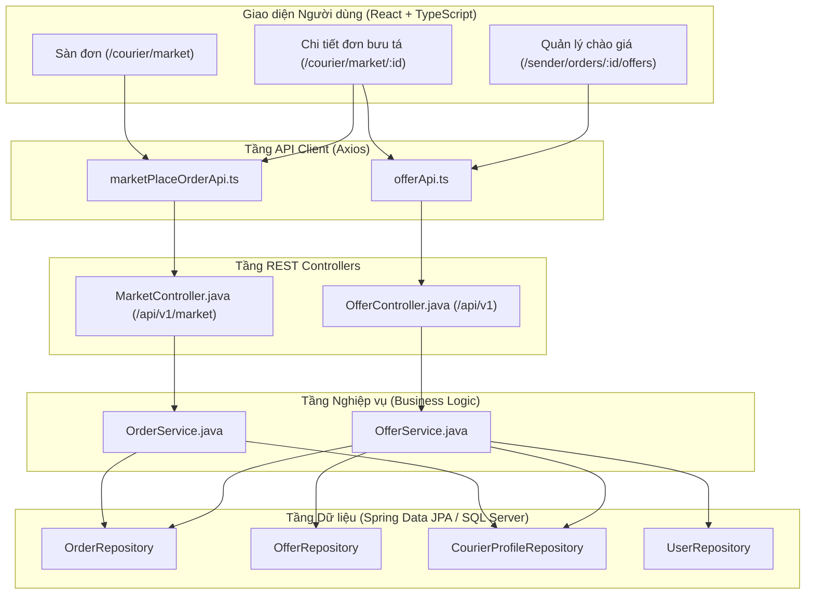
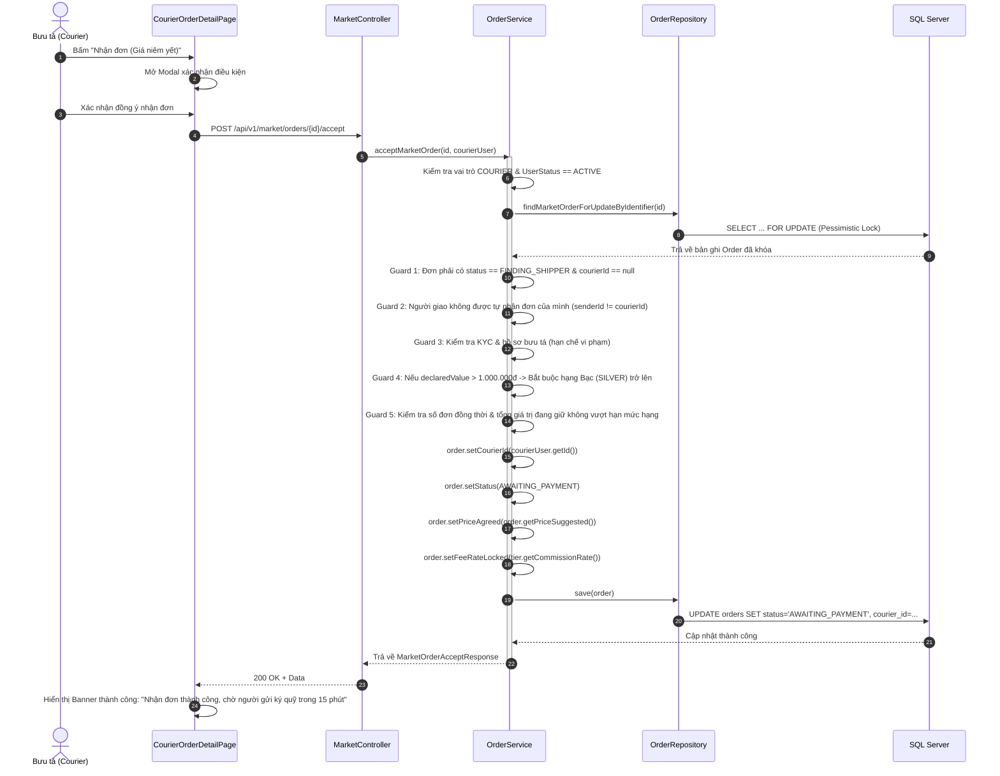

# ĐẶC TẢ THIẾT KẾ & VẬN HÀNH CLASS/HÀM: UC-16, UC-17, UC-18, UC-19
> **Phân hệ:** Sàn đơn & Thương lượng giá (Marketplace & Matching - MKT)  
> **Dự án:** FPTPost - Nền tảng giao hàng cowork ngang hàng (P2P)  
> **Phiên bản:** 1.0  
> **Công nghệ:** Java 21, Spring Boot 3, Spring Data JPA, React 18, TypeScript, Tailwind/Darkmode Tokens

---

## 1. TỔNG QUAN PHÂN HỆ VÀ KIẾN TRÚC PHẦN MỀM

Phân hệ Sàn đơn & Thương lượng (MKT) chịu trách nhiệm kết nối người gửi hàng có nhu cầu vận chuyển với các bưu tá tiện đường. Bốn ca sử dụng trọng tâm trong giai đoạn này bao gồm:

| Mã UC | Tên Use Case | Tác nhân chính | Trọng tâm chức năng |
| :--- | :--- | :--- | :--- |
| **UC-16** | Duyệt & tìm kiếm sàn đơn | Bưu tá (Courier) | Xem danh sách đơn đang mở, tìm kiếm theo từ khóa/khu vực, xem chi tiết kiện hàng (đã che thông tin nhạy cảm). |
| **UC-17** | Nhận đơn theo giá niêm yết | Bưu tá (Courier) | Nhận ngay kiện hàng với mức cước người gửi niêm yết; khóa đơn, kiểm tra hạn mức & chuyển đơn sang *Chờ ký quỹ*. |
| **UC-18** | Gửi & rút chào giá | Bưu tá (Courier) | Đề xuất mức cước mới trong biên [70% - 150%] kèm thời gian lấy hàng dự kiến; có quyền rút chào giá khi chưa chốt. |
| **UC-19** | Xử lý chào giá | Người gửi (Sender) & Bưu tá | Người gửi so sánh các chào giá, chấp nhận (chốt bưu tá), từ chối hoặc phản giá hai chiều tối đa 3 vòng thương lượng. |

### Sơ đồ luồng phân tầng (Layered Flow)


---

## 2. CHI TIẾT CÁC CLASS VÀ HÀM TRONG TỪNG USE CASE

### 2.1. UC-16: DUYỆT VÀ TÌM KIẾM SÀN ĐƠN (MARKETPLACE)

#### A. Backend Classes & Methods

##### 1. `MarketController.java`
- **`getMarketplaceOrders(String keyword, Pageable pageable)`**
  - **Endpoint:** `GET /api/v1/market/orders`
  - **Quyền:** `COURIER`
  - **Mục đích:** Trả về danh sách đơn hàng có thể nhận trên sàn, hỗ trợ phân trang và tìm kiếm theo từ khóa.
  - **Tham số vào:**
    - `keyword` (String, tùy chọn): Từ khóa tìm kiếm theo tên hàng hoặc địa chỉ.
    - `pageable` (Pageable, mặc định `size = 10`): Trang và thứ tự sắp xếp.
  - **Kết quả trả về:** `ResponseEntity<ApiResponse<Page<MarketplaceOrderResponse>>>`.

- **`getMarketOrderDetail(String id, Jwt jwt)`**
  - **Endpoint:** `GET /api/v1/market/orders/{id}`
  - **Quyền:** `COURIER`, `SENDER`
  - **Mục đích:** Xem chi tiết một kiện hàng trên sàn. Để bảo vệ quyền riêng tư, thông tin người nhận (tên, số điện thoại) được che nếu người xem chưa phải là bưu tá được giao nhận đơn.
  - **Tham số vào:** `id` (Long ID hoặc mã vận đơn `orderCode`), `jwt` (Token xác thực).
  - **Kết quả trả về:** `ResponseEntity<ApiResponse<MarketplaceOrderDetailResponse>>`.

##### 2. `OrderService.java`
- **`viewAvailableOrder(Pageable pageable, String keyword)`**
  - **Mục đích:** Thực thi truy vấn các đơn hàng ở trạng thái `FINDING_SHIPPER` (Đang tìm người giao) và chưa gán bưu tá (`courier_id IS NULL`).
  - **Thuật toán:**
    - Nếu `keyword` rỗng: gọi `orderRepository.findAvailableShippingOrder(pageable)`.
    - Nếu `keyword` có giá trị: gọi `orderRepository.findAvailableShippingOrderByKeyword(pageable, keyword)`.
    - Sử dụng `OrderMapper.toMarketplaceOrderResponses(...)` chuyển đổi sang DTO trả về client.

- **`getMarketOrderDetail(String identifier, User currentUser)`**
  - **Mục đích:** Lấy thông tin chi tiết đơn hàng trên sàn kèm trạng thái điều kiện bưu tá.
  - **Thuật toán & Bảo mật:**
    - Tìm kiếm đơn bằng ID hoặc `orderCode`.
    - Kiểm tra quyền: Nếu `currentUser` đã là người được chốt đơn hoặc là người tạo đơn (`senderId`), hiển thị đầy đủ; ngược lại kích hoạt cơ chế mặt nạ thông tin nhạy cảm qua `maskName(...)` và `maskPhone(...)` (ví dụ: `Ng*** A`, `090****567`).
    - Tính cờ `requiresSilver`: Kiểm tra nếu `declaredValue > 1.000.000đ` thì đơn yêu cầu bưu tá từ hạng Bạc trở lên.
    - Tính cờ `isAvailable`: Đơn đang mở và chưa có bưu tá nào nhận.

##### 3. `OrderRepository.java`
- **`findAvailableShippingOrder(Pageable pageable)`**
  - Truy vấn JPA: `SELECT o FROM Order o WHERE o.status = OrderStatus.FINDING_SHIPPER AND o.courierId IS NULL ORDER BY o.createdAt DESC`.
- **`findAvailableShippingOrderByKeyword(Pageable pageable, String keyword)`**
  - Lọc thêm theo điều kiện `LOWER(productName) LIKE %keyword%` hoặc `LOWER(pickupAddress) LIKE %keyword%` hoặc `LOWER(deliveryAddress) LIKE %keyword%`.

##### 4. `OrderMapper.java`
- `toMarketplaceOrderResponse(Order order)`: Chuyển entity `Order` sang thẻ tóm tắt trên sàn đơn.
- `toMarketplaceOrderDetailResponse(Order order)`: Chuyển entity sang chi tiết kiện hàng.

#### B. Frontend Components
- **`CourierMarketplacePage.tsx`**: Trang danh sách sàn đơn dạng lưới thẻ `MarketplaceOrderCard`, tích hợp ô tìm kiếm từ khóa, bộ lọc khoảng cách và phân trang.
- **`CourierOrderDetailPage.tsx`**: Trang chi tiết kiện hàng trên sàn, hiển thị tuyến đường, mô tả, ảnh thực tế, cước phí niêm yết, và các cảnh báo điều kiện.

---

### 2.2. UC-17: NHẬN ĐƠN THEO GIÁ NIÊM YẾT (DIRECT ACCEPT)

#### A. Quy trình nghiệp vụ & Sequence Diagram


#### B. Backend Classes & Methods

##### 1. `MarketController.java`
- **`acceptOrder(String id, Jwt jwt)`**
  - **Endpoint:** `POST /api/v1/market/orders/{id}/accept`
  - **Quyền:** `COURIER`
  - **Mục đích:** Bưu tá tiếp nhận trực tiếp đơn hàng theo giá cước niêm yết ban đầu.

##### 2. `OrderService.java`
- **`acceptMarketOrder(String identifier, User courierUser)`**
  - **Kiểm tra nghiệp vụ (Guard Conditions):**
    1. *Xác thực:* Bưu tá hợp lệ và đang ở trạng thái hoạt động (`ACTIVE`).
    2. *Trạng thái đơn:* Đơn hàng phải đang ở `FINDING_SHIPPER` và chưa có người nhận (`courierId == null`).
    3. *Chống tự giao dịch:* Nếu `senderId.equals(courierUser.getId())` $\rightarrow$ quăng lỗi `ORDER_SELF_ACCEPT_FORBIDDEN`.
    4. *Kiểm tra hàng giá trị cao:* Nếu `declaredValue > 1.000.000đ` và bưu tá chỉ ở hạng Tân binh (`ROOKIE`) hoặc Đồng (`BRONZE`) $\rightarrow$ quăng lỗi `COURIER_HIGH_VALUE_RESTRICTED`.
    5. *Hạn mức đơn đồng thời:* Bưu tá không được vượt quá số đơn đang nhận đồng thời theo cấu hình hạng (`CONC_TIER`):
       - Tân binh: 3 đơn | Đồng: 5 đơn | Bạc: 8 đơn | Vàng: 12 đơn | Kim cương: 15 đơn.
    6. *Hạn mức giá trị bảo lãnh:* Tổng giá trị khai báo đang giữ không vượt ngưỡng hạng (`VALUE_TIER`).
  - **Xử lý trạng thái & Khóa dữ liệu:**
    - Sử dụng `findByIdForUpdate` (Pessimistic Write Lock) ngăn chặn Race Condition khi nhiều bưu tá cùng bấm nhận 1 đơn cùng lúc.
    - Chuyển `order.status` $\rightarrow$ `AWAITING_PAYMENT`.
    - Khóa mức hoa hồng tại thời điểm chốt: `order.feeRateLocked = tier.getCommissionRate()`.
    - Gán `order.priceAgreed = order.priceSuggested`.

##### 3. `MarketOrderAcceptResponse.java` (DTO)
- Chứa các thông tin phản hồi sau khi nhận đơn: mã vận đơn, người gửi, bưu tá nhận, giá thống nhất, trạng thái mới, thời điểm cập nhật và thông điệp hướng dẫn.

---

### 2.3. UC-18: GỬI VÀ RÚT CHÀO GIÁ (COURIER OFFER SUBMISSION)

#### A. Backend Classes & Methods

##### 1. `OfferController.java`
- **`createOffer(String orderIdentifier, OfferCreateRequest request, Jwt jwt)`**
  - **Endpoint:** `POST /api/v1/orders/{id}/offers`
  - **Quyền:** `COURIER`
  - **Mục đích:** Gửi đề xuất mức giá vận chuyển mới và thời gian đến lấy hàng dự kiến.

- **`withdrawOffer(Long offerId, Jwt jwt)`**
  - **Endpoint:** `DELETE /api/v1/offers/{id}`
  - **Quyền:** `COURIER`
  - **Mục đích:** Bưu tá tự nguyện rút lại đề xuất giá đang chờ phản hồi.

- **`getMyOffers(Jwt jwt)`**
  - **Endpoint:** `GET /api/v1/me/offers`
  - **Quyền:** `COURIER`
  - **Mục đích:** Bưu tá theo dõi tất cả các đề xuất chào giá mình đã gửi.

##### 2. `OfferService.java`
- **`createOffer(String orderIdentifier, OfferCreateRequest request, User courierUser)`**
  - **Kiểm tra biên giá:** Mức giá chào $P_{bid}$ phải thỏa mãn:
    $$0.70 \times P_{suggested} \le P_{bid} \le 1.50 \times P_{suggested}$$
    Nếu nằm ngoài khoảng $\rightarrow$ quăng lỗi `OFFER_PRICE_OUT_OF_RANGE`.
  - **Quy tắc một chào giá hiệu lực:** Kiểm tra các chào giá cũ của bưu tá này trên đơn hàng có trạng thái `PENDING` hoặc `COUNTERED`. Tất cả các bản ghi cũ được cập nhật thành `WITHDRAWN`.
  - **Tạo chào giá mới:**
    - `roundNo = 1`, `createdBySender = false`.
    - `status = OfferStatus.PENDING`.
    - `expiresAt = now + 120 phút`.
  - Lưu vào CSDL qua `offerRepository.save(newOffer)`.

- **`withdrawOffer(Long offerId, User courierUser)`**
  - Kiểm tra quyền sở hữu: `offer.getCourier().getId() == courierUser.getId()`.
  - Kiểm tra trạng thái: Chào giá phải đang ở `PENDING` hoặc `COUNTERED`.
  - Cập nhật trạng thái `offer.status = OfferStatus.WITHDRAWN`.

##### 3. Entity `Offer.java`
- `@Id @GeneratedValue Long id`: Khóa chính.
- `@ManyToOne Order order`: Đơn hàng liên kết.
- `@ManyToOne User courier`: Bưu tá gửi chào giá.
- `BigDecimal price`: Mức giá đề xuất.
- `String message`: Lời nhắn gửi kèm.
- `Instant etaPickup`: Thời gian dự kiến lấy hàng.
- `@Enumerated OfferStatus status`: `PENDING`, `ACCEPTED`, `REJECTED`, `COUNTERED`, `EXPIRED`, `WITHDRAWN`.
- `Long parentOfferId`: ID chào giá gốc (dùng cho luồng phản giá nhiều vòng).
- `int roundNo`: Vòng thương lượng hiện tại (1, 2, 3).
- `boolean createdBySender`: Đánh dấu ai là người khởi tạo vòng thương lượng này.
- `Instant expiresAt`: Thời điểm hết hiệu lực (120 phút).

---

### 2.4. UC-19: XỬ LÝ CHÀO GIÁ (SENDER COUNTER & ACCEPT)

#### A. Quy trình thương lượng & Sequence Diagram
```mermaid
sequenceDiagram
    autonumber
    actor Sender as Người gửi (Sender)
    actor Courier as Bưu tá (Courier)
    participant UI_Offers as OrderOffersPage
    participant Ctrl as OfferController
    participant Svc as OfferService
    participant DB as SQL Server

    Courier->>Ctrl: POST /orders/{id}/offers (Giá chào: 45.000đ - Vòng 1)
    Ctrl-->>Sender: Thông báo chào giá mới

    Sender->>UI_Offers: Mở màn hình danh sách chào giá
    UI_Offers->>Ctrl: GET /orders/{id}/offers
    Ctrl-->>UI_Offers: Danh sách chào giá + Điểm uy tín bưu tá

    alt Kịch bản 1: Phản giá (Counter-Offer)
        Sender->>UI_Offers: Nhập giá phản xuất: 38.000đ (Vòng 2)
        UI_Offers->>Ctrl: POST /offers/{id}/counter
        Ctrl->>Svc: counterOffer(offerId, request, senderUser)
        Svc->>Svc: Kiểm tra roundNo < 3 & Giá trong biên [70% - 150%]
        Svc->>DB: Offer cũ -> COUNTERED; Tạo Offer mới (roundNo=2, createdBySender=true)
        DB-->>Ctrl: 200 OK
        Ctrl-->>UI_Offers: Cập nhật danh sách
        Note over Courier: Bưu tá nhận được giá phản xuất và có thể phản hồi lại
    else Kịch bản 2: Từ chối (Reject)
        Sender->>UI_Offers: Bấm "Từ chối"
        UI_Offers->>Ctrl: POST /offers/{id}/reject
        Ctrl->>Svc: rejectOffer(offerId, senderUser)
        Svc->>DB: Offer -> REJECTED
        DB-->>UI_Offers: Đã từ chối chào giá
    else Kịch bản 3: Chấp nhận chào giá (Accept)
        Sender->>UI_Offers: Bấm "Chấp nhận chào giá"
        UI_Offers->>Ctrl: POST /offers/{id}/accept
        Ctrl->>Svc: acceptOffer(offerId, senderUser)
        activate Svc
        Svc->>DB: Khóa Order (Pessimistic Lock)
        Svc->>DB: Offer này -> ACCEPTED
        Svc->>DB: Order: courierId = courier.id, status = AWAITING_PAYMENT, priceAgreed = offer.price
        Svc->>DB: Tất cả Offer khác của đơn này -> REJECTED
        Svc-->>Ctrl: OfferAcceptResponse (giữ chỗ 15 phút)
        deactivate Svc
        Ctrl-->>UI_Offers: Hiển thị thông báo chuyển trang ký quỹ
    end
```

#### B. Backend Classes & Methods

##### 1. `OfferController.java`
- **`getOffersForOrder(String orderIdentifier, Jwt jwt)`**
  - **Endpoint:** `GET /api/v1/orders/{id}/offers`
  - Người gửi xem toàn bộ danh sách chào giá của đơn. Bưu tá chỉ xem chào giá của chính mình.
- **`acceptOffer(Long offerId, Jwt jwt)`**
  - **Endpoint:** `POST /api/v1/offers/{id}/accept`
  - Người gửi chốt bưu tá, đơn chuyển sang `AWAITING_PAYMENT`.
- **`rejectOffer(Long offerId, Jwt jwt)`**
  - **Endpoint:** `POST /api/v1/offers/{id}/reject`
  - Người gửi từ chối một đề xuất chào giá cụ thể.
- **`counterOffer(Long offerId, OfferCounterRequest request, Jwt jwt)`**
  - **Endpoint:** `POST /api/v1/offers/{id}/counter`
  - Đề xuất mức giá mới từ phía người gửi hoặc bưu tá (hỗ trợ 2 chiều).

##### 2. `OfferService.java`
- **`acceptOffer(Long offerId, User senderUser)`**
  - **Kiểm tra:**
    - Đơn thuộc sở hữu của `senderUser`.
    - Đơn chưa có bưu tá và đang ở trạng thái tìm kiếm.
    - Chào giá còn hiệu lực (`expiresAt > now`), trạng thái là `PENDING` hoặc `COUNTERED`.
  - **Xử lý:**
    - Cập nhật chào giá được chọn sang `ACCEPTED`.
    - Gán `order.courierId = offer.courier.id`.
    - Gán `order.priceAgreed = offer.price`.
    - Gán `order.feeRateLocked = courierProfile.tier.commissionRate`.
    - Chuyển `order.status = OrderStatus.AWAITING_PAYMENT`.
    - **Tự động từ chối chào giá cạnh tranh:** Lấy tất cả các chào giá khác thuộc đơn đang ở `PENDING`/`COUNTERED` và cập nhật thành `REJECTED`.
    - Khởi tạo thời hạn giữ chỗ 15 phút (`HOLD_PAYMENT_MINUTES = 15`).

- **`counterOffer(Long offerId, OfferCounterRequest request, User currentUser)`**
  - **Kiểm tra lượt thương lượng:** Người gửi chỉ được phản giá khi chào giá do bưu tá tạo; ngược lại bưu tá chỉ được phản giá khi chào giá do người gửi phản xuất (`currentOffer.isCreatedBySender() != isSender`).
  - **Kiểm tra số vòng tối đa:**
    ```java
    if (currentOffer.getRoundNo() >= MAX_COUNTER_ROUNDS) { // MAX_COUNTER_ROUNDS = 3
        throw new AppException(OrderErrorCode.OFFER_EXCEEDED_ROUNDS);
    }
    ```
  - **Kiểm tra biên giá:** Mức giá phản xuất mới phải nằm trong [70% - 150%] của giá gợi ý.
  - **Sinh chào giá con:**
    - Đánh dấu bản ghi chào giá hiện tại: `currentOffer.status = OfferStatus.COUNTERED`.
    - Tạo bản ghi mới kế thừa: `parentOfferId = currentOffer.id`, `roundNo = currentOffer.roundNo + 1`, `createdBySender = isSender`, `status = PENDING`.

---

## 3. BẢNG TỔNG HỢP ÁNH XẠ QUY TẮC NGHIỆP VỤ (BUSINESS RULES MAPPING)

| Mã BR | Tên quy tắc nghiệp vụ | Tham số cấu hình | Triển khai mã nguồn |
| :--- | :--- | :--- | :--- |
| **BR-F-026** | Hiển thị sàn đơn chỉ gồm đơn mở | `OrderStatus.FINDING_SHIPPER` | `OrderRepository.findAvailableShippingOrder` |
| **BR-R-027** | Che thông tin nhạy cảm trên sàn | - | `OrderService.maskName(...)`, `maskPhone(...)` |
| **BR-R-008** | Chống tự giao dịch | - | `order.getSenderId().equals(courier.getId())` $\rightarrow$ quăng lỗi |
| **BR-R-024** | Đơn giá trị cao > 1.000.000đ | `[PRM-017] HIGH_VALUE = 1.000.000đ` | `tier.isCanAcceptHighValue()` (chỉ hạng Bạc trở lên) |
| **BR-R-028** | Hạn mức nhận đơn theo hạng | `[PRM-083] CONC_TIER`, `[PRM-084] VALUE_TIER` | `OfferService.checkCourierLimits(...)` |
| **BR-R-029** | Biên giá chào [70% - 150%] | `[PRM-039] 0.7`, `[PRM-040] 1.5` | `OfferService.validatePriceBounds(...)` |
| **BR-R-030** | Một chào giá hiệu lực mỗi bưu tá | - | Cập nhật chào giá cũ thành `OfferStatus.WITHDRAWN` |
| **BR-R-031** | Chốt chào giá & từ chối chào giá khác | `[PRM-023] PAY_HOLD = 15 phút` | `OfferService.acceptOffer(...)`, `HoldExpiresAt` |
| **BR-R-032** | Giới hạn vòng thương lượng | `[PRM-054] NEGO_ROUNDS = 3` | `currentOffer.getRoundNo() >= 3` $\rightarrow$ chặn phản giá |
| **BR-F-086** | Minh bạch cấu thành phí | Hoa hồng 4% - 8% | `Order.feeRateLocked`, tính cước ròng hiển thị |
| **BR-R-025** | Một người giao một đơn | Pessimistic Locking | `OrderRepository.findByIdForUpdate(...)` |

---

## 4. BẢNG MÃ LỖI VÀ XỬ LÝ NGOẠI LỆ (ERROR CODES)

Tất cả các ngoại lệ nghiệp vụ được định nghĩa trong `OrderErrorCode.java` và định dạng trả về chuẩn RFC 7807:

| Mã lỗi | HTTP Status | Thông điệp người dùng | Nguyên nhân |
| :--- | :---: | :--- | :--- |
| `ORDER_NOT_AVAILABLE` | 400 | Đơn hàng không còn khả dụng trên sàn | Đơn đã được người khác nhận hoặc đã bị hủy |
| `ORDER_SELF_ACCEPT_FORBIDDEN` | 400 | Bạn không thể tự nhận đơn hàng do chính mình tạo | Vi phạm quy tắc chống tự giao dịch (BR-R-008) |
| `COURIER_ROLE_REQUIRED` | 403 | Yêu cầu tài khoản có vai trò Bưu tá | Người dùng chưa đăng ký hoặc chưa duyệt vai trò Courier |
| `COURIER_ACCOUNT_RESTRICTED` | 403 | Tài khoản bưu tá đang bị tạm khóa hoặc hạn chế | Bưu tá bị kỷ luật hoặc đang trong thời gian phạt hủy đơn |
| `COURIER_HIGH_VALUE_RESTRICTED` | 400 | Đơn hàng giá trị cao đòi hỏi bưu tá từ hạng Bạc trở lên | Đơn > 1.000.000đ nhưng bưu tá hạng Tân binh / Đồng |
| `COURIER_MAX_ORDERS_EXCEEDED` | 400 | Bạn đã đạt số lượng đơn hàng tối đa được giao đồng thời | Vượt quá số đơn tối đa cho phép theo hạng bưu tá |
| `COURIER_MAX_VALUE_EXCEEDED` | 400 | Tổng giá trị hàng hóa đang giữ vượt quá hạn mức của hạng | Vượt quá tổng giá trị bảo lãnh theo hạng bưu tá |
| `OFFER_PRICE_OUT_OF_RANGE` | 400 | Mức giá đề xuất phải nằm trong khoảng 70% đến 150% giá gợi ý | Nhập giá chào thấp hơn 70% hoặc cao hơn 150% |
| `OFFER_EXCEEDED_ROUNDS` | 400 | Đã đạt số vòng thương lượng tối đa (3 vòng) | Không thể tiếp tục phản giá, chỉ có thể chấp nhận hoặc từ chối |
| `OFFER_NOT_ACTIVE` | 400 | Lời chào giá đã hết hạn hoặc không còn hiệu lực | Chào giá đã quá 120 phút hoặc đã bị rút trước đó |
| `OFFER_FORBIDDEN` | 403 | Bạn không có quyền thao tác trên lời chào giá này | Thao tác sai phiên người dùng hoặc sai vai trò |

---

## 5. HƯỚNG DẪN KIỂM THỬ TỰ ĐỘNG (AUTOMATED TEST VERIFICATION)

Bộ kiểm thử đơn vị độc lập đã được thiết lập đầy đủ trong mã nguồn để kiểm chứng toàn bộ các quy tắc nghiệp vụ trên:

```bash
# Chạy toàn bộ Unit Tests cho OrderService và OfferService
mvn test -Dtest=OfferServiceTest,OrderServiceTest
```
- **Số lượng ca kiểm thử:** 21/21 passed (0 failure, 0 error).
- **Độ bao phủ:** Kiểm tra thành công luồng tạo chào giá, biên giá hợp lệ/ngoài biên, rút chào giá, chấp nhận chào giá tự động từ chối các đối thủ, thương lượng 3 vòng, và kiểm tra quyền hạn mức hạng bưu tá.
