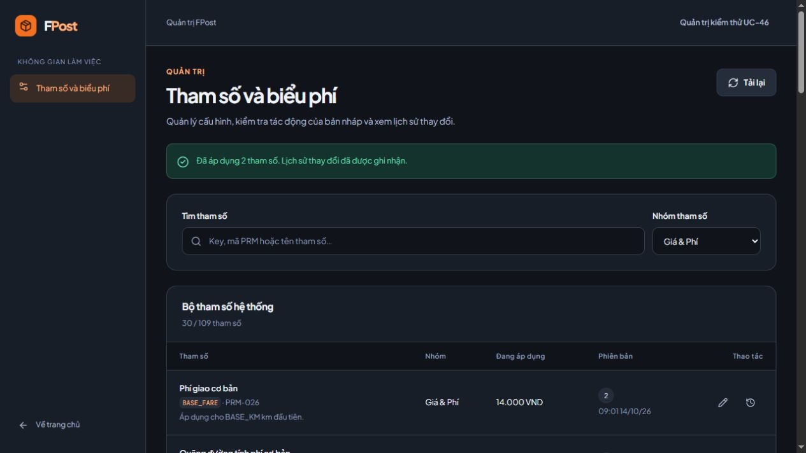

# Bàn giao đợt 1 — P00 và UC-46

Hoàn tất bản độc lập ngày **14/10/2026** trên máy của Thuận.
Nhánh **feature/UC-46-ThuanTC-cau-hinh-tham-so**. Thuận yêu cầu commit/push bản bàn giao ngày 14/10; tra mã commit và trạng thái remote bằng Git.
Yêu cầu Excel đang áp dụng được giữ nguyên; các cập nhật runtime của nhóm đã được tiếp nhận.

Cập nhật sau bàn giao: đã ghép develop `13eeb41` (UC-12/UC-34), giữ UC-46 và kiểm thử
toàn bộ bản merge. Kết quả mới ở [MERGE-DEVELOP-CHECK.md](MERGE-DEVELOP-CHECK.md);
các số liệu/ảnh nghiệm thu đầu bên dưới được giữ làm lịch sử.

## Phần đã hoàn thành

| Gói | Trạng thái | Kết quả |
| --- | --- | --- |
| P00 | VERIFIED | Tái sử dụng auth/session/UI; ADMIN guard; audit producer, SQL outbox, Mongo sink, retry/dedupe/fencing; workflow CI và checks local |
| P01 / UC-46 | READY_WITH_MOCK | 109 tham số chính thức; seed không reset; validation; sửa đơn/batch; version conflict; history; immutable snapshot; preview; giao diện quản trị |

Persistence, quyền, history và audit chạy thật. Phần giả lập duy nhất của chức năng này
là adapter mô phỏng Pricing `REFERENCE`, chờ module Pricing của **Nguyễn Thành Huy**.
Chưa nghiệm thu luồng tạo đơn giữ snapshot hoặc thay đổi cấu hình Identity qua các consumer của đồng đội.
P02–P15 chưa triển khai; không đánh dấu UC-60 hoàn thành chỉ vì đã có audit capture.

Giao diện có nhóm/tìm kiếm/phân trang, form theo kiểu dữ liệu, bản nháp nhiều key,
giá hiện tại/đề xuất, xác nhận trước lưu, xử lý 409 giữ bản nháp, lịch sử và layout mobile.
Các trọng số tổng bằng 1 được lưu bằng PUT batch nguyên tử.

## Mở bản chạy trên máy

- Frontend: **http://localhost:15173/admin/params**.
- Backend: **http://localhost:18080/api/v1**; Swagger `/swagger-ui/index.html`.
- SQL Server Docker: localhost:31433; MongoDB Docker: localhost:37017.
- Database ứng dụng: group6_project_db; profile dev,demo; Gmail theo cấu hình leader.

Trang quản trị yêu cầu tài khoản thật có role ADMIN. Tài khoản đang có role SENDER
không được tự nâng quyền. ADMIN dùng trong browser UAT là identity riêng trong database test tạm thời,
đã dọn sau kiểm thử; không phải tài khoản mặc định của ứng dụng.
Sau khi ghép develop, UserDemoSeeder của nhóm bổ sung các identity demo, bao gồm ADMIN,
trong profile dev/demo/test/local; không thay role/password của tài khoản đã tồn tại.

Chạy lại tại thư mục gốc, giữ `.env` hiện có:

```powershell
docker compose up --build -d
docker compose ps
```

Launcher `scripts/dev.ps1` và các lệnh setup của nhóm được giữ nguyên; xem [HANDOFF gốc](../../HANDOFF.md).
Đợt 1 không đổi credentials/.env, không dùng SQL Server Windows, không đăng ký tài khoản qua Gmail,
không gửi email kiểm thử. Chỉ frontend/backend được build/recreate; database Docker giữ dữ liệu.

## Kiểm thử đã thực hiện

| Kiểm tra | Kết quả / giới hạn |
| --- | --- |
| Backend thông thường | 144 tests PASS; class live không chạy nếu chưa opt-in |
| SQL Server/MongoDB live | 5 tests opt-in PASS trong database riêng; trong đó test thứ 5 mở cửa sổ cho browser UAT |
| Tổng report sau live | 149 tests, 0 failures, 0 errors, 0 skipped; [test-summary.json](evidence/test-summary.json) |
| Công thức giá | 20 golden cases Excel PASS, thêm ca tham số đề xuất/khấu trừ/discount/bounds |
| Frontend | typecheck, lint, build PASS |
| Browser UAT | Login thật/JWT/returnTo; sửa BASE_FARE; preview đổi giá không lưu; history; batch hai trọng số; mobile 390×844 không tràn ngang |
| Docker | Build package PASS (144 tests chạy, 5 live được bỏ qua đúng opt-in); client/server/SQL/Mongo healthy; API/proxy 200, Actuator UP; [runtime-verification.json](evidence/runtime-verification.json) |
| CI | Workflow đã tạo; checks tương đương đã chạy local; chưa có run trên GitHub |

Tests xác nhận rollback khi enqueue/batch thất bại, version conflict/no-op,
constraint liên khóa khi cập nhật đồng thời, snapshot cũ không đổi và quyền ADMIN.
Live test kiểm tra Unicode/schema/transaction SQL Server, Mongo append/dedupe và acknowledgement SQL.
Mất kết nối/retry/lease hết hạn/crash fencing được kiểm tra bằng tests mô phỏng;
không tuyên bố đã ngắt hoặc restart Mongo vật lý để gây lỗi.

Lệnh kiểm tra thông thường (JDK 21/Maven/Node đã có trong `.tools`):

```powershell
npm run test:server
npm run typecheck --prefix client
npm run lint --prefix client
npm run build:client
```

Live test `ParameterLiveIntegrationTest` bật bằng FPTPOST_UC46_LIVE_TEST=1,
SQL/Mongo ports như trên và FPTPOST_UC46_SQL_PASSWORD lấy từ cấu hình local vào process env.
Test tạo/drop duy nhất database tên ngẫu nhiên fptpost_uc46_it_<UUID>; không seed/drop database ứng dụng.
Browser UAT dùng Vite tạm ở 15174 nối backend test; tiến trình tạm đã dừng sau kiểm thử.

Ảnh dưới là dữ liệu của database test; không phản ánh giá đã chỉnh trong database ứng dụng:



[Ảnh lịch sử](evidence/uc46-history.jpg) · [Ảnh mobile](evidence/uc46-mobile.jpg).

## File và contract để tiếp tục

- Backend: `server/src/main/java/com/fptpost/modules/catalog`, registry `server/src/main/resources/catalog/parameters.json`.
- Audit: `server/src/main/java/com/fptpost/common/audit`.
- Frontend: `client/src/features/parameters`, `pages/AdminParametersPage.tsx`, `api/parameterApi.ts`, `types/parameter.ts`, `styles/parameters.css`.
- Tests: ParameterCatalog/Initializer/Http/Transaction/LiveIntegration, ReferencePricingSimulation/PricingSimulationConfiguration, common/audit tests.
- API/DB: [UC46-CONTRACT.md](UC46-CONTRACT.md), [API.md](../API.md), [DATABASE.md](../DATABASE.md).
- Kế hoạch còn lại: [PROGRESS.md](PROGRESS.md), [THUAN-IMPLEMENTATION-PLAN.md](THUAN-IMPLEMENTATION-PLAN.md).

Thành Huy cung cấp bean PricingSimulationPort nhận snapshot đã truyền vào;
tắt reference khi xác nhận provider thật. Dùng lại 20 ca giá để kiểm tra contract trước khi nghiệm thu.
Owner Order lưu values+versions vào đơn; owner Identity chọn thời điểm đọc cấu hình cho hành vi mới.
UC-46 hiện đọc SQL trực tiếp nên không có cache cũ cần invalidate.

Bước ưu tiên tiếp theo theo plan là **P02 / UC-60: truy vấn và giao diện audit**,
dựa trên outbox/audit đã có, sau đó P03/UC-57 và P04/UC-56.
