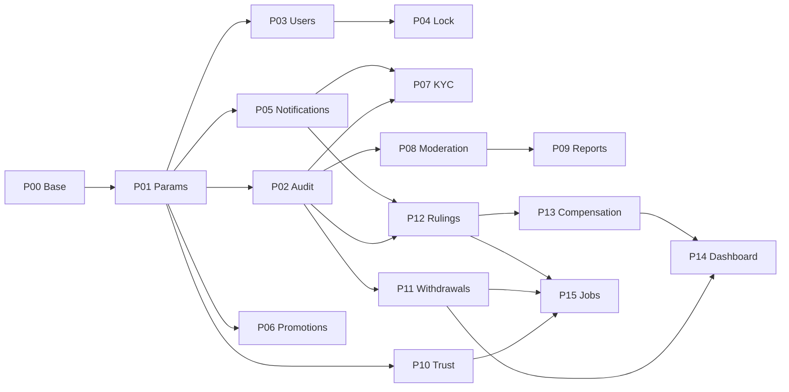

# Kế hoạch thực hiện 15 UC của Trần Công Thuận

Ngày bắt đầu mới: **14/10/2026**. Baseline audit 13/10, xuất plan 14/10. Mục tiêu bản tích hợp/UAT: **13/11/2026**. Tất cả P00–P15 ban đầu là `NOT_STARTED`; trạng thái sau thực hiện xem [PROGRESS.md](PROGRESS.md). Đợt 1 đã có bàn giao P00/P01 tại [ROUND1-HANDOFF.md](ROUND1-HANDOFF.md).

## 1. Thứ tự ưu tiên

Chọn theo khả năng chạy thật với base hiện có, khả năng mở đường cho UC khác và rủi ro giao dịch. Dependency chưa có được thay bằng adapter giả lập ở môi trường phát triển; không chờ toàn bộ module của đồng đội mới làm FE/BE.

| Thứ tự | Gói | UC | Lý do làm ở vị trí này | Đích phần độc lập |
| --- | --- | --- | --- | --- |
| 0 | P00 | Việc nền dùng chung | Dùng lại auth/UI, contract, CI và audit seam cần ngay; không tạo framework lớn | T1 |
| 1 | P01 | UC-46 | Ít phụ thuộc nhất; bộ tham số và snapshot là input cho phần lớn module | T1 |
| 2 | P02 | UC-60 | Có audit thật từ P01; tạo truy vết cho thao tác quản trị tiếp theo | T2 |
| 3 | P03 | UC-57 | User/role/session đã có; tạo công cụ nhân sự, privacy workflow | T2 |
| 4 | P04 | UC-56 | Tái sử dụng kiểm tra JWT/session; mock xử lý đơn/escrow | T2 |
| 5 | P05 | UC-53 | Dùng sự kiện thật từ tham số/user; làm hạ tầng thông báo cho các hàng đợi | T2; phần Web Push hoàn tất trước T5 |
| 6 | P06 | UC-45 | CRUD/ràng buộc khuyến mãi có thể độc lập; contract áp dụng do Thành Huy tiêu thụ | T3 |
| 7 | P07 | UC-09 | Duyệt hồ sơ fixture qua Identity contract; có audit/notif đã sẵn | T3 |
| 8 | P08 | UC-54 | Kiểm duyệt fixture Order và từ khóa; không tự viết Order state machine | T3 |
| 9 | P09 | UC-55 | Hàng đợi vi phạm tận dụng moderation UI; action nối qua owner facade | T3 |
| 10 | P10 | UC-49 | Tính điểm từ snapshot/metrics fixture; dùng lại params/notif, bàn giao eligibility sớm | T3 |
| 11 | P11 | UC-41 | Tiền/rút cần contract và idempotency đã ổn; payout demo độc lập | T4 |
| 12 | P12 | UC-51 | Phán quyết cần Order/Ledger/evidence; dùng fixtures và adapter nghiệp vụ tiền | T4 |
| 13 | P13 | UC-52 | Dựa vào phán quyết P12 và Ledger/Quỹ; xử lý thiếu quỹ đúng thứ tự | T4 |
| 14 | P14 | UC-59 | Dashboard/report tiêu thụ các nguồn đã có; mock nguồn còn thiếu | T4 |
| 15 | P15 | UC-63 | Hạ tầng runner chuẩn bị trong T3; đủ handlers/retry/locks/observability sau các domain | T4; tích hợp T5 |

Thứ tự tạo nền khác thứ tự nghiệm thu: audit capture có từ P00/P01, job runner có từ T3; không đợi UC-60/63 ở cuối mới thêm bảo đảm vào các service đã viết.



Các cạnh trên là thứ tự hữu ích trong phần Thuận, không yêu cầu mọi công việc chạy tuần tự. Ví dụ P06/P07/P08/P10 có thể được agent khác làm song song sau khi contract/nền chung đã ổn. P12 còn cần contract Complaint UC-50, bằng chứng và Ledger của đồng đội; UC-55 báo cáo vi phạm không phải điều kiện bắt buộc để phán quyết khiếu nại.

## 2. Lịch thực hiện và checkpoint

| Đợt | Ngày | Công việc | Checkpoint có thể demo |
| --- | --- | --- | --- |
| T1 | 14/10 | P00: đọc source, baseline checks, xác định provider thật/missing, layout/role guards và fixture strategy | Contract C01/C02, bảng nguồn tham số, danh sách file sẽ đổi |
| T1 | 15–16/10 | P01: persistence, seed 109 params, edit/history/version, simulation adapter, FE và audit/outbox tối thiểu | Admin sửa tham số; reject giá trị lỗi; preview không lưu; history và audit không mất khi retry |
| T2 | 17–19/10 | P02 query audit; P03 user search/detail/roles/staff; P04 lock/session, mock Order/Ledger | User thường bị chặn Admin; đổi role/khóa làm token cũ vô hiệu; mock có đơn/escrow thể hiện đủ nhánh |
| T2 | 20–23/10 | P03 privacy export/anonymize workflow; P05 in-app/settings/email/SMS adapter, retry/dedupe/realtime | Domain event thật tạo notif; mandatory không tắt; người khác không xem được notif |
| T3 | 24–26/10 | P06 promotion; P07 KYC fixtures; P08 keyword/manual moderation; runner seam của P15 | Mỗi hàng đợi có approve/reject, lý do, audit và notification; fixture mutation có trạng thái/version |
| T3 | 27–30/10 | P09 reports/SOS routing; P10 trust/tiers/penalties; nhận KYC/Order/ratings adapters nếu có | Score giải thích được, recompute không mất penalty; bản độc lập đủ negative/concurrency cases |
| T4 | 31/10–02/11 | P11 withdrawal approvals/payout/rollback; bắt đầu P12 complaint/evidence/appeal | Hai Admin khác nhau với ngưỡng 5 triệu, timeout/duplicate không chi lặp; mock escrow freeze đúng |
| T4 | 03–06/11 | P12 ruling; P13 compensation; P14 dashboard/report; P15 jobs/handlers, batch payout và Web Push hoàn thiện | Tất cả 15 UC có bản độc lập đủ phạm vi; không còn màn hình chỉ vẽ hoặc endpoint rỗng |
| T5 | 07–10/11 | Intake adapters thật, KYC→courier, moderation→market, trust→eligibility, payout/ledger, complaint→compensation, dashboard/audit | UC-59/60 tích hợp trước 10/11; dùng cùng scenarios mock trên real providers |
| T5 | 11–13/11 | SQL/Mongo integration, concurrency/retry/job replay, UI/mobile/role UAT, bug fixes, release evidence | 15 UC `VERIFIED` khi đủ bằng chứng; bảng chờ upstream rõ nếu chưa đủ |

Phần mô tả ngày là mốc mục tiêu, không phải giờ công đã cam kết. Chia ticket lại ngay sau T1 bằng thời gian thực tế; giữ toàn bộ phạm vi và ưu tiên xử lý đường tiền/ quyền/ trạng thái trước chỉnh trang trí UI. T5 không dùng để bắt đầu lần đầu một UC còn trống.

## 3. Quy tắc hoàn thành áp dụng mọi gói

- **Độc lập:** service có nghiệp vụ thật của Thuận, API/FE nối nhau, persistence thật cho dữ liệu Thuận sở hữu; upstream thiếu dùng adapter có trạng thái/validation và fixture failure, không chỉ trả HTTP 200.
- **Tích hợp:** thay adapter qua DI, không viết lại UI; schema/DTO/enum/permissions khớp owner; không truy cập repository của module khác.
- **SQL transaction:** state transition/history/bút toán/outbox cần atomic gọi facade nội bộ chung transaction; nếu upstream được mô phỏng thì chỉ chứng minh orchestration, chưa chứng minh giao dịch tiền thật. Provider mạng ở ngoài transaction dài.
- **API:** đường dẫn/quyền theo sheet 10, `ApiResponse`, paging từ 0, lỗi Problem Details và mã ổn định; idempotency cho thao tác tiền. API bổ sung để đủ UC phải ghi rõ là đề xuất, không đổi/xóa API nguồn.
- **FE:** UI tokens/components có sẵn, responsive, loading/error/empty/success, form validation và lỗi field; không dùng FE guard thay backend authorization.
- **Bằng chứng:** test quan trọng pass, ảnh/demo luồng thực, OpenAPI/contract/fixture/hướng dẫn tích hợp cập nhật. Không viết test getter/setter hoặc chỉ mirror implementation.
- **Phân loại:** `READY_WITH_MOCK` khác `INTEGRATED`; `VERIFIED` chỉ sau nghiệm thu acceptance trên providers thật, ngoại trừ sandbox/payout demo được Excel cho phép.

## 4. Chi tiết gói việc

### P00 — Nền tối thiểu cho đợt đầu

**Phạm vi:** kiểm tra source hiện tại; dùng lại JWT/session, lỗi/paging/mail, UTC Clock, WorkspaceLayout và UI components. Bổ sung role guard/layout route cần P01; CI chạy test backend và typecheck/lint/build FE nếu chưa có. Tạo audit capture/outbox đủ cho tham số, không tạo service rỗng cho cả 15 UC.

**Backend:** giữ code first/schema strategy đang dùng. Thiết kế SQL outbox, actor/correlationId, retry và dedupe tối thiểu; lỗi Mongo không làm mất event SQL đã commit. Audit không phụ thuộc vào service Admin; service Admin gọi audit producer. Không thay logger Product bằng audit nghiệp vụ dùng chung một cách cơ học.

**Frontend:** layout `/admin/*` có quyền, reuse auth hiện tại; dữ liệu/session thật. Demo admin/moderator fixtures chỉ profile phát triển và tài khoản test riêng, không default account trong production.

**Kiểm tra:** đọc baseline test hiện có; chạy checks phù hợp trước/sau đợt code. Test rollback không tạo audit cho mutation thất bại; worker crash/retry không nhân đôi audit. Không drop schema/shared SQL hoặc thay config local của người dùng.

**Bàn giao:** sơ đồ owner, mock profile, contract C01/C02, CI evidence. P00 không được phình thành viết lại base.

### P01 — UC-46 Tham số, biểu phí và simulation

**Nguồn:** API-114–116, SCR-57; DB-034/035; BR-F-085/089, BR-R-055/067/083. Giao diện `/admin/params`.

**Backend:** seed đủ 109 key `06_Tham_số`, giữ mã PRM, kiểu, đơn vị, mặc định và mô tả. Có edit validation dựa vào constraints nguồn, trước/sau, history và optimistic version. Preview không ghi dữ liệu. Cập nhật/history/outbox trong cùng SQL transaction. ParameterFacade trả snapshot có phiên bản để Order/Pricing dùng; cache invalidation khi sửa. Đơn cũ giữ snapshot; sửa auth params áp dụng cho thao tác/token mới theo contract Identity, không sửa nội dung token đã phát hành.

**Frontend:** nhóm tham số, tìm key, form đúng số/ratio/duration/compound text; hiển thị 0.08 là tỷ lệ 8% đúng nghĩa, không đổi đơn vị PRM. Preview cấu thành giá/hoa hồng/bảo hiểm trước xác nhận. History giá trị/version cần API contract tương ứng.

**Mock:** C02 PricingSimulationPort với 20 ca sheet 07 và bộ tham số đề xuất. Không hardcode giá để preview vẫn đứng yên khi tham số đổi; không dựng module pricing trùng với Thành Huy. Có timeout/error fixtures. Adapter thật lấy cùng công thức UC-11.

**Acceptance/tests:** 109 key không thiếu/trùng; restart/seed không reset giá trị; ADMIN-only; validation/cross-field constraint khi nguồn quy định; version conflict; rollback đồng bộ history/outbox; preview không mutate; snapshot cũ bất biến; đối chiếu 20 ca biểu phí. SQL Server kiểm tra index/unique thực.

**Đầu ra cho đồng đội:** key registry, snapshot DTO/parameter revision, simulation request/response, parameter-change event. P01 là task đầu tiên có thể giao ngay.

### P02 — UC-60 Audit log

**Nguồn:** API-157, SCR-60; DB-055; BR-F-083/116, BR-N-026/038, BR-R-084. `/admin/audit`.

**Backend:** query/filter/paging theo actor, action, entity, thời gian; audit append-only với before/after đã che dữ liệu nhạy cảm, IP/time/correlationId/eventId. Outbox producer đã có từ P01; thêm index Mongo/dedupe, giới hạn payload. Không API sửa/xóa; retention theo `AUDIT_KEEP`, không TTL tùy tiện. Tra cứu chi tiết có thể qua response danh sách hoặc endpoint bổ sung có contract rõ.

**Frontend:** lọc, bảng, xem before/after/correlationId; dữ liệu rỗng và lỗi tải phân biệt. Chỉ người có quyền Admin đọc.

**Mock:** producer tạo sự kiện seed cho các domain chưa có; log từ tham số/user thật vẫn thật. Không fake bằng chứng giao dịch tiền.

**Acceptance/tests:** quyền; search/paging/sort ổn định; secret/CCCD/OTP không lọt log; retry event không trùng; mutation rollback không có audit thành công; Mongo gián đoạn event còn SQL outbox và được gửi lại.

### P03 — UC-57 Người dùng, nhân sự và quyền dữ liệu cá nhân

**Nguồn:** API-144–147, SCR-48/49/63; BR-F-111/112/124, BR-N-040. `/admin/users`, `/admin/users/:id`, `/admin/staff`.

**Backend:** tìm/detail user qua Identity facade; gán đa role; tạo staff theo chính sách source, yêu cầu đổi mật khẩu đầu tiên theo SPEC mục 7.2, trang 32, phối hợp UC-06 của Luân. Role change khiến token mang role cũ bị vô hiệu qua cơ chế JWT hiện có. Tạo/xử lý yêu cầu export/xóa/ẩn danh, mốc ≤30 ngày; giữ giao dịch/audit theo retention và ẩn danh phù hợp. Dữ liệu orders/transactions đọc qua owner facades. Bảo vệ quyền nhân sự chi tiết nếu policy source yêu cầu; không tự đặt thêm quyền kinh doanh.

**Frontend:** list/detail/roles/staff, confirmation, security state; privacy queue và chi tiết request, tải export và xử lý anonymization. Không rút gọn UC thành CRUD staff.

**Mock:** Order/Ledger/Profile data views; privacy consumers trả dry-run retention/anonymization report. Identity base vẫn thật; phần schema workflow chung với UC-07 bàn giao Luân, không tạo bảng yêu cầu thứ hai.

**Acceptance/tests:** role/permission denied; role đổi có hiệu lực với JWT cũ; staff lần đầu bị giới hạn đúng luồng đổi mật khẩu; export chỉ dữ liệu người được phép; anonymization giữ lịch sử tiền/audit và không xóa ledger; deadline/cases rejected/in progress/finished. API privacy bổ sung phải ghi rõ trong OpenAPI.

### P04 — UC-56 Khóa/mở tài khoản và blacklist

**Nguồn:** API-141–143, SCR-49; BR-F-109, BR-R-074/081/082. Dùng chung detail user P03.

**Backend:** reason bắt buộc, status/session revoke trong transaction; dùng `revokeAll` và JWT DB checks có sẵn. Xử lý running order/escrow theo source qua C05/C07, gồm chuyển người giao/hủy/hoàn; không chỉ set LOCKED. Hash blacklist theo loại, chống trùng; phối hợp registration/KYC của Luân dùng cùng blacklist. Đồng bộ `RESTRICTED/CLOSED` trong workbook với enum hiện tại bằng decision/contract trước khi thêm, không tự đổi nghĩa `LOCKED/DELETED`.

**Mock:** OrderSafetyPort cho no-active-order/assigned/in-transit/frozen-escrow; Ledger trả result hoặc failure. Không fallback sang mock khi upstream thật lỗi; không báo khóa workflow thành công nếu bắt buộc xử lý tiền chưa được xác nhận.

**Acceptance/tests:** access/refresh cũ bị chặn ngay; unlock không khôi phục phiên đã revoke; reason/audit; failure tiền rollback workflow hoặc trạng thái pending được contract quy định, không để nửa hành động; blacklist chặn nguồn đăng ký/KYC khi tích hợp. Điểm dưới ngưỡng chuyển xem xét, không tự khóa toàn tài khoản trái source.

### P05 — UC-53 Notifications và settings

**Nguồn:** API-130–135, SCR-39/40; DB-045/048/054; BR-F-035/101–105, BR-N-009/014, BR-R-085. `/notifications`, `/me/notifications`.

**Backend:** domain event → SQL outbox → dispatcher → templates/settings → Mongo/in-app/email/SMS/Web Push. Mandatory bảo mật/tiền/khiếu nại/trạng thái đơn không được tắt. Read/read-all và settings kiểm user ownership. Dedupe event+kênh+recipient; retry tối đa PRM-098, backoff theo SPEC, alert khi hết retry. Chỉ báo sent khi adapter channel có kết quả. Dùng mail service có sẵn, thống nhất WebSocket/STOMP với Long để không dựng hai endpoint/broker/client.

**Frontend:** inbox/unread/read-all/settings; realtime thêm notification, reconnect lấy missed events; permission UX và subscription Web Push. Web Push BR-F-105 là Could nhưng nằm trong phạm vi plan, hoàn thiện trước nghiệm thu T5. Không cài service worker toàn app chỉ để làm offline cache chưa được yêu cầu.

**Mock:** phát event đồng đội chưa có; SMS/WebPush transport fake dev, email Mailpit; events params/user thật. Tích hợp channel thật hoặc demo transport được nhóm ghi nhận theo phạm vi nguồn; mock output không chứng minh gửi qua nhà cung cấp.

**Acceptance/tests:** user khác không đọc được; duplicate/retry không nhiều notification; mandatory toggle bị reject backend; event rollback không phát; latency in-app p95 ≤2s trên môi trường kiểm tra đã ghi; retry/expired subscription/unsubscribe; thiếu channel không trả sent giả.

### P06 — UC-45 Promotions

**Nguồn:** API-111–113, SCR-59; DB-036; BR-F-088, BR-R-069. `/admin/promotions`.

**Backend:** create/edit/pause; unique code, hạn, giá trị, đối tượng, số lượt dùng, version/audit. Pricing sở hữu promotions/usages theo contract cùng Thành Huy; không tạo admin_promotions riêng. Thuận làm management, Thành Huy UC-44 làm evaluate/reserve/redeem/release tại Order/Payment.

**Frontend:** form/lists/edit/pause, số lượt thực tế, conflict và invalid dates. Không sửa trực tiếp usage để vượt hạn.

**Mock:** consumer usage data với zero/active/exhausted/expired; bản quản lý promotion thật có thể xây độc lập trong pricing khi chưa có UC-44. Published contract nêu consumer semantics và platform chịu discount, không giảm thu nhập courier.

**Acceptance/tests:** duplicate/cross-field dates/permission; pause/expired không eligible khi UC-44 tích hợp; đồng thời không vượt lượt dùng; reject request lặp nếu có reservation; impact không giảm courier revenue trái source. Không bỏ vì nhãn Could.

### P07 — UC-09 Duyệt KYC

**Nguồn:** API-024–027, SCR-50; DB-008/009; BR-F-011, BR-R-011/012/082/084. `/mod/kyc`.

**Backend:** queue/detail/approve/reject reason; self-review blocked, actor/ownership; state/version kiểm tra để không hai moderator duyệt khác kết quả. Xem CCCD có audit mỗi lượt, link hạn, masked/encrypted metadata do Identity/storage owner. Duplicate approved CCCD constraint thuộc contract canonical KYC. SLA warning theo KYC_SLA và lịch giờ làm đã thống nhất.

**Frontend:** queue/filter/secure images/review dialog, lý do từ chối và escalation nghi gian lận. Không đặt CCCD hoặc token signed URL trong logs/localStorage.

**Mock:** identity-owned KycReviewPort stateful fixtures pending/approved/rejected/blacklisted/self-owned/duplicate; ảnh synthetic không dùng dữ liệu thật. Không viết lại UC-08/upload hay kyc entity độc lập trùng của Luân. Khi owner entity chưa có, endpoint/service dùng adapter dev; persistence/constraint KYC thật được nghiệm thu khi adapter thật bàn giao.

**Acceptance/tests:** moderator rights; unauthorized image view; self-review; duplicate CCCD; concurrent reviews; reject reason; expired link; audit access không mất; KYC_APPROVED→UC-10 của Luân khi tích hợp.

### P08 — UC-54 Kiểm duyệt đơn

**Nguồn:** API-136–138, SCR-51; DB-013; BR-F-106/107, BR-R-080, BR-C-012. `/mod/orders`.

**Backend:** text/category rule service và manual queue; clean đơn mở, nghi vấn chờ review, reject reason. Dùng `OrderFacade.transition`/owner hook; không update order.status từ admin repository. Từ khóa thuộc catalog chung Thành Huy UC-58; chốt schema/owner, không tạo hai bộ keyword. Tái chạy review không phát nhiều sự kiện.

**Mock:** OrderModerationPort + CatalogRulePort với clean/suspected/forbidden/already-reviewed/stale-version. Contract phản hồi cho UC-12/market lúc publish.

**Frontend:** queue/detail/action với risk reason và category, confirmation, version conflict; gọi APIs đúng source.

**Acceptance/tests:** publication chỉ khi phù hợp state; forbidden items không bypass; manual role/reason; stale/concurrent review; market không nhìn đơn pending; notification/audit phát sau commit. Hook vào create/edit Order của Thành Huy khi bàn giao.

### P09 — UC-55 Violation reports

**Nguồn:** API-139/140, SCR-64; DB-042; BR-F-044/056/108/110, BR-R-034. `/mod/reports` và action báo cáo trên resource.

**Backend:** report order/user/message, reason/evidence/ownership, dedupe/gộp report trùng; queue và lifecycle review/warn/escalate. Lock action thuộc ADMIN P04; moderator không tự có quyền khóa. SOS/route-risk BR liên quan phải nhận signal và chuyển hàng đợi/notification; Long sở hữu phát SOS/tracking, không giao agent Thuận làm UI tracking.

**Frontend:** report form tích hợp qua component nhận target; queue/detail/history/action. API nguồn chưa mô tả action resolution: thêm contract cần thiết thay vì endpoint rỗng hoặc UI giả kết quả.

**Mock:** target views/tracking/chat participants; duplicate/missing target/missing evidence/self-owned/abusive-report. Không cho xem chat không thuộc quyền.

**Acceptance/tests:** permissions, evidence, duplicate merging, tracking signal routing, warning/escalation/audit, lock request handoff ADMIN, error/not-found tránh lộ dữ liệu.

### P10 — UC-49 Trust score và tiers

**Nguồn:** API-121; DB-010/038; BR-F-092/094/119, BR-R-028/072–075; PRM-074–090. Chức năng `/me/trust` backend; UI score/tier do Long UC-48 tiêu thụ, Thuận bàn giao DTO, không tạo trang quản trị không có source chỉ để đủ FE.

**Backend:** pure calculation từ metrics snapshot; khởi tạo 50, weights 35/30/20/15%, smoothing/công thức kỹ thuật SPEC nếu khớp Excel. Tier phải đạt cả điểm và số đơn, hỗ trợ xuống hạng; below30 restriction/below20 review. Penalty mỗi courier cancellation sau nhận trừ5, lần4 trong30ngày khóa nhận3ngày. Chỉ một pipeline event+nightly để recompute không xóa penalty; penalty/sourceEventId dedupe, history giải thích delta. Hạng/commission đã snapshot trong đơn không đổi theo score mới.

**Mock:** CourierMetricsPort với cold-start/no-reviews, tier boundaries, late delivery, won/lost complaint, cancellation duplicates và case 4 lần/30 ngày. Courier profile/tier state phải dùng cùng Identity contract với Luân, metrics/review từ Long/Order.

**Acceptance/tests:** score 0–100; mọi threshold ngay dưới/bằng/trên; zero denominator/cold start; weighted formula và penalties; repeat/recompute không trừ hai lần/mất penalty; fourth cancellation restriction; downgrade; event ordering/time UTC; market dùng eligibility thật khi tích hợp. Chính sách thời hạn tồn tại penalty chưa được Excel nêu: ghi decision đề xuất không tự hết hạn, không biến cửa sổ đếm30ngày thành tự xóa penalty.

### P11 — UC-41 Duyệt/chi trả rút tiền

**Nguồn:** API-100–105, SCR-54; DB-031; BR-F-079–081, BR-R-060/061, BR-C-008. `/admin/withdrawals`.

**Backend:** queue, approve cấp1/cấp2, reject, mark-paid, export/import batch. Ngưỡng **≥5.000.000 VND** cần 2 Admin khác nhau; không duyệt request do mình tạo/đứng tên. State/version/idempotency ở canonical Payment withdrawal; chỉ Ledger giữ/hoàn/chi tiền. PayoutProvider Mock/Manual được scope demo cho phép, tách khỏi mock whole Ledger. Network payout ngoài transaction dài; timeout chuyển pending/unknown query trạng thái, không retry mù chi lại. Mark-paid/import result yêu cầu reference, validation row và chống replay.

**Frontend:** approvals/reasons, payout status/reference, batch export/import preview/result row errors; không hiện paid trước Ledger/provider confirmation.

**Mock:** C07 withdrawal+ledger stateful, C08 PayoutProvider success/reject/fail/timeout/duplicate callback; test bank cooldown/pending withdrawal do Nhựt Huy provider xử lý. Mọi receipt fake có mode SIMULATED rõ, chỉ dev DB.

**Acceptance/tests:** 4.999.999/5.000.000/5.000.001; self-approval, sameAdmin2levels, concurrency/idempotency; fail/reject hoàn đúng held amount; replay không chi/hoàn hai lần; batch duplicates/partial invalid/malformed reference; double-entry/actual balance kiểm trên Ledger SQL thật khi tích hợp.

### P12 — UC-51 Khiếu nại, phán quyết và kháng nghị

**Nguồn:** API-123–127, SCR-52/53; DB-039/040; BR-F-045/096/097/099/100, BR-R-077/078. `/mod/complaints`, `/mod/complaints/:id`; người tham gia dùng complaint detail/messages/appeal.

**Backend:** queue/detail/evidence/messages, phản hồi đầu tiên, yêu cầu bổ sung, phán quyết/lý do và kháng nghị chuyển Admin. Complaint creation UC-50 do Long; dùng chung Complaint facade/model theo contract, không tạo AdminComplaint bản sao. Chưa giải ngân thì đóng băng ký quỹ và auto-release bỏ qua; đã giải ngân thì thu hồi/nợ/quỹ qua Ledger. State/history/ledger/outbox cùng transaction khi có facade thật. SLA 24 giờ phản hồi đầu tiên, 5 ngày làm việc xử lý; mỗi bên 1 kháng nghị trong 48 giờ, lưu history và quyền Admin xét lại. Kháng nghị tạo phiên bản phán quyết mới; điều chỉnh tiền bằng bút toán mới và kiểm tra các khoản bồi thường đang chờ theo phiên bản cũ.

**Mock:** ComplaintCasePort, OrderEvidencePort/chat access, LedgerDisputePort: escrowHeld/frozen/released/debt, missing evidence/expired window/repeated ruling/appeal. Không write ledger từ dispute repo. Fixture UC-50 đi qua event case-opened để test freeze hook.

**Frontend:** queue/history/party evidence, secure attachments, messages/supplement, ruling form, appeal view Admin; đủ errors và concurrency conflict.

**Acceptance/tests:** party/mod/Admin rights; missing evidence; ruling retry không xử lý tiền hai lần; frozen blocks auto-release; post-release recovery không available âm; appeals bound/time; SLA clock/calendar; rollback khi ledger fail; finance truth kiểm adapter thật trước VERIFIED.

### P13 — UC-52 Bồi thường Quỹ bảo đảm

**Nguồn:** API-128/129, SCR-56; DB-041; BR-F-098, BR-R-064/077/079. `/admin/guarantee`.

**Backend:** fund view và approved ruling→compensation command qua Ledger. Chỉ đơn mua bảo hiểm, ≤declared value; không có bảo hiểm chỉ refund phí giao qua ruling/Ledger, không chi fund. Quỹ thiếu thì queue theo thời điểm phán quyết, lưu pending, không báo success; khi quỹ đủ retry theo order và idempotency. Không cập nhật fund balance trực tiếp.

**Mock:** GuaranteeFundPort fund enough/insufficient; CompensationPostingPort duplicate/fail/racing claims; source ruling thật từ P12, order metadata fixture khi owner chưa có.

**Frontend:** balances/movements, queue, insurance/ruling/cap, confirm, pending/paid/failure khác nhau.

**Acceptance/tests:** no-insurance, over-cap, invalid ruling; FIFO thiếu quỹ; concurrent claims không chi vượt quỹ; replay không chi hai lần; Ledger rollback; actual fund reconciliation. Ruling/compensation mang judgementId, judgementVersion và ledgerTxnId; kháng nghị tạo phiên bản phán quyết mới và bút toán điều chỉnh, không sửa sổ cái cũ. Khoản đang xếp hàng phải kiểm tra lại phán quyết trước khi chi, không thanh toán theo phiên bản đã bị thay thế.

### P14 — UC-59 Dashboard và báo cáo

**Nguồn:** API-154–156, SCR-47/62; BR-F-084/100/114/115, BR-C-010. `/admin`, `/admin/reports`.

**Backend:** order/user/finance/complaint metrics qua read facades; timezone/range/filter contract; SQL nghiệp vụ là nguồn thật, Mongo không tính số dư. Xuất CSV và Excel theo request format, doanh thu courier theo tháng; file access/permissions, formula injection khi export chuỗi; ghi source/time và filter consistent với UI.

**Frontend:** empty states, charts/tables, range filters, export/download, không hiển thị0 khi nguồn lỗi. Cho biết dữ liệu fake ở dev; thiếu provider thật trả unavailable field có giải thích, không totals giả như đầy đủ.

**Mock:** DashboardReadPort deterministic cho zero, normal, partial source failure, timezone month boundary; expected aggregates lưu fixture để đối chiếu.

**Acceptance/tests:** sums/counts independently computed, balance sources đúng Ledger; filter monthly boundary UTC/AsiaSaigon; download formats mở được; user forbidden; huge range bounds; tổng trên UI và export nhất quán; providers thật nghiệm thu trước 10/11.

### P15 — UC-63 Scheduler và jobs

**Nguồn:** API-162/163/167, SCR-61; DB-047; UC-63 BR links, SPEC4.6. `/admin/jobs`.

**Backend:** `@Scheduled`/ShedLock SQL, job_runs, UTC clock, run(name) allowlist/Admin-only, batch size/checkpoint/retry/error alert. Mỗi job idempotent; orchestration gọi domain handlers của owner. Không update status/balance trực tiếp trong JobRunner. Handler chưa có trong mode thật là unavailable/failed rõ ràng, không noop trả success. Manual run cần chống chạy trùng với scheduled run. Recovery sau crash có bằng chứng.

**Danh mục đủ:** expiry open orders/offers; release payment holds; overdue pickup và penalties; auto-release trừ disputed/frozen; query pending VNPay; outbox dispatch; reconciliation; ledger integrity; nightly trust; expired session/OTP cleanup; notification retry/reminders; KYC/dispute/withdrawal SLA warnings; retention theo từng dữ liệu được phép. Tên/lịch job ở SPEC là tham chiếu, phải map đúng PRM nguồn; bổ sung job cần để thực hiện UC không bỏ vì bảng SPEC chưa liệt kê.

**Mock:** per-domain handler registry dev có đủ success/no-items/transient-error/timeout/already-processed/locked; replay test từ fixture states. P00 outbox worker và T3 runner là nền, T4 hoàn thiện API/UI/danh mục, T5 nối handlers thật.

**Frontend:** job list/status/last/next, run history/details/correlationId, manual run confirm/progress; health giữ API hiện có.

**Acceptance/tests:** 2instances chỉ1run, lock expiry/crash recovery, repeat không double transition/money/notification/penalty; frozen blocks release; failure recorded/alert; only allowlisted authorized manual runs; UTC/calendars; SQL Server locking và Ledger integrity thật.

## 5. Chia việc cho nhiều agent

Một agent tích hợp chính giữ `SecurityConfig`, router/layout, shared outbox/audit/contracts và dependency files. Agent domain chỉ sửa thư mục/gói đã giao; thay shared file phải phối hợp để tránh overwrite.

| Slot | Sau P00/P01 | Sau T2 | T4 |
| --- | --- | --- | --- |
| Agent tích hợp | P02 và shared CI/contract | mock/real adapter intake, runner seam | P15, integration tests và review |
| Agent Identity/Admin | P03/P04 | P07 | P14/report views |
| Agent Messaging/Moderation | P05 | P08/P09 | channels/WebPush completion |
| Agent domain riêng | Chưa tạo nếu shared chưa ổn | P06/P10 | P11/P12/P13 theo thứ tự và review tiền |

Đây là cách chia khi có đủ agents; không cần tạo đồng thời ngay từ đầu. P11/P12/P13 có thể tách UI/logic, nhưng người tích hợp phải kiểm tra boundary và transaction chung. Không giao một agent viết cả module PAY thay Nhựt Huy.

## 6. Kiểm tra và cập nhật tiến độ

Các lệnh đã tồn tại trong repo, chạy khi thực hiện code, không phải đã chạy trong lần lập plan:

```powershell
npm run test:server
npm run typecheck --prefix client
npm run lint --prefix client
npm run build:client
```

Repo có H2 cho một số tests; H2 chỉ hỗ trợ kiểm tra nhanh. Lock/filtered unique/transaction schema/money/outbox phải có SQL Server test riêng và Mongo test. Dùng database/containers test độc lập, không drop/seed dữ liệu SQL Server dùng chung. Nếu thêm Testcontainers hoặc browser-test tooling, agent chọn phiên bản tương thích và bổ sung đúng gói cần dùng, không tự nâng stack toàn repo.

Mỗi gói ghi: status; commit/branch khi đã có; paths đổi; acceptance đã pass; command/date/result; provider mode; upstream còn chờ; remaining defects; bước tiếp theo. Không auto tick 15 UC chỉ vì build xanh.

| Gói | Trạng thái lúc lập plan | Kết quả/bằng chứng |
| --- | --- | --- |
| P00–P15 | NOT_STARTED | Baseline lịch sử lúc lập plan; trạng thái hiện tại cập nhật theo từng gói trong PROGRESS.md |

**Các luồng nghiệm thu cuối:** đổi tham số giữ giá đơn cũ; KYC review→courier; moderation→market; lock/revoke→running-order handling; notifications settings/retry/realtime; reviews/cancel→trust→eligibility; withdrawal twoAdmin→payout→ledger; complaint freeze→ruling/appeal→refund/debt/fund; dashboard/export/audit consistent; scheduler replay/concurrency. Scope từng UC đối chiếu `SOURCE-TRACEABILITY.md` và manifest.
