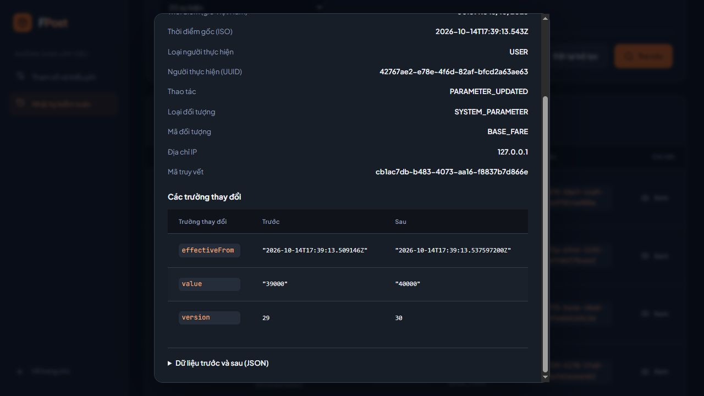

# Bàn giao UC-60 — Xem nhật ký kiểm toán

Hoàn tất phạm vi tra cứu, bảo vệ dữ liệu và retention ngày **15/10/2026** cho Trần Công Thuận.
Nhánh **feature/UC-60-ThuanTC-tra-cuu-audit**, kế thừa nền UC-46 tại **cef0f4e**.
P02 được thực hiện sớm hơn cửa sổ T2 của kế hoạch; không thay phân công hoặc lịch của đồng đội.

## Phần đã chạy và kiểm thử

- Trang **http://localhost:15173/admin/audit** trong khu vực ADMIN, giữ màn tham số và các route đơn hàng.
- **GET /api/v1/admin/audit-logs** theo API-157: lọc AND theo actor UUID, action, loại/mã đối tượng và khoảng thời gian; phân trang phía server.
- Modal chi tiết: eventId, actor, IP, correlationId, thời điểm UTC/Việt Nam và so sánh dữ liệu trước/sau.
- Dữ liệu nhạy cảm được che khi capture và một lần nữa khi đọc; JSON hiển thị bằng text.
- Mongo unique eventId và sáu compound index, tự khởi tạo/thử lại sau lỗi; không TTL cố định.
- Job nội bộ đọc **AUDIT_KEEP**, mặc định 5 năm lịch UTC; loại bỏ bản ghi đã hết hạn trong batch giới hạn, giữ bản ghi đúng mốc và mới hơn. Không có API/UI sửa/xóa audit.
- Loading, lỗi kho dữ liệu, kết quả trống và validation được phân biệt; request cũ không ghi đè kết quả mới.

Không có mock query hoặc mock store. Luồng đã tích hợp là **UC-46 → SQL history/outbox → MongoDB → UC-60**.
VERIFIED của P02 áp dụng phạm vi trên. Coverage toàn bộ thao tác tiền/KYC/phân quyền/khóa/Order
của BR-N-026 còn cần producer ở UC của các owner; chưa tuyên bố toàn dự án có audit đầy đủ.
BR-R-045 về lịch sử trạng thái SQL và quy tắc KYC BR-R-084 tiếp tục thuộc các module tạo hành động đó.

## Kết quả kiểm tra

| Kiểm tra | Kết quả |
| --- | --- |
| Maven toàn bộ suite | 212 tests được phát hiện; **200 chạy PASS**, 12 tests opt-in không bật |
| Docker package | Cùng **200 tests PASS**, frontend lint/build PASS |
| Live SQL Server/MongoDB | **6 tests PASS**, 1 rendezvous browser được bỏ qua trong lần xác nhận cuối |
| Frontend | Typecheck, lint, build PASS; 9 kiểm tra helper về giờ Việt Nam/diff JSON PASS |
| Browser UAT | Login/returnTo, 35 sự kiện test; lọc kết hợp ra 30; trang 2 hiển thị 21–30; chi tiết, masking, kết quả trống, UUID lỗi PASS |
| Responsive | 390×844; page/client width cùng 375px, không tràn ngang trang |
| Runtime Docker | ADMIN 200, SENDER 403, anonymous 401; filter rỗng 200, khoảng thời gian đảo 400; frontend/proxy 200; bốn dịch vụ healthy |

[Tổng hợp test](evidence/uc60-test-summary.json) · [Bằng chứng runtime](evidence/uc60-runtime-verification.json).
206 tests thực thi thành công gồm 200 tests thường và 6 live; không cộng số lần chạy lặp của Docker.
Sau lần live cuối, XML còn 6 tests opt-in không chạy (5 UC-46 và 1 rendezvous UC-60).

Live tests tạo database SQL/Mongo riêng `fptpost_uc60_it_<UUID>` và xác nhận:

1. Mười thay đổi tham số thật có đủ mười audit, actor/IP/time/before/after và outbox đã delivered.
2. Bộ lọc literal, mốc thời gian inclusive, thứ tự ổn định khi trùng timestamp và masking record cũ.
3. Driver Mongo trỏ vào endpoint lỗi khiến event còn SQL outbox; phục hồi sink thật gửi lại, duplicate không nhân bản.
4. Phân quyền, không hỗ trợ phương thức ghi/xóa, mutation bị từ chối không sinh audit.
5. Rollback SQL giữ nguyên tham số/history/outbox và không có event để phát.
6. Index thật không có TTL; retention xóa duy nhất fixture hết hạn, giữ record mới.

Không ngắt Mongo dùng chung để thử lỗi. Retention chỉ được thử với record hết hạn trong database test riêng.
Browser UAT đầu đã xong trước khi Docker Desktop/tiến trình test bị dừng; sau khi khởi động lại,
database test bị gián đoạn đã được dọn theo đúng tên đã tạo, sáu tests tự động được chạy lại và cleanup PASS.
Không lấy lần test bị gián đoạn làm kết quả PASS; ảnh UAT thuộc cùng phiên bản source trước khi khởi động lại.

Ảnh là dữ liệu kiểm thử riêng, không phải lịch sử giao dịch của database ứng dụng:



[Metadata audit](evidence/uc60-detail.png) · [Bảng sự kiện](evidence/uc60-desktop.png) · [Mobile](evidence/uc60-mobile.png).

## Chạy và kiểm tra lại

Giữ nguyên `.env` của leader và volume SQL/Mongo. SQL Server Windows không được sử dụng hoặc thay đổi.
Không gửi OTP/email, không gọi VNPay; smoke runtime chỉ đọc dữ liệu và tạo/thu hồi phiên demo.

```powershell
docker compose up --build -d
docker compose ps
npm run test:server
npm run typecheck --prefix client
npm run lint --prefix client
npm run build:client
```

Live test: `AuditLogLiveIntegrationTest`, bật FPTPOST_UC60_LIVE_TEST=1,
FPTPOST_UC60_SQL_PORT=31433, FPTPOST_UC60_MONGO_PORT=37017 và password SQL từ cấu hình local vào process env.
FPTPOST_UC60_BROWSER_TEST=1 chỉ dùng khi chủ động giữ cửa sổ test backend cho browser UAT.
Không bật flag giữ database nếu không cần điều tra. Các workers được tắt trong test-only application.properties;
tests gọi trực tiếp worker/indexer. Runtime bật index/retention theo mặc định; xem [contract](UC60-CONTRACT.md).

## File và bước tiếp theo

Backend query tại `server/src/main/java/com/fptpost/modules/audit`; retention ở package con `retention`.
Common audit thêm indexer, tăng masking và giữ producer/sink/outbox hiện có.
Frontend tại `client/src/features/audit`, `pages/AdminAuditPage.tsx`, `api/auditApi.ts`, `types/audit.ts`, `styles/audit.css`.
Tests mới gồm AuditLogHttp/LiveIntegration/QueryRepository/Service, AuditRetentionService,
MongoAuditIndexInitializer và AuditPayloadMasker.

Nhánh này kế thừa UC-46 vì develop tại thời điểm bắt đầu chưa có nền đó.
Khi mở MR vào develop, nên tích hợp MR UC-46 trước rồi cập nhật/kiểm tra lại diff của UC-60.
Tiêu đề MR: **[UC-60] [ThuanTC] Xem nhật ký kiểm toán**.

Gói kế tiếp là **P03 / UC-57 — Người dùng, nhân sự và quyền dữ liệu cá nhân**,
sau đó **P04 / UC-56 — Khóa tài khoản**. Các thao tác ghi ở những gói đó sử dụng AuditOutboxService hiện có.
